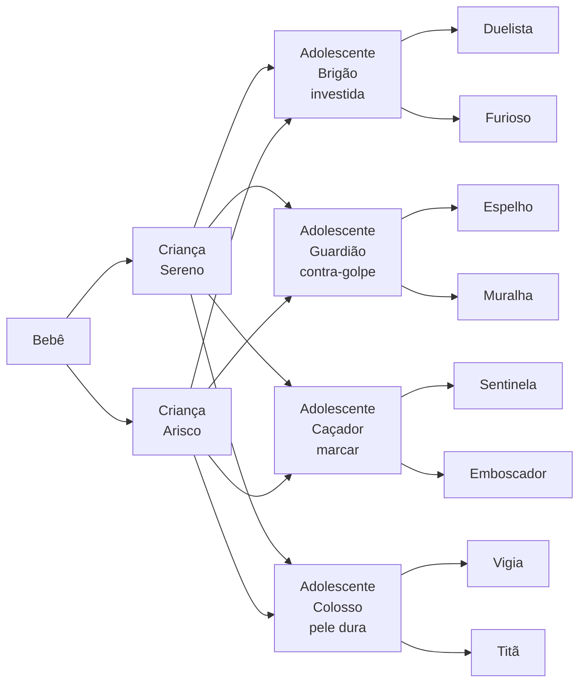

# Especificação — árvore de evolução integrada ao combate V2

Leia o `CLAUDE.md`, `docs/ESPEC_COMBATE_V2.md`, `docs/catalogo_pets.json` e
`docs/arvore_evolucao.json` antes de começar. Todas as regras do `CLAUDE.md`
valem.

## Pré-condições

- Bateria do combate V2 **base** APROVADA, já com as correções da
  simulação (finta, parry, fuga condicionada, morte súbita, gates de
  robustez e de espelho).
- `TAREFA_PERSONALIDADE_OBEDIENCIA` concluída (usa temperamento e caráter).

Esta tarefa é o **combate V2.1**: acrescenta técnicas e passivas por
linha. A base V2 continua reproduzível.

## Estrutura

Quatro estágios; cada espécie do catálogo percorre a mesma árvore de
arquétipos. Forma = espécie + caminho.

Cada transição usa **uma moeda**, e os contadores zeram a cada evolução
(como nos v-pets); os traços continuam acumulando.

| transição | moeda | decide |
|---|---|---|
| bebê → criança | cuidado (fração de janelas atendidas no bebê) | sereno / arisco |
| criança → adolescente | caráter dominante | linha: brigão, guardião, caçador, colosso |
| adolescente → adulto | eixo de caráter complementar + sparring mínimo | 2 formas por linha |

O cuidado só decide o ramo da criança, cujo efeito é pequeno (±3 pontos,
soma zero). As linhas e as formas adultas vêm do caráter, isto é, do que o
pet **aprendeu**.

## A evolução muda a cabeça

| estágio | regras de gambit | condições novas | combate |
|---|---|---|---|
| bebê | — | — | não luta |
| criança | 3 | estado próprio e distância | ações base |
| adolescente | 5 | estado do oponente | + técnica da linha |
| adulto | 8 | adaptação (`oponente_repete`, `oponente_frequente`, turno de execução) | + passiva |

A expressão por estágio acompanha: a criança não "entende" o oponente e
também não fala dele; o adulto adapta e explica.

## Técnicas (adolescente) e passivas (adulto)

Definidas em `arvore_evolucao.json`. Cada técnica é uma ação nova no
catálogo do combate, com custo, alcance, efeito e **resposta declarada**.
Toda técnica precisa ter pelo menos uma resposta nas ações base.

Regras:

- Técnicas e passivas entram em `digilab/combate_v2/` como dados
  declarativos + resolução pura. Sem rng.
- Resolução de técnica segue a ordem de turno da especificação V2; onde a
  técnica muda a ordem (ex.: `investida` move e ataca), documentar e testar.
- Passivas são modificadores de regra, nunca stats escondidos.

## Stats

`stat = espécie + temperamento + caráter + arquétipo_criança +
arquétipo_adolescente + arquétipo_adulto`, depois estágio e condição.
Todo modificador soma zero. Trocar o corte (clamp) por **renormalização**
que devolva o total ao orçamento, para a soma zero não quebrar nos
extremos.

## Pesquisa

- A arena usa só adultos. Capacidade de gambit igual entre braços.
- Ovos pareados: mesma espécie e temperamento em todos os braços.
- A forma adulta vira **variável de resultado**: a distribuição de linhas
  por braço mostra se donos diferentes produzem pets diferentes. Reportar.
- Ablação obrigatória: arena com técnicas e passivas desligadas, para
  separar efeito de forma de efeito de estilo.

## Bateria V2.1 — gates novos (PROPOSTOS)

Bots canônicos por arquétipo adulto (8), escritos em gambits de 8 regras
usando a técnica e a passiva.

- **E1 — sem arquétipo dominante:** nenhum arquétipo adulto vence todos os
  outros; equilíbrio com suporte ≥ 4.
- **E2 — sem espécie dominante:** com o mesmo arquétipo e estilo, nenhuma
  espécie vence todas as outras.
- **E3 — técnica usada e respondível:** cada técnica em ≥ 5% das decisões
  do seu arquétipo; a resposta declarada reduz a taxa de vitória do
  usuário da técnica.
- **E4 — estágio importa, sem esmagar:** adulto vence adolescente da mesma
  linha com taxa entre 0,6 e 0,85.
- **E5 — robustez:** perturbar cada número de técnica/passiva em ±10%
  mantém E1 na maioria das perturbações.
- Gates G1–G7 da base continuam valendo.

## Artefatos

`artifacts_combate_v21/`: matriz por arquétipo, matriz espécie × arquétipo,
uso de técnicas, equilíbrio, `gates.json`. Código de saída 0/2.

## O que reportar

1. E1 e E2 passaram? Se algum arquétipo ou espécie dominar, diga primeiro.
2. Matriz de arquétipos e suporte do equilíbrio.
3. Técnicas pouco usadas ou sem resposta efetiva.
4. Números ajustados na calibração, de quanto para quanto.

Nenhum número sem o artefato que o gerou.
