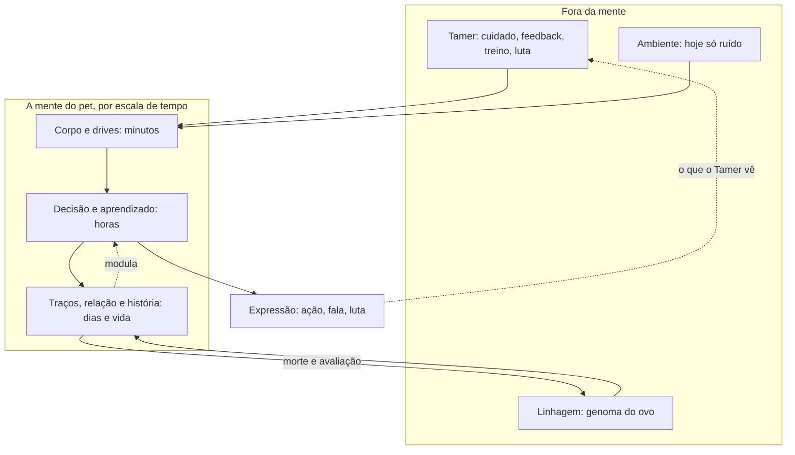

# Mapa do sistema — o que está mapeado, o que falta e como simular a "mente" do pet

Status: **análise** (pedido do Matheus, 2026-09-29). Nada aqui muda código. Complementa o `DIRECIONAMENTO_2026-09-29.md`. Referências só as VERIFICADAS na revisão de 2026-09-29; o que não tem fonte está marcado **[ESCOLHA DE DESIGN]**.

## 1. As camadas e o estado de cada uma

A "mente" do pet já é um sistema em camadas por escala de tempo. O que falta não é uma camada nova: é um **ambiente** de verdade, a **legibilidade** do que existe e o fechamento dos ciclos entre camadas.

| camada | escala | o que existe | estado | o que falta |
|---|---|---|---|---|
| **Corpo e drives** | minutos | necessidades, saúde, lesão, morte por lesão, humor | EXECUTADO | envelhecimento e morte natural; peso |
| **Ambiente** | contínuo | só a `rng_ambiente` (ruído no decaimento das necessidades) | **quase nada** | lugares, clima, ritmo de necessidades por lugar. O E1 mostrou dono × ambiente = 22% e o "ambiente" que temos é só sorte |
| **Instinto** | fixo | `PoliticaInstinto`, e o prior exato do bandit | EXECUTADO | o instinto como *prior evoluído* por espécie (Singh et al., 2010) |
| **Aprendizado da vida** | horas | bandit contextual (Thompson) com feedback do dono; memória curta e por espaços; habituação | EXECUTADO, sinal fraco (≈ 0,02 bit) | um modelo do dono (seção 4); a não estacionariedade em meses (Russo et al., 2018) |
| **Aprendizado da luta** | por luta | gambits e gambits híbridos (web) | EXECUTADO só na web | freio de repetição (M1); paridade Python |
| **Temperamento** | inato | 4 eixos da `rng_ovo`; herdado no cruzamento | EXECUTADO, pesa 4,9% | eixos correlacionados (síndromes: Sih et al., 2004) em vez de sorteio independente; norma de reação com inclinação (Dingemanse et al., 2010) |
| **Traços e caráter** | dias–vida | EMA lenta das ações; caráter pela política; emoção | EXECUTADO, só leitura | um estado de confiança que vira traço (M1); traço como distribuição de estados |
| **Relação** | dias | vínculo, obediência com recusa, disciplina, desejo | EXECUTADO, vínculo invertido | confiança por coerência (M3); a recusa real do pet (B2, mexe no motor) |
| **Educação e morte** | dias | janelas, travessuras, lesões, morte, qualificação | EXECUTADO (v4) | morte natural; avaliação da trajetória |
| **Evolução** | estágios | cuidado → ramo, caráter → linha e forma, sombria, Mega (v5) | EXECUTADO | requisitos "k de n"; medalha do Tamer (M2) |
| **Herança** | gerações | temperamento e espécie, evento `origem` | EXECUTADO, imperceptível | afinidade e plasticidade herdadas, talentos latentes (M4) |
| **Expressão** | por decisão | motivo → frase; moldura LLM; fala livre; voz própria em curso | EXECUTADO | frases de **estado** (M1); a legibilidade medida com pessoas (Anderson et al., 2019) |
| **Tamer** | entre vidas | jornada e lugares | **não existe** | medalhas, conhecimento, rating, economia |
| **Outros pets** | — | rivais bots; o retrato do pet de cenário | **não existe** | sociabilidade; ecologia entre pets |

## 2. As perguntas que ainda faltam

Não são pendências de implementação: são perguntas sem resposta, e cada uma trava um pedaço do mapa.

1. **O que é "ambiente"?** Se 22% da variância vem de dono × ambiente e o ambiente é só ruído, o achado mais forte do E1 aponta para algo que o jogo nem representa. Definir ambiente como lugar com ritmo próprio de necessidades é a primeira pergunta de design e de pesquisa ao mesmo tempo.
2. **Qual é o critério de "pet bom"?** Hoje é a taxa na arena. Um pet pacífico, curioso ou confiável não pontua. Sem um segundo critério, toda mecânica é puxada para o combate. O MineRL BASALT (Shah et al., 2021) é o precedente de avaliação sem métrica objetiva.
3. **Como medir legibilidade sem pessoas?** A H-legibilidade só se testa com jogador. Enquanto o estudo com humanos é IDEIA (e pede comitê de ética), precisamos de um substituto: um "juiz" que confere se a frase tem causa no registro (já existe na fala livre) e uma métrica de **surpresa** (quantas vezes a explicação aponta uma causa que o jogador não veria sozinho).
4. **Qual é o dono humano típico?** Os donos sintéticos são coerente, aleatório, relapso, incoerente. Thomaz e Breazeal (2008) mostram que pessoas reais dão recompensa antecipada, guiam em vez de avaliar e são inconsistentes. O contraste "coerente × aleatório" pode ter sido a pergunta errada desde o início. Falta um dono sintético com esses vieses.
5. **O feedback depende da política atual do pet** (MacGlashan et al., 2017). O bandit trata bronca e elogio como recompensa fixa. Se o dono elogia o que o pet *já* faz, o sinal é outro. Não sabemos quanto disso explica o sinal fraco.
6. **Emergência ou script?** Não temos uma medida de "o pet fez algo que ninguém escreveu". A busca por novidade (Lehman e Stanley, 2011) dá o vocabulário, mas o descritor de "diferente" seria escolhido por nós, não pelo jogador.
7. **Escala de tempo.** Tudo foi calibrado em vidas simuladas de 14 dias com orçamento fixo de interações. Um jogador real joga em rajadas, por semanas. Não sabemos se os parâmetros sobrevivem a isso.
8. **Quantas gerações fazem sentido?** Griffiths e Kalish (2007) mostram que, em aprendizado iterado, o que atravessa gerações converge para o prior. Numa linhagem longa, o traço do dono tende a ser lavado. Não medimos isso, e ele decide se M4 vale a pena.
9. **O que separa criação de seleção pelo usuário?** É a lacuna real da literatura (revisão de 2026-09-29). O desenho 2×2 já está no plano da linhagem, mas só faz sentido com um genoma que pese mais do que 4,9%.
10. **A recusa do pet.** O dono age direto no estado; o pet não tem como impedir. Toda a "autonomia" é de decisão, nunca de resistência. Mudar isso mexe no `engine.py`, e é decisão do pesquisador.
11. **Espécies em ciclo (E2).** Sem ciclo entre espécies, qualquer seleção converge para a ferrugem. É desenho de combate, não calibração.
12. **Ética e apego.** Se um dia houver jogador de verdade: o efeito IKEA depende de a criação dar certo (Marsh et al., 2018), e o vínculo com pet virtual é mensurável mas não equivale ao real (Chesney e Lawson, 2007; Rault, 2015). O jogo pode produzir culpa por negligência e frustração por fracasso; isso precisa de desenho antes de qualquer teste com pessoas.

## 3. Como simular essa IA: três níveis, do que existe ao que seria "cérebro"

### Nível 1 — o que existe (e por que continua sendo a base)

Um agente em camadas: drives homeostáticos (estado) → prior de instinto → bandit contextual que aprende com o feedback do dono → traços lentos → regras de luta. É determinístico, rejogável e **explicável por construção**: cada decisão tem um motivo com fatores. A literatura dá a base teórica desse desenho: recompensa como redução de desvio homeostático (Keramati e Gutkin, 2014) e a separação entre motivação intrínseca e recompensa externa (Oudeyer e Kaplan, 2007). O problema não é o modelo; é que o sinal do dono é fraco e o jogador não vê o que muda.

### Nível 2 — reconhecimento: o pet constrói um modelo do dono e do rival

"Reconhecimento neural" não precisa de neurônio para existir. O que o pet precisa reconhecer é **padrão**: quando o dono aparece, o que faz depois de uma manha, como o rival luta. Isso cabe num modelo preditivo pequeno e legível:

- **Modelo do dono:** uma tabela de transição por período do dia (o extrator da história da voz própria já calcula parte disso: os fatos H e O). O erro de previsão ("achei que você viria de manhã") vira **curiosidade** e **surpresa**, no sentido de Oudeyer e Kaplan (2007) e da curiosidade por erro de predição (Pathak et al., 2017).
- **Modelo do rival:** a frequência das ações do rival por distância, já disponível no registro da luta. É o que permite "já sei tudo dele" (M1) e o conhecimento do Tamer (M2).
- **Custo:** baixo. **Determinismo:** total. **Legibilidade:** alta, porque a previsão errada é uma frase pronta.

Recomendo este nível antes de qualquer rede: ele responde à pergunta 3 (surpresa) e dá à fala um conteúdo novo sem inventar causa.

### Nível 3 — sinapses: uma "neuroquímica" ao estilo Creatures

O precedente verificado é o Creatures (Grand, Cliff e Malhotra, 1997; Grand e Cliff, 1998): cada criatura tem uma rede neural recorrente **modular** (lobos) com aprendizado hebbiano, modulada por uma **bioquímica** de drives e hormônios, e tanto a rede quanto a química são especificadas por um genoma. Traduzido para o Digilab:

| peça | o que seria | no código |
|---|---|---|
| **lobo de percepção** | neurônios que representam necessidades, presença do dono, hora, distância do rival | um vetor de entrada (já existe como `Observacao`) |
| **lobo de decisão** | um neurônio por ação; a ação é o mais ativo (com ruído da rng da política) | uma matriz de pesos `W[entrada × ação]` mais recorrência curta |
| **sinapse** | um peso que muda por plasticidade **modulada por recompensa**: Δw = η · pré · pós · (recompensa − linha de base) | a "recompensa" é a redução de drive (Keramati e Gutkin, 2014) mais o feedback do dono |
| **química** | níveis de "fome", "medo", "tédio", "dor" que decaem e são produzidos por eventos; modulam η e o ruído | o estado atual, com dois campos novos (medo, tédio) |
| **genoma** | tamanho dos lobos, taxas de aprendizado, sensibilidade de cada receptor, hora de ativação por estágio | a norma de reação: intercepto e inclinação herdados |
| **reconhecimento** | um lobo que prevê a próxima entrada; o erro de predição é a curiosidade | o nível 2, agora dentro da rede |

**O que isso compra:** comportamento que ninguém escreveu; a mesma arquitetura para vida e luta; genoma que especifica *estrutura* (o que o Creatures fez) em vez de valores finais.

**O que isso custa, e por que não é agora:**
1. **Legibilidade.** Uma rede não tem "fator". O motivo teria de vir de atribuição (qual entrada pesou), que é aproximada e menos honesta do que o motivo atual. A hipótese de explicação do projeto (Madumal et al., 2020: explicação ancorada em causa) fica mais difícil, não mais fácil.
2. **Calibração.** O Creatures é conhecido por ser difícil de ajustar; cada parâmetro novo é um PROPOSTO sem fonte.
3. **Determinismo:** viável (rng própria e derivada, replay do log), mas o custo de replay cresce com o tamanho da rede.
4. **Pesquisa:** com o sinal do dono já fraco no bandit, uma rede com mais parâmetros tende a diluí-lo mais, como temperamento e obediência já fizeram.

**A forma certa de entrar, se um dia entrar:** uma trilha própria (**E-neural**), como política nova sob o mesmo `Protocol Politica` (`agir`, `observar`, `estado_interno`), com um gate: ela precisa **igualar** a divergência entre donos do bandit (JSD entre braços ≥ 0,02 bit) e **produzir um motivo** para cada decisão. Se não passar nos dois, não entra no jogo. O `engine.py` não muda, porque a política é uma classe trocável. **[ESCOLHA DE DESIGN]**

### O que recomendo

- **Agora:** nível 2 (modelo do dono e do rival), porque fecha a pergunta da surpresa e alimenta a fala.
- **Depois da V4:** decidir sobre o E-neural com base em se ainda há sinal do dono a preservar.
- **Nunca sem gate:** uma rede que não explica o que fez contraria o que o projeto já mediu como valioso.

## 4. Como os sistemas se entrelaçam (o mapa)

Os dois ciclos que ainda não fecham:
- **Expressão → Tamer.** O jogador só muda o que faz se perceber o efeito (Amershi et al., 2014). É o ciclo que a voz própria e o M1 começam a fechar.
- **Traços → Linhagem.** A avaliação da vida que vira predisposição (M4). Hoje só o temperamento passa, e ele pesa pouco.

## 5. Referências (VERIFICADAS na revisão de 2026-09-29)

- Amershi, S. et al. (2014). Power to the people. *AI Magazine* 35(4). https://doi.org/10.1609/aimag.v35i4.2513
- Anderson, A. et al. (2019). Explaining reinforcement learning to mere mortals. IJCAI. https://doi.org/10.24963/ijcai.2019/184
- Chesney, T. & Lawson, S. (2007). The illusion of love. *Interaction Studies* 8(2). https://doi.org/10.1075/is.8.2.09che
- Dingemanse, N. J. et al. (2010). Behavioural reaction norms. *TREE* 25(2). https://doi.org/10.1016/j.tree.2009.07.013
- Grand, S., Cliff, D. & Malhotra, A. (1997). Creatures. Agents '97. https://doi.org/10.1145/267658.267663
- Grand, S. & Cliff, D. (1998). Creatures: entertainment software agents with artificial life. *AAMAS* 1(1). https://doi.org/10.1023/a:1010042522104
- Griffiths, T. L. & Kalish, M. L. (2007). Language evolution by iterated learning with Bayesian agents. *Cognitive Science* 31(3). https://doi.org/10.1080/15326900701326576
- Keramati, M. & Gutkin, B. (2014). Homeostatic reinforcement learning. *eLife* 3. https://doi.org/10.7554/elife.04811
- Lehman, J. & Stanley, K. O. (2011). Abandoning objectives. *Evolutionary Computation* 19(2). https://doi.org/10.1162/evco_a_00025
- MacGlashan, J. et al. (2017). Interactive learning from policy-dependent human feedback. ICML. https://arxiv.org/abs/1701.06049
- Madumal, P. et al. (2020). Explainable reinforcement learning through a causal lens. AAAI. https://doi.org/10.1609/aaai.v34i03.5631
- Marsh, L. E. et al. (2018). When and how does labour lead to love? *Cognition* 170. https://doi.org/10.1016/j.cognition.2017.10.012
- Oudeyer, P.-Y. & Kaplan, F. (2007). What is intrinsic motivation? *Frontiers in Neurorobotics* 1. https://doi.org/10.3389/neuro.12.006.2007
- Pathak, D. et al. (2017). Curiosity-driven exploration by self-supervised prediction. CVPR Workshops. https://doi.org/10.1109/cvprw.2017.70
- Rault, J.-L. (2015). Pets in the digital age. *Front. Vet. Sci.* 2. https://doi.org/10.3389/fvets.2015.00011
- Russo, D. et al. (2018). A tutorial on Thompson sampling. *FnT ML* 11(1). https://doi.org/10.1561/2200000070
- Shah, R. et al. (2021). The MineRL BASALT competition. https://arxiv.org/abs/2107.01969
- Sih, A., Bell, A. & Johnson, J. C. (2004). Behavioral syndromes. *TREE* 19(7). https://doi.org/10.1016/j.tree.2004.04.009
- Singh, S. et al. (2010). Intrinsically motivated reinforcement learning: an evolutionary perspective. *IEEE TAMD* 2(2). https://doi.org/10.1109/tamd.2010.2051031
- Thomaz, A. L. & Breazeal, C. (2008). Teachable robots. *Artificial Intelligence* 172(6–7). https://doi.org/10.1016/j.artint.2007.09.009
