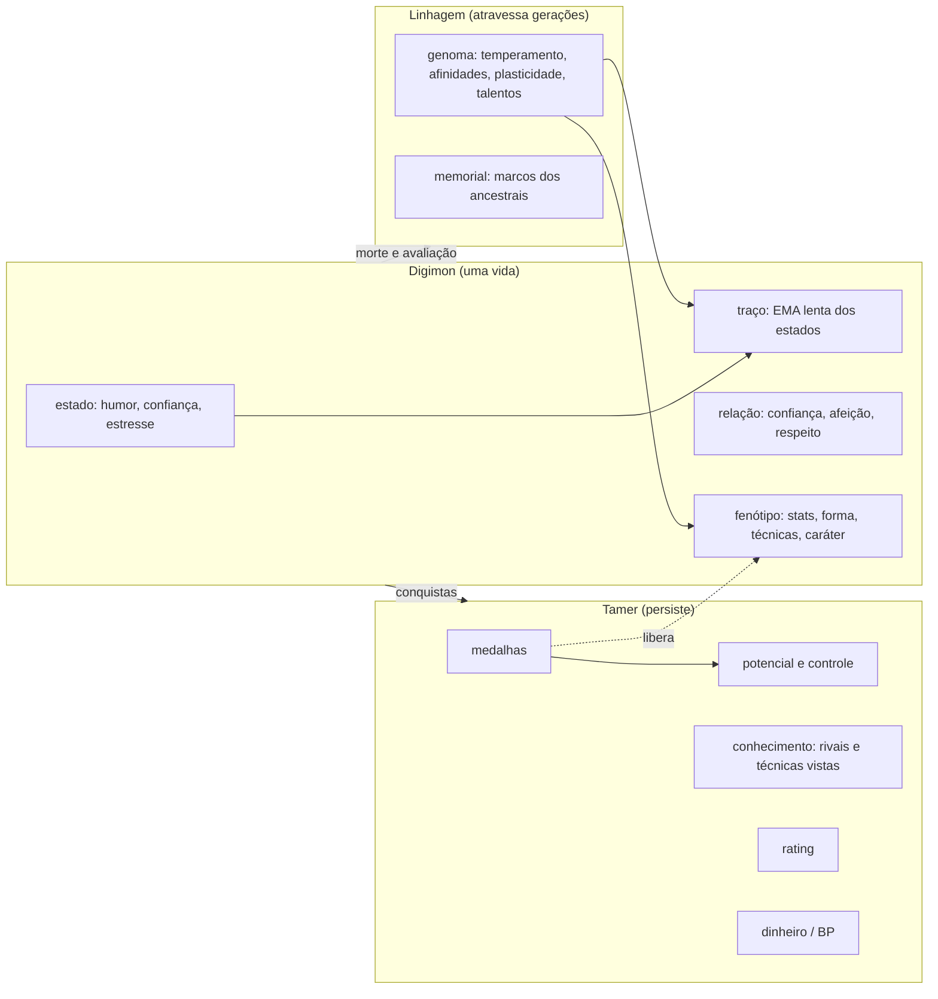
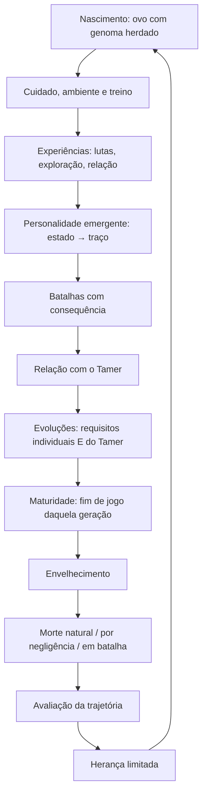
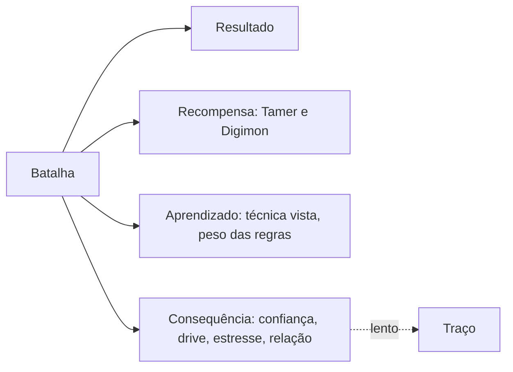
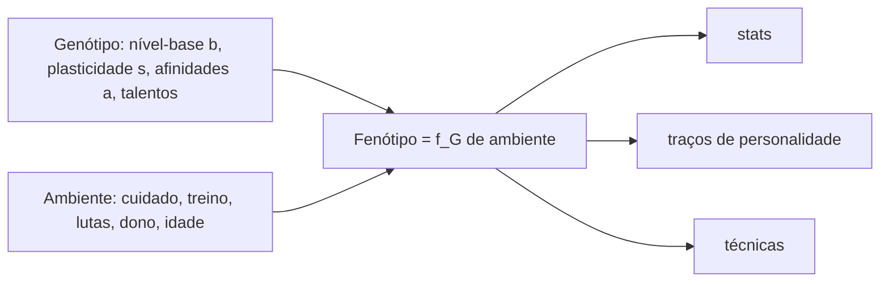
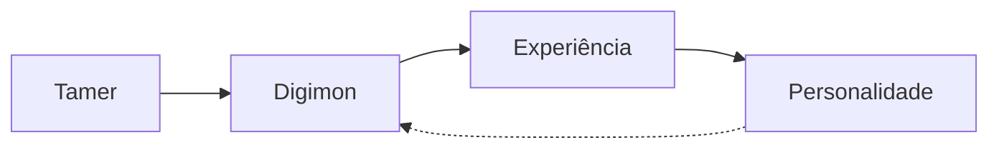
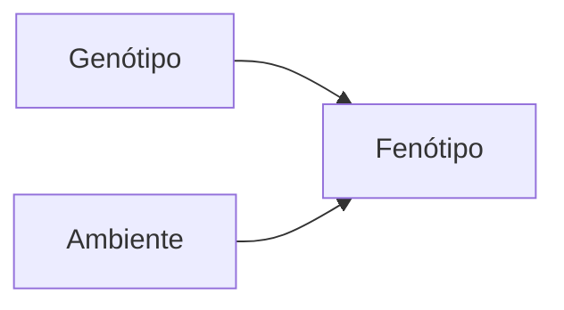
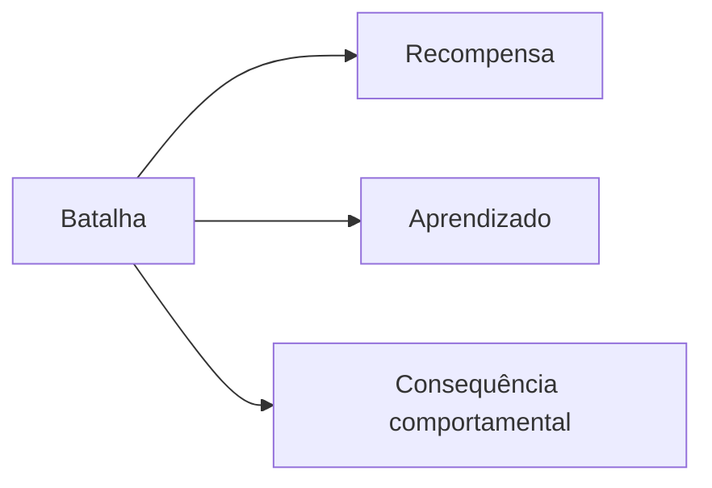
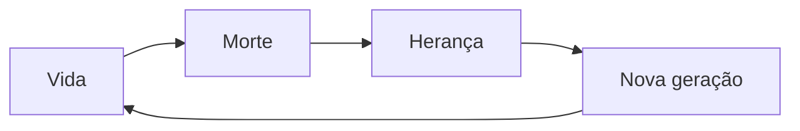
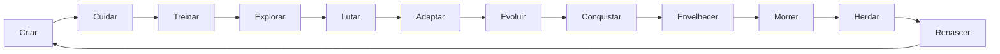

# Pesquisa — vida, personalidade, batalha, herança e progressão do Tamer

Status: **pesquisa e proposta de design** (pedido do Matheus, 2026-09-29). Nenhum código foi alterado. Nada aqui está decidido: toda proposta é candidata, com a indicação de entrar ou não no MVP.

**Como ler as marcas.** Cada afirmação traz uma marca:

| marca | o que quer dizer |
|---|---|
| **[REF]** | referência existente: mecânica usada em jogo ou projeto, com fonte na seção 33 |
| **[CIÊNCIA]** | evidência científica: resultado de literatura, com fonte na seção 33 |
| **[DIGILAB]** | evidência do próprio projeto: resultado de uma run nossa, com artefato em disco |
| **[INFERÊNCIA]** | conclusão de design tirada das referências |
| **[PROPOSTA]** | mecânica nova sugerida para o Digilab |

- **Graus de confiança:** "(trecho de busca)" quer dizer que só vimos o resumo do buscador, não a página. "(comunidade)" é fonte de fã ou fórum. **NÃO VERIFICADO** é o que não confirmamos.
- **Como a pesquisa foi feita:** três buscas em paralelo, sobre jogos, Vida Artificial e agentes, e design de progressão. Muitas páginas (GameFAQs, Bulbapedia, ACM, SAGE) devolveram 403; nesses casos valem só o resumo ou o registro bibliográfico, e isso está marcado.

---

## 0. Resumo em uma página

A arquitetura pedida (Tamer + linhagem + indivíduo) **é viável e tem precedentes diretos**, cada um cobrindo uma parte:

| precedente | o que cobre |
|---|---|
| Creatures | genes que codificam estrutura e aprendizado por reforço |
| Monster Rancher 2 | herança como fração do excedente, com cortes |
| Digimon World e Next Order | herança pequena, ligada ao nível do Tamer ou ao máximo histórico |
| Dragon Quest Monsters | teto de nível ligado ao número de gerações |
| Rogue Legacy | a morte como o momento da escolha do herdeiro |
| Pokémon | teto de EVs; obediência liberada por insígnias; Battle Palace, em que o monstro age pela natureza |

**O que já existe no Digilab e resolve boa parte:**
- temperamento herdado;
- caráter aprendido pela política;
- vínculo, obediência com recusa, disciplina, sobrecarga e forma sombria;
- lesões e morte;
- herança com evento `origem`;
- combate autônomo por regras de "se isto, faça aquilo" (gambits);
- campanha com lugares;
- registro de eventos que permite rejogar a vida.

**O que os nossos dados já avisaram (as quatro armadilhas do projeto):**
1. **Batalha que treina sem freio vira espiral.** O "luta treina" levou 577 de 640 pets à forma sombria (V3b). **[DIGILAB]**
2. **O efeito do dono é pequeno.** A confirmatória foi refutada, e o aprendizado mexe cerca de 0,02 bit no comportamento. Uma personalidade sutil demais fica invisível. **[DIGILAB]**
3. **O genoma pesa pouco.** No E1 ele explicou 4,9% do desempenho, e a espécie domina. Como pesquisa, a linhagem foi encerrada; como jogo, ela precisa ser **amplificada e legível** para ser sentida. **[DIGILAB]**
4. **O vínculo mede frequência, não coerência.** O dono aleatório termina com vínculo maior que o atencioso. A relação precisa premiar a previsibilidade, como mostra a literatura de bem-estar animal. **[DIGILAB]** **[CIÊNCIA]**

**A recomendação central:**
- A personalidade tem **três escalas de tempo**: estado, traço e predisposição.
- A batalha mexe no **estado** (confiança pelo efeito vencedor e perdedor), que devagar vira traço.
- A herança passa **normas de reação** (nível-base e sensibilidade), não stats.
- As medalhas liberam **controle e regras**, não força.
- O endgame testa o **conhecimento do Tamer** (times alugados, regras especiais, rating), não o grind.

**MVP em 4 passos** (seção 28): confiança de combate e habituação por oponente → medalhas que liberam controle e o Mega → confiança da relação por consistência → herança legível na tela pós-morte. Economia, equipamentos e o Battle Frontier completo ficam para depois.

---

## 1. Estado da arte (panorama)

**Vida Artificial (ALife) com criaturas.**
- No Tierra, parasitas e hiperparasitas evoluíram sem nenhuma função de aptidão. **[CIÊNCIA]**
- O Avida mostrou que funções complexas surgem por **degraus intermediários recompensados**; a função complexa, recompensada sozinha, nunca evoluiu (Lenski et al. 2003). **[CIÊNCIA]**
- No Creatures, o genoma especifica **estrutura** (lobos neurais, receptores, reações químicas), e não traços como "coragem". O aprendizado vem da redução de drives, que gera "recompensa". **[REF]** **[CIÊNCIA]**

**Evolução com aprendizado.**
- **Efeito Baldwin:** herdar só a facilidade de aprender já melhora a linhagem (Hinton e Nowlan 1987; Fernando et al. 2018, com meta-aprendizado). **[CIÊNCIA]**
- **Lamarck parcial:** reescrever o genoma de 20–40% dos indivíduos deu o melhor compromisso (Houck et al. 1997). **[CIÊNCIA]**
- Um trabalho recente (Benito et al. 2026) confirma que a variante baldwiniana não é a opção fraca. **[CIÊNCIA]**

**Personalidade animal.**
- Entre espécies, as dimensões mais gerais são extroversão/ousadia, neuroticismo/medo, amabilidade/agressividade e abertura/curiosidade.
- "Dominância" é mais bem vista como resultado social, e "atividade" tem pouco apoio (Gosling e John 1999; Réale et al. 2007). **[CIÊNCIA]**
- Personalidade é **nível mais plasticidade**, as normas de reação comportamentais (Dingemanse et al. 2010). **[CIÊNCIA]**
- A personalidade é pouco herdável: h² médio ≈ 0,14, repetibilidade ≈ 0,29 (Dochtermann et al. 2015, pelo resumo). **[CIÊNCIA]**

**A batalha muda a criatura.**
- Os efeitos vencedor e perdedor são gerais: 37 estudos, efeitos simétricos (Yan et al. 2024, pelo resumo). **[CIÊNCIA]**
- As lutas recentes pesam mais (Hsu e Wolf 1999). **[CIÊNCIA]**
- O efeito age na **autoavaliação**, não na força (Hsu et al. 2006). **[CIÊNCIA]**
- A passividade é a resposta padrão a aversivos sem controle. O que protege é **ter controle**, não vencer (Maier e Seligman 2016). **[CIÊNCIA]**

**IA de jogo com aprendizado.**
- O dynamic scripting (Spronck et al. 2006) usa regras com peso ajustado pelo resultado. É o análogo mais próximo dos gambits do Digilab. **[CIÊNCIA]**
- Utility AI (Mark 2009), behavior trees (Isla 2005; Colledanchise e Ögren 2018) e GOAP (Orkin 2006) são alternativas. **[REF]**
- No NERO, o jogador é o instrutor que desenha um currículo, e treino e batalha são separados. **[REF]**

**Vínculo, morte e grind.**
- Agentes relacionais são mais queridos e confiáveis ao longo de semanas (Bickmore e Picard 2005). **[CIÊNCIA]**
- Permadeath lembrada é mais apreciada quando tem significado (West et al. 2022; Carter e Allison 2017). **[CIÊNCIA]**
- Grind e "jogar com hora marcada" aparecem como dark patterns (Zagal et al. 2013). **[CIÊNCIA]**

---

## 2. Referências científicas por tema (o que usar e onde)

| tema | referência | uso no Digilab |
|---|---|---|
| genes codificam estrutura | Grand, Cliff e Malhotra 1997 (Creatures) | o genoma define ganhos e sensibilidades, não valores finais |
| degraus recompensados | Lenski et al. 2003 | técnicas e formas precisam de passos intermediários que também valham algo |
| Baldwin | Hinton e Nowlan 1987; Fernando et al. 2018 | herdar a **taxa de aprendizado** de um eixo, não o valor |
| Lamarck parcial | Houck et al. 1997; Whitley et al. 1994 | só uma fração pequena do aprendido vira predisposição |
| norma de reação | Pigliucci 2001; Dingemanse et al. 2010 | fenótipo = nível-base + inclinação × experiência |
| canalização | Waddington 1942; West-Eberhard 2003 | regressão à média da espécie e "vales" de desenvolvimento |
| mapa modular | Wagner e Altenberg 1996 | uma mutação mexe em poucos traços, para a linhagem ser reconhecível |
| eixos de personalidade | Gosling e John 1999; Réale et al. 2007; Sih et al. 2004 | 4 eixos-núcleo; os traços vazam entre contextos (síndromes) |
| traço como distribuição | Fleeson 2001; Gebhard 2005 (ALMA) | três escalas de tempo: emoção → humor → traço |
| herdabilidade | Dochtermann et al. 2015; Bell et al. 2009 | calibra a herança e a repetibilidade |
| vencedor e perdedor | Hsu e Wolf 1999; Hsu et al. 2006; Dugatkin 1997; Yan et al. 2024 | a confiança de combate como estado com memória recente |
| controle e desamparo | Maier e Seligman 2016 | uma derrota "com controle" não gera apatia |
| habituação | Rankin et al. 2009 | o mesmo rival rende cada vez menos e recupera com o tempo |
| relação humano-animal | Rault et al. 2020 | a confiança cresce com previsibilidade, não só com quantidade |
| dynamic scripting | Spronck et al. 2006 | a personalidade define os pesos iniciais das regras e a luta os ajusta |
| qualidade-diversidade | Mouret e Clune 2015; Perez-Liebana et al. 2021 | gerar rivais competentes cobrindo o espaço de personalidades |
| Yerkes-Dodson | Teigen 1994; Corbett 2015 | um "U invertido" de estresse serve como convenção de jogo, **não** como fato científico |

---

## 3. Referências de jogos (a mecânica exata de cada um)

| jogo | mecânica verificada | lição |
|---|---|---|
| **Digimon World** (PS1) | Cada forma tem 4 grupos de requisitos (stats, peso, erros de cuidado, bônus); basta cumprir 3, e a prioridade sai dos stats. Morte natural dá escolha de ovo; morte em batalha não. A herança é de 1% dos stats por nível de Tamer, até 10% (comunidade, trecho de busca). Comandos na luta dependem da inteligência. Algumas técnicas só se aprendem vendo o inimigo usar. **[REF]** | A evolução nasce de um **perfil**, não de uma receita. A morte pesa diferente conforme a causa. **A herança cresce com o Tamer.** |
| **Next Order** | Requisitos por "key points" (k de n). Vínculo e disciplina são medidores separados. A herança parte de 10% e sobe até 14% com habilidades de Tamer, calculada sobre o **máximo histórico** (fórum). Na luta, "torcer" gera pontos de ordem que compram comandos. **[REF]** | O máximo histórico protege a linhagem de uma geração ruim. A influência do Tamer é limitada e custa algo. |
| **Championship** | Luta automática, requisitos ocultos, reversão a ovo como requisito de algumas formas. **[REF]** | A morte vira pré-requisito de formas avançadas. O que esconder deixa o jogo opaco. |
| **Cyber Sleuth** | A ABI sobe ao digievoluir e des-digievoluir e eleva o teto de treino. **[REF]** | Regredir de estágio como investimento: progressão horizontal. |
| **Tamagotchi** | Erros de cuidado decidem o ramo adulto. No m!x, os filhos herdam **traços físicos** dos pais. **[REF]** | Poucos limiares legíveis. A herança aparece primeiro na aparência. |
| **Pokémon** | EVs com teto de 252 por stat e 510 no total. IVs e naturezas. Destiny Knot passa 5 IVs. Pokémon "de fora" desobedecem acima de um nível ligado às insígnias. Battle Frontier com 7 instalações de regras distintas e Battle Points próprios. No **Battle Palace** o monstro age pela natureza, com pesos ataque/defesa/suporte que mudam abaixo de 50% de HP (comunidade). **[REF]** | O teto força escolha. As insígnias liberam **controle**, não força. O Palace é o combate autônomo por personalidade. |
| **Monster Rancher 2** | Vida em semanas, encurtada por estresse e fadiga. Lealdade como equilíbrio entre mimo e medo. Ganhos de treino por fase de vida. Torneios com graus E→S como portas. A herança é uma fração do **excedente sobre a base**, com dois cortes (alinhamento e raridade). **[REF]** | Herança limitada por construção. O estilo de criação afeta a obediência. |
| **Creatures** | Genoma haploide de ~320 genes, cruzamento, mutação, genes com hora para ligar. Aprendizado por recompensa e punição químicas. **[REF]** | Genes com "hora de ligar" encaixam nas digievoluções. |
| **Black & White** | A criatura aprende por carinho, tapa e observação; a equipe evitou aleatoriedade para simular personalidade. O alinhamento muda a aparência. O modelo BDI só é confirmado por fontes secundárias. **[REF]** | A personalidade parece autoria do jogador e fica **visível**. |
| **NERO** | O jogador monta exercícios e usa sliders para dizer o que recompensar; depois solta o time na batalha. **[REF]** | "Criar e soltar", com alavancas legíveis. |
| **Dragon Quest Monsters** | Na síntese o filhote recebe 1/4 dos stats de cada pai. O valor "+" sobe por geração e libera o teto de nível (50 → 75 → 100). **[REF]** | Linhagem limitada por teto e por gerações, e cada geração precisa ser criada de novo. |
| **Shin Megami Tensei** | Não se funde um demônio de nível maior que o do jogador. **[REF]** | A linhagem não passa a progressão do jogador. |
| **Monster Hunter** | Sem nível de personagem: o poder vem do equipamento feito com partes de monstros. **[REF]** | Progressão horizontal. |
| **Rogue Legacy** | Na morte o jogador escolhe entre herdeiros com traços. O ouro vira melhorias permanentes antes de ser confiscado. O ciclo põe "o RPG depois da morte" (postmortem no GDC). **[REF]** | A morte é o ponto alto da decisão, não uma tela de perda. |
| **Hades** | Cada morte traz diálogo novo; o God Mode cresce 2% por morte, até 80%. **[REF]** | Toda morte gera conteúdo. A assistência opcional cresce com as falhas. |
| **Temtem, Palworld, CK3, Kynseed** | Fertilidade limitada (Temtem). Passivas herdadas com teto de 4 (Palworld). Traços congênitos e recessivos, com o nível acima quando os dois pais têm o traço (CK3). Morte com idade fixa e escolha entre filhos (Kynseed). **[REF]** | Freio à reprodução, recessivos para profundidade e a morte anunciada. |

---

## 4. Comparação entre sistemas existentes

| eixo | Digimon World | Next Order | Monster Rancher 2 | Pokémon | DQM | Rogue Legacy | **Digilab hoje** |
|---|---|---|---|---|---|---|---|
| autonomia na luta | alta, com comandos por inteligência | alta, com comandos pagos em OP | média | baixa (exceto no Palace) | baixa | nenhuma | **total** (gambits e bandit; o jogador trava ou veta regras) |
| personalidade | felicidade e disciplina | vínculo e disciplina | lealdade (mimo e medo) | natureza fixa | — | traços do herdeiro | temperamento, caráter, vínculo, obediência, disciplina, emoção |
| herança | 1–10% dos stats (nível do Tamer) | 10–14% do máximo histórico | fração do excedente, com cortes | IVs, natureza, habilidade | 1/4 dos stats e o "+" | traços aleatórios e o castelo | temperamento (média + ruído) e espécie |
| anti-grind | tempo, cansaço, vida | fadiga, vida | estresse, fadiga, vida | teto de EVs | teto de nível | cada vida curta | tetos de treino, fadiga, sobrecarga, orçamento de interações |
| gate | torneios, recrutas | prosperidade | graus E→S | insígnias → obediência | — | — | lugares da campanha |

**[INFERÊNCIA]** O Digilab já é o mais autônomo da lista. O que falta para a personalidade ser sentida é **legibilidade** e **consequência contextual**, não mais autonomia.

---

## 5. Arquitetura geral proposta



**Regras de posse** **[PROPOSTA]**:
- **É do Digimon:** stats treinados, forma, técnicas aprendidas, caráter, traço e estado, relação, memórias. Some com a morte, exceto o que a avaliação transforma em marca.
- **É da linhagem:** o genoma e o memorial. Muda só na morte e na avaliação, com teto.
- **É do Tamer:** medalhas, conhecimento, rating, dinheiro e desbloqueios. Nunca some.

**Implementação** **[PROPOSTA]**: continua o registro de eventos.
- O Digimon tem o seu log, como hoje. A linhagem é a cadeia de eventos `origem` (já existe).
- O Tamer ganha um log próprio de eventos (`medalha`, `conhecimento`, `avaliacao`), também rejogável.

---

## 6. Modelo de ciclo de vida



**O que já existe no Digilab:**
- os estágios por tempo;
- os chamados do bebê;
- o caráter pela política aprendida;
- a qualificação por vitórias para virar adulto;
- lesões e morte;
- o cruzamento.

**O que falta:**
- **Envelhecimento e morte natural** (hoje só se morre por lesão ou saúde). **[PROPOSTA]**
- **Tela de avaliação da trajetória.** **[PROPOSTA]**
- **Causa da morte com consequência diferente**: natural, negligência ou batalha, como no Digimon World (morte natural preserva mais). Na literatura, a morte por negligência gera culpa (Turkle, fonte secundária) e a morte com significado é apreciada (West et al. 2022). **[REF]** **[CIÊNCIA]**

---

## 7. Modelo de personalidade

### 7.1 Três escalas de tempo **[PROPOSTA]**, apoiada em Fleeson 2001, Gebhard 2005 e Dingemanse 2010 **[CIÊNCIA]**

| camada | escala | o que é | no Digilab hoje |
|---|---|---|---|
| **estado** | minutos a dias | humor, confiança de combate, estresse, tédio | emoção (`emocao.py`), humor |
| **traço** | a vida | a média móvel lenta dos estados (média e amplitude) | camada 3 (`tracos.py`, que já é uma EMA lenta) e o caráter |
| **predisposição** | herdada | nível-base e **plasticidade** (quanto a experiência move) de cada eixo | temperamento (4 eixos, `rng_ovo`) |

### 7.2 Quais dimensões **[INFERÊNCIA]** (Gosling e John 1999; Réale et al. 2007)

- **Núcleo, com 4 eixos armazenados:**
  - **ousadia** (ousado–tímido);
  - **reatividade** (medo e estresse; é o neuroticismo);
  - **agressividade** (contra amabilidade);
  - **curiosidade** (exploração).

  O temperamento atual do Digilab (curiosidade, teimosia, sensibilidade, rancor) cobre bem três deles. A **teimosia** é relacional (independência), e cabe melhor na relação e na obediência.
- **Derivadas, calculadas e não armazenadas:**

  | nome pedido | como sai | por quê |
  |---|---|---|
  | Battle Drive (gosto por lutar) | ousadia + agressividade + frequência recente de lutas × novidade | é estado, não traço de nascença |
  | Confiança | estado de vencedor e perdedor + ousadia | a literatura mostra que é autoavaliação recente |
  | Competitividade | drive alto **sem** agressividade alta | diferencia "gosta de vencer" de "quer machucar" |
  | Coragem | ousadia × (1 − reatividade) | redundante como eixo próprio |
  | Impulsividade | caráter "impetuoso" (já existe, aprendido) | é hábito de decisão |
  | Dominância | histórico de vitórias contra os mesmos rivais | Gosling e John: é resultado social |
  | Estresse | estado; sobe com derrota **sem controle** e com luta forçada | Maier e Seligman 2016 |
  | Disciplina | é relação e educação, não traço | já existe (0–100) |
  | Sociabilidade | fora do MVP: não há outros Digimon convivendo | sem uso no jogo atual |
  | Crueldade | **fora** | evita a moral "lutar = mau"; o "sombrio" já tem causa própria (sobrecarga) |

### 7.3 O que o jogador vê **[PROPOSTA]**

Nenhum número; frases com limiar e histerese, como o `expressar_temperamento` e a voz própria já fazem:
- "adora lutar" (drive alto por muitos dias);
- "parece inseguro" (confiança baixa e reatividade alta);
- "fica inquieto sem treinar" (tédio alto com drive alto);
- "prefere evitar briga" (ousadia baixa e drive baixo).

Pela Bates 1994 **[CIÊNCIA]**, a personalidade só existe para o jogador quando é expressa **clara e na hora certa**. O Digilab já mediu que só 13–18% das decisões do bandit têm fator explicável **[DIGILAB]**; o resto é "não sei". Por isso a expressão precisa vir de estados e traços, não só do motivo de cada decisão.

---

## 8. Relação Tamer–Digimon

**Personalidade e relação são coisas separadas** **[PROPOSTA]**. Um pet agressivo pode confiar muito; um pacífico pode desconfiar.

| dimensão | sobe com | cai com | já existe? |
|---|---|---|---|
| **confiança** | **previsibilidade e coerência** do dono (Rault et al. 2020) | resposta errática, luta forçada, bronca sem motivo | parcial: o vínculo atual premia frequência (ver abaixo) |
| **afeição** | carinho, petisco, brincar, vitória difícil juntos | negligência, treino severo | o vínculo atual |
| **respeito** (disciplina) | bronca certa, limites consistentes | ceder a manhas | a disciplina (educação-v1) |
| medo | derivado: respeito alto com afeição baixa | — | não armazenar (a lealdade do Monster Rancher é esse equilíbrio **[REF]**) |
| dependência | — | — | fora do MVP |

- **Achado do projeto que muda o desenho [DIGILAB]:** na personalidade, o vínculo do aleatório (0,607) ficou **acima** do atencioso (0,539), porque o componente de atendimento premia fazer cuidado com frequência. A proposta é que a **confiança** meça coerência, como o atendimento no prazo e o feedback com o mesmo sinal para a mesma situação. Isso corrige a inversão.
- **Trade-offs [PROPOSTA]:**
  - treino severo → respeito sobe e afeição cai;
  - luta forçada → confiança cai (igual ao `vinculo_forcar` −0,05 que já existe no treino);
  - vencer uma luta **difícil** juntos → afeição e confiança sobem, maior quanto mais difícil.

---

## 9. Modelo de batalha

**Batalha → resultado + recompensa + desenvolvimento + mudança de comportamento**



**Como a personalidade decide a luta [PROPOSTA]**, sem trocar o motor de combate (V21C):
- **Pesos por personalidade:** os gambits viram uma **lista ponderada**, no estilo do dynamic scripting (Spronck 2006). A personalidade dá os pesos iniciais, e cada luta os ajusta. A web já tem gambits aprendidos (`GA`); o passo é a personalidade entrar no peso.
- **Personalidade sob pressão:** com HP baixo, os pesos mudam conforme a ousadia e a reatividade, como no Battle Palace, que troca a proporção abaixo de 50% de HP (comunidade) **[REF]**.
- **Estado de confiança:** alta → mais tolerância a regras arriscadas (preparar o pesado); baixa → hesita e recua. A indisciplina já entra no ε (`epsilon_disciplina`) **[DIGILAB]**. A proposta soma a confiança ao ε, ou a um viés.
- **Luta forçada contra a vontade:** a obediência que já existe decide, e a recusa sai com motivo. A confiança da relação sobe ou desce a chance de aceitar.

---

## 10. Recompensa por batalha

| modelo | vantagem | problema | veredito **[INFERÊNCIA]** |
|---|---|---|---|
| XP tradicional | legível | vira grind; conflita com os estágios por tempo | **não** |
| stats diretos | "lutou, ficou forte" | o Digilab já viu a espiral (V3b) **[DIGILAB]** | só **pequeno, com teto por estágio e por rival** |
| moedas | alimentam a economia | inflação; o dinheiro compra poder | depois do MVP, com escoadouros |
| Battle Points | isolam o endgame (Pokémon) **[REF]** | outra moeda para aprender | só no Frontier |
| materiais | progressão horizontal (Monster Hunter) **[REF]** | pede sistema de equipamento | fase 3 |
| técnicas vistas | aprender vendo o rival (Digimon World) **[REF]** | pode virar farm do mesmo rival | **sim**, com novidade |
| conhecimento do rival | é do Tamer, útil no Frontier | invisível se não houver uso | **sim** (dex de padrões) |
| mudança comportamental | é o coração da ALife | pode punir sem querer | **sim** (seção 9) |

**Quem recebe o quê [PROPOSTA]:**
- **O Digimon recebe:** confiança e drive, técnica vista, pequeno ganho de stat (com teto) e ajuste dos pesos das regras.
- **O Tamer recebe:** conhecimento do rival, dinheiro (fase 2) e rating.

---

## 11. Economia (fase 2, fora do MVP)

- **Fontes e escoadouros** (Adams e Dormans 2012; Castronova 2003) **[CIÊNCIA]**:
  - toda fonte (lutas comuns, torneios) precisa de um escoadouro proporcional (comida, cuidado, instalações, entrada de torneio);
  - num jogo single-player, o jogo pode fixar preços e tetos.
- **Moedas separadas por origem** **[REF]** (Pokémon): dinheiro do dia a dia e BP só do Frontier. O dinheiro não compra o prestígio do endgame.
- **Contra a inflação** **[PROPOSTA]**: o dinheiro de uma luta comum é multiplicado pela **novidade** (seção 12). Repetir o mesmo rival rende quase nada.
- **Não entra no MVP:** o Digilab não tem economia hoje, e ela só vale quando houver no que gastar.

---

## 12. Mecanismos contra o grind

O objetivo é **atividade → benefício → saturação → outra atividade**.

| mecanismo | fonte | no Digilab | proposta |
|---|---|---|---|
| **habituação por rival** | Rankin et al. 2009 **[CIÊNCIA]** | não existe | o rendimento de lutar de novo contra o mesmo rival cai por repetição e **se recupera com o tempo** |
| teto por estágio e total | teto de EVs do Pokémon **[REF]** | existe: `tetoEstagio` 10/12/14, `tetoVida` 36 | manter; o "luta treina" bate no teto (~34) **[DIGILAB]** |
| fadiga e descanso | Digimon World, Monster Rancher **[REF]** | existe: fadiga, recuperação por hora, sobrecarga | lutar **não** passa pela fadiga do treino (a lição da V3b) |
| bônus de descanso, não multa | WoW: níveis de penalidade removidos no beta (Engadget) **[REF]** | não existe | "energia de treino" que enche com o tempo fora; a história do "reenquadramento" é NÃO VERIFICADA em fonte primária |
| orçamento de ações | — | existe: `CanalDeInteracao` | o custo de oportunidade já é real: lutar tira uma interação do cuidado |
| risco | Monster Rancher, lesões | existe: lesão na derrota (20%) | manter |
| nada de hora marcada | Zagal et al. 2013 **[CIÊNCIA]** | — | desafios semanais sem punir quem falta |

---

## 13. Progressão do Tamer

**O Tamer ganha [PROPOSTA]:**
- **medalhas** (seção 14);
- **conhecimento:** um dex de rivais com os padrões vistos, as técnicas observadas e as formas alcançadas;
- **rating:** Glicko no Frontier, como na ordenação de níveis de Sarkar et al. 2017 **[CIÊNCIA]**;
- **fração de herança:** cresce com a experiência do Tamer, como no Digimon World (1% por nível até 10%) e no Next Order (10–14%) **[REF]**.

**[INFERÊNCIA]** Ligar a fração de herança ao Tamer, e não ao grind, faz a linhagem crescer com a **maestria do jogador**.

---

## 14. Medalhas

**O que a medalha pode fazer:**

| abordagem | liberdade | ritmo | grind | clareza | frustração | veredito **[INFERÊNCIA]** |
|---|---|---|---|---|---|---|
| bloqueia a evolução diretamente | baixa | forte | médio | alta | **alta** (o bicho está pronto e trava) | só no último nível |
| libera **controle** (obediência, número de regras editáveis) | alta | médio | baixo | alta | baixa | **sim**: é o modelo das insígnias do Pokémon **[REF]** |
| libera regiões e arenas | alta | forte | baixo | alta | baixa | **sim** |
| libera métodos de treino e itens | média | médio | médio | média | baixa | fase 2 |
| aumenta o "potencial do Tamer" (fração de herança) | alta | lento | baixo | média | baixa | **sim**, somada às outras |

**A proposta [PROPOSTA]**, com relações não lineares:
- **Medalhas 1–3:** abrem lugares e mais regras editáveis.
- **Medalha 4:** vira **uma das condições** para o Mega. Isso encaixa no `DESIGN_EVOLUCAO_CANONICA`, que já pede tempo, qualificação e vínculo ≥ 0,7. Fica `pode_evoluir = requisitos individuais E requisito do Tamer`, e a **tela mostra o que falta** (lição de opacidade do Championship **[REF]**).
- **Todas:** abrem o Frontier.

---

## 15. Requisitos de evolução

**[PROPOSTA]** Adotar **k de n grupos** (Digimon World: 3 de 4; Next Order: key points **[REF]**) nas formas novas, com a prioridade calculada pelo perfil.

- **Hoje no Digilab:** a forma sai do caráter (linha e forma adulta), da sobrecarga (sombria) e da qualificação por vitórias. Tudo é determinístico e legível.
- **Extra do Mega:** a condição do Tamer (seção 14).
- **Não recomendo requisitos ocultos:** a opacidade do Championship é criticada **[REF]**. Talento pode ser latente; requisito, não.

---

## 16. Arenas e líderes

Cada líder testa **uma capacidade de criação**, não números maiores. O modelo são as instalações do Battle Frontier, cada uma com regra distinta **[REF]**.

| arena | teste | regra **[PROPOSTA]** | Digimon do líder (sugestão) |
|---|---|---|---|
| Paciência | caráter | o rival pune regras impulsivas (contra-golpe forte) | um guardião |
| Resistência | cuidado | três lutas seguidas sem cura; conta a saúde real | um colosso |
| Leitura | aprendizado | o rival muda de padrão no meio da luta; ganha quem tem regras condicionais | um caçador |
| Vínculo | relação | o pet decide sozinho (sem travar nem vetar), como no Battle Palace | — |
| Classe | horizontal | só Rookie ou Champion, com stats normalizados | — |

**[INFERÊNCIA]** A campanha atual (Campina, Torre, Cidadela) testa quase só o treino ("todo pet treinado vence"). As arenas acrescentam testes do **cuidado, da relação e do aprendizado**, que a pesquisa mostrou pesarem pouco na arena atual **[DIGILAB]**.

---

## 17. Equipamentos, cartas e itens (fase 3)

- **Risco:** o equipamento pode substituir a identidade da criatura. No Diablo III, a casa de leilões desfez o loop de loot, e a correção trocou eficiência por fantasia **[REF]**.
- **Regras [PROPOSTA]:**
  - o bônus máximo de equipamento fica **bem abaixo** da diferença entre estágios;
  - de preferência, o equipamento **muda o comportamento**, como um chip que dá uma condição nova de gambit ou uma técnica, em vez de somar número;
  - o equipamento raro vem de feitos específicos, não do dinheiro de grind.
- **Uso bom:** compensar um defeito da espécie, como a falta de ciclo entre espécies (E2) **[DIGILAB]**.

---

## 18. Progressão horizontal

- **Referências [REF]:** o Guild Wars para no nível 20, e depois só se ganham habilidades. No Monster Hunter, o poder vem do equipamento. No Magic, cada coleção fortalece um aspecto e enfraquece outro (a "escada de Escher" de Rosewater).
- **O problema no Digilab [DIGILAB]:** o E4 mostrou que o adulto esmaga o adolescente (0,94–1,0). A escala da campanha torna isso intencional.
- **Formas de manter estágios baixos relevantes [PROPOSTA]:**
  - **classes por estágio** nas arenas e no Frontier;
  - **técnicas e passivas** que não escalam com o estágio;
  - **custo:** um Rookie precisa de menos cuidado, o que vale no Frontier com orçamento;
  - **regredir de estágio como investimento**, como a ABI do Cyber Sleuth **[REF]**, que só entraria depois.

---

## 19. Modelo de herança

**Hipótese do Matheus:** herdar **predisposição**, não stats. A literatura sustenta que isso funciona (Baldwin: Hinton e Nowlan; Fernando et al.; Benito et al.) **[CIÊNCIA]**.

**O que herda [PROPOSTA]:**

| parte | herda? | como |
|---|---|---|
| temperamento (4 eixos) | **sim** | já existe: média dos pais + N(0; 0,1), cortado |
| afinidade de treino (6 stats, média 1) | **sim** | é a taxa de ganho, não o valor. Hoje é fixa por espécie (`aptidao_especie`) |
| plasticidade de cada eixo | **sim** | quanto a experiência move o traço (norma de reação) |
| talentos latentes | **raro** | a chance de ter sobe se o ancestral **realizou** algo, como o nível acima do CK3 quando os dois pais têm o traço **[REF]** |
| stats, forma, técnicas, caráter, relação | **não** | é do indivíduo |
| memorial | **sim** | marcos do ancestral, para a voz própria citar |

**Lamarck limitado [PROPOSTA]:**
- Uma fração α do **desvio realizado** pelo pai na direção do que ele treinou empurra a predisposição do filho.
- α pequeno, com teto por geração. Houck et al. dão 20–40% como o melhor compromisso em otimização; num jogo, começar menor.
- **α cresce com o Tamer** (seção 13).

**O que o nosso E1 diz [DIGILAB]:**
- O genoma de hoje explica 4,9% do desempenho, e a espécie 32% da diferença entre genomas.
- A herança do temperamento, **sozinha, é imperceptível**.
- Para o jogador sentir a linhagem, a predisposição precisa agir onde se **vê**: a velocidade de aprender um eixo e o talento anunciado. Não adianta uma pequena mudança no resultado da arena.

---

## 20. Genótipo → fenótipo



**Norma de reação [PROPOSTA]** (Pigliucci 2001; Dingemanse 2010 **[CIÊNCIA]**):

```
traco_final[eixo] = corte(b[eixo] + s[eixo] * experiencia[eixo])
ganho_treino[stat] = ganho_base * a[stat] * retorno_decrescente(pontos[stat])
```

Dois irmãos com o mesmo `b` e o mesmo `s` divergem pela experiência: é o **G×E**. Um `s` alto quer dizer "é moldável"; um `s` baixo, "é teimoso, nasce assim e fica assim".

---

## 21. Especialização de linhagens

Uma linhagem que investe num eixo por gerações fica **reconhecível**, mas **paga custo**. **[PROPOSTA]**

- As afinidades têm **soma fixa (média 1)**: especializar num stat tira de outro. É a "escada de Escher" aplicada à linhagem **[REF]**.
- **Regressão à média da espécie** em toda geração (canalização, Waddington) **[CIÊNCIA]**.
- **Teto por geração** para o empurrão lamarckiano.
- **Mutação** a cada geração, o que traz diversidade.
- **Recessivos** (CK3) **[REF]**: um talento pode pular uma geração.

---

## 22. Contra o power creep

| mecanismo | efeito |
|---|---|
| afinidades de soma zero | não sobe o total, só a distribuição |
| teto de stat por estágio e por vida (já existe) | o filho não passa o teto, mesmo com afinidade alta |
| regressão à média | corta a deriva de muitas gerações |
| α pequeno e com teto | o acúmulo é lento e limitado |
| o Frontier com classes e regras | o poder bruto não resolve tudo |
| fertilidade e tempo (Temtem) **[REF]** | ninguém gera 100 filhos para escolher |

---

## 23. Ritmo entre gerações

- **Não fixar números** (pedido do Matheus).
- **A primeira geração ensina:** o Professor Agumon, as dicas e a campanha.
- **Ninguém termina o jogo com o primeiro pet de propósito:** o chefe e o Mega pedem medalhas e maestria.
- **Para a morte não parecer perda injusta:**
  - **anunciada:** vida com fim previsível (Kynseed) **[REF]**;
  - **com significado:** avaliação, memorial e escolha do herdeiro (Rogue Legacy; West et al. 2022) **[REF]** **[CIÊNCIA]**;
  - **que sempre gera algo:** a fração de herança e uma fala nova (Hades) **[REF]**;
  - **com a causa importando:** na morte natural a herança é cheia; por negligência, reduzida, sem virar castigo eterno.

---

## 24. Battle Frontier (fim de jogo)

| instalação | testa | inspiração **[REF]** | regra **[PROPOSTA]** |
|---|---|---|---|
| Torre | consistência | Battle Tower | sequência de lutas, com rating |
| Fábrica | **conhecimento do Tamer** | Battle Factory (aluguel) | Digimon alugados; vence quem entende regras e personalidades |
| Palácio | criação e relação | Battle Palace | o pet decide sozinho; conta o que ele se tornou |
| Castelo | cuidado | Battle Castle | sem cura automática; pagar cura custa pontos |
| Pirâmide | exploração | Battle Pyramid | lutas numa masmorra com o que se acha dentro |
| Salão | horizontal | Battle Hall | um pet por classe de estágio |

- **Rating Glicko** para escolher o próximo rival (Sarkar et al. 2017) **[CIÊNCIA]**.
- **Modificadores opcionais** que aumentam a recompensa, como o Heat e a Ascension dos roguelites **[REF]**.
- **Desafio semanal com a mesma semente para todos**, sem punir quem falta (Zagal) **[REF]** **[CIÊNCIA]**.
- **Rivais gerados por qualidade-diversidade** (MAP-Elites, já especificado na `TAREFA_QD_MAP_ELITES`) **[CIÊNCIA]**.

---

## 25. Arquitetura de IA

| tecnologia | resolve | custo | complexidade | determinismo | emergência | depuração | MVP | futuro |
|---|---|---|---|---|---|---|---|---|
| FSM | estados simples do pet | mínimo | baixa | total | baixa | fácil | parcial | base |
| Behavior Tree | estrutura do que é possível fazer | baixo | média | total | baixa | boa | não precisa | se o combate crescer |
| **Utility AI** | a personalidade pesa as ações | baixo | média | total (com rng própria) | média | boa (curvas) | **sim** | sim |
| GOAP | metas com planos diferentes por tipo | médio | alta | total | média | média | não | talvez |
| **probabilístico / pesos** (Battle Palace) | ação por temperamento | mínimo | baixa | total (com rng) | baixa | fácil | **sim** | sim |
| **bandit / regras ponderadas** (já existe) | aprender com o dono e com a luta | baixo | média | total | **média** | boa (motivo) | **sim** | sim |
| RL profundo | políticas ricas | **alto** (GT Sophy precisou de grande infraestrutura) | alta | difícil | alta | difícil | **não** | não |
| algoritmo evolutivo | gerar rivais e calibrar | médio (offline) | média | total | alta | média | não | sim (QD) |
| neuroevolução (NEAT) | agentes que evoluem | médio | alta | total | alta | difícil | não | pesquisa |
| geração procedural | arenas, desafios | baixo | média | total | média | boa | não | sim |
| LLM | **só fala** (já é assim) | médio (local) | média | não (modo livre gravado) | alta | média | sim, na fala | fala e interpretação |
| **híbrido** | tudo acima no lugar certo | — | — | — | — | — | **sim** | **sim** |

**Recomendação [INFERÊNCIA]:**
- Manter o que existe: bandit para a vida, gambits para a luta e LLM só para a fala.
- Somar a **utilidade por personalidade** (Utility AI) no peso das regras.
- RL profundo e neuroevolução ficam fora do jogo; a evolução só entra offline, para gerar rivais.

---

## 26. Estrutura de dados

```python
@dataclass
class Genoma:                      # da linhagem
    temperamento: dict[str, float] # ousadia, reatividade, agressividade, curiosidade (base b)
    plasticidade: dict[str, float] # s por eixo
    afinidade: dict[str, float]    # 6 stats, media 1
    talentos: frozenset[str]       # latentes; revelados pelo uso

@dataclass
class EstadoPersonalidade:         # do individuo; muda rapido
    confianca: float               # efeito vencedor/perdedor, com decaimento
    drive: float                   # gosto por lutar
    estresse: float
    tedio: float

@dataclass
class Relacao:                     # do individuo com o Tamer
    confianca: float               # coerencia do dono
    afeicao: float
    respeito: float                # = disciplina

@dataclass
class Tamer:                       # persiste; log proprio
    medalhas: set[str]
    conhecimento: dict[str, dict]  # rival -> padroes vistos; tecnicas vistas
    rating: tuple[float, float]    # Glicko (valor, desvio)
    fracao_heranca: float
```

**Eventos novos no registro [PROPOSTA]:**
- **no log do pet:** `morte` (com a causa), `avaliacao` (resultado da trajetória) e `habituacao` (implícita, derivada das lutas);
- **no log do Tamer:** `medalha` e `conhecimento`.

Todos entram no replay, e um evento desconhecido continua falhando alto.

---

## 27. Pseudocódigo dos sistemas principais

```python
def apos_luta(pet, luta, tamer):
    novidade = habituacao(pet, luta.rival)               # 1 no primeiro encontro; cai com a repeticao; volta com o tempo
    controle = fracao_decisoes_com_efeito(luta)          # Maier e Seligman: o que protege e o controle
    sinal = +1 if luta.venceu else -1
    pet.estado.confianca = ema(pet.estado.confianca, sinal, tau=TAU_CONFIANCA)       # recencia (Hsu e Wolf)
    pet.estado.drive += K_DRIVE * novidade * (pet.traco("ousadia") + pet.traco("agressividade")) / 2
    if not luta.venceu and controle < LIMIAR_CONTROLE:
        pet.estado.estresse += K_ESTRESSE
    if luta.forcada:
        pet.relacao.confianca += VINC_FORCAR                                     # como o forcar treino
    if luta.venceu and luta.dificil:
        pet.relacao.afeicao += K_VITORIA_JUNTOS
    for tec in luta.tecnicas_vistas:                                             # aprender vendo (Digimon World)
        if rng_luta.random() < P_APRENDER * novidade * pet.afinidade_tecnica(tec):
            pet.tecnicas.add(tec)
    pet.ganho_stat(luta.tipo, GANHO_LUTA * novidade)                             # respeita tetoEstagio e tetoVida
    tamer.conhecimento.registrar(luta.rival, luta.padroes)
    pet.tracos.atualizar(pet.estado)                                             # EMA lenta: estado vira traco


def peso_regra(pet, regra):
    """Utility AI sobre os gambits: a personalidade pesa, a experiencia ajusta."""
    u = regra.peso_aprendido
    u *= curva(regra.risco, pet.traco("ousadia") + pet.estado.confianca)
    if pet.hp_frac < 0.5:                                                         # pressao muda o peso (Battle Palace)
        u *= curva_pressao(regra.tipo, pet.traco("reatividade"))
    return u


def pode_evoluir(pet, tamer, forma):
    k = sum(grupo.cumprido(pet) for grupo in forma.grupos)
    individual = k >= forma.k_minimo
    do_tamer = forma.medalha is None or forma.medalha in tamer.medalhas
    return individual and do_tamer, forma.faltando(pet, tamer)                   # sempre mostra o que falta


def herdar(pai, mae, tamer, rng_heranca):
    g = Genoma()
    for eixo in EIXOS:
        base = (pai.genoma.temperamento[eixo] + mae.genoma.temperamento[eixo]) / 2
        empurrao = tamer.fracao_heranca * desvio_realizado(pai, mae, eixo)     # Lamarck limitado
        empurrao = corte(empurrao, TETO_GERACAO)
        base = base + empurrao
        base = base + REGRESSAO * (media_especie(eixo) - base)                  # canalizacao
        g.temperamento[eixo] = corte(base + rng_heranca.gauss(0, SIGMA), 1.0)
    g.afinidade = renormalizar_media_1(misturar(pai.genoma.afinidade, mae.genoma.afinidade, rng_heranca))
    g.talentos = sortear_talentos(pai, mae, rng_heranca)                          # recessivos; realizados pesam mais
    return g
```

---

## 28. Proposta de MVP (só no jogo web; pesquisa em Python intacta)

| passo | o que entra | por que primeiro | toca |
|---|---|---|---|
| **M1** | confiança de combate (vencedor e perdedor, com decaimento), habituação por rival, técnica vista, frases de estado | é o que torna a batalha **experiência** e resolve o anti-grind sem economia | motor TS, combate (só o ε e os pesos), fala |
| **M2** | medalhas: liberam controle (regras editáveis), lugares e **o Mega** | casa com o `DESIGN_EVOLUCAO_CANONICA` | campanha, evolução, log do Tamer |
| **M3** | a relação em 3 eixos, com **confiança por coerência** | corrige a inversão medida do vínculo | vínculo (pets novos) |
| **M4** | herança legível: afinidade e plasticidade herdadas, talentos latentes, tela de avaliação pós-morte, envelhecimento e morte natural | faz a linhagem ser **sentida** | herança, Gerações, voz própria |

- **Paridade:** cada passo é uma versão nova de pet (v5, v6…). Os pets v1–v4 continuam rejogando igual.
- **Desvio:** o desvio entre o jogo e o Python vai para o `REGISTRO_DESVIOS`, como os gambits híbridos.
- **Python:** só se uma pergunta de pesquisa pedir.

---

## 29. Versões posteriores

1. economia (fontes e escoadouros, moedas separadas);
2. arenas com líderes temáticos (seção 16);
3. Battle Frontier (seção 24) com Glicko e rivais de qualidade-diversidade;
4. equipamentos e chips que mudam o comportamento;
5. regredir de estágio como investimento;
6. combate 1×1 em tempo real (em stand-by).

---

## 30. Riscos

| risco | onde aparece | mitigação |
|---|---|---|
| a personalidade não é percebida | o aprendizado mexe ~0,02 bit **[DIGILAB]** | frases de estado com limiar, voz própria, consequência contextual |
| a espiral da batalha | V3b: 577 de 640 sombrias **[DIGILAB]** | a luta não passa pela fadiga do treino; tetos; habituação |
| o vínculo premia o dono errado | aleatório > atencioso **[DIGILAB]** | confiança por coerência (M3) |
| a herança imperceptível | E1: 4,9% **[DIGILAB]** | predisposição na taxa de aprendizado e no talento, visível na fala e na avaliação |
| a espécie dominante | E2: ferrugem **[DIGILAB]** | seleção de genitor fixaria a espécie; arenas por classe e equipamento compensatório |
| desobediência frustrante | Pokémon, Digimon World e Trico ficaram mais controláveis ao longo do desenvolvimento **[REF]** | a recusa sempre com motivo legível e uma ação que muda isso (Wardrip-Fruin et al. 2009) **[CIÊNCIA]** |
| a morte vira perda injusta | Turkle (fonte secundária); Carter e Allison | morte anunciada, com significado e herança |
| grind de disciplina | Digimon World: comprar item barato e dar bronca (comunidade) **[REF]** | disciplina ligada a eventos com pausa, como as janelas da educação-v1 |
| complexidade | 4 camadas, economia, Frontier | MVP em 4 passos; economia e equipamento depois |
| determinismo | uma rng para cada sistema novo | rngs próprias e derivadas, como a `rng_heranca` e a `rng_travessura` |

---

## 31. Respostas às perguntas de pesquisa

| # | resposta curta |
|---|---|
| **Q1** batalhas comuns sem grind | Recompensa multiplicada pela **novidade**, com habituação por rival que se recupera com o tempo; tetos por estágio; técnica vista; conhecimento do rival para o Tamer. A luta não passa pela fadiga do treino. |
| **Q2** frequência, resultado e contexto | O resultado mexe na **confiança** (vencedor/perdedor, com recência). A frequência com novidade mexe no **drive**. A derrota sem controle gera **estresse**. O traço é a EMA lenta desses estados. |
| **Q3** gostar ou não de lutar | O drive é derivado de ousadia, agressividade e histórico. Um pet de ousadia baixa e poucas lutas "prefere evitar briga". |
| **Q4** vontade × ordem | A obediência com recusa e motivo já existe. A confiança da relação sobe ou desce a chance de aceitar. Forçar baixa a confiança, como no treino forçado. |
| **Q5** personalidade no combate | Utility AI sobre os gambits: a ousadia e a confiança pesam as regras de risco; a reatividade muda os pesos sob pressão (Battle Palace). |
| **Q6** medalhas sem muro | Medalhas liberam **controle**, lugares e potencial. Só o último nível (Mega) as exige, e a tela diz o que falta. |
| **Q7** Tamer × criatura | Três posses separadas (seção 5), cada uma com seu log. |
| **Q8** o que fica na morte | Com o Tamer: medalhas, conhecimento e rating. Com a linhagem: genoma e memorial. O resto some. |
| **Q9** o que se herda | Temperamento, afinidades, plasticidade e talentos latentes. Nunca stats, forma ou técnicas. |
| **Q10** experiência em predisposição | Lamarck limitado: uma fração pequena do desvio realizado, com teto por geração e fração ligada ao Tamer. |
| **Q11** power creep | Afinidade de soma zero, tetos, regressão à média, α com teto, classes no Frontier. |
| **Q12** especialização | Gerações seguidas empurrando o mesmo eixo, pagando nos outros (soma zero). |
| **Q13** natureza × criação | Norma de reação: base e plasticidade herdadas; a experiência decide. |
| **Q14** estágios baixos relevantes | Classes por estágio, técnicas que não escalam, custo menor, regressão como investimento. |
| **Q15** equipamento sem substituir | Bônus bem abaixo da diferença entre estágios; muda o comportamento; vem de feitos. |
| **Q16** arenas que testam criação | Cada líder testa uma coisa: caráter, cuidado, leitura, relação ou classe (seção 16). |
| **Q17** fim de jogo | Um Battle Frontier com aluguel, regra de autonomia, cuidado, rating e modificadores (seção 24). |
| **Q18** continuar sendo ALife | A autonomia continua total; a batalha é experiência; a herança é predisposição; a morte gera conteúdo; a eficiência não é a única medida (o Palácio e o Vínculo premiam quem o pet se tornou). |

---

## 32. Diagramas pedidos












---

## 33. Referências

### Ciência

- Bates, J. (1994). The role of emotion in believable agents. *CACM* 37(7). https://doi.org/10.1145/176789.176803
- Bell, A. M., Hankison, S. J. & Laskowski, K. L. (2009). The repeatability of behaviour: a meta-analysis. *Animal Behaviour* 77(4). https://doi.org/10.1016/j.anbehav.2008.12.022
- Benito, I., Lutzeyer, J. F. & Doerr, B. (2026). A fresh look at Lamarckian evolution and the Baldwin effect. PPSN XIX. https://arxiv.org/abs/2605.28703
- Bickmore, T. W. & Picard, R. W. (2005). Establishing and maintaining long-term human-computer relationships. *ACM TOCHI* 12(2). https://dl.acm.org/doi/10.1145/1067860.1067867
- Bopp, J. A. et al. (2019). Exploring Emotional Attachment to Game Characters. CHI PLAY '19. https://dl.acm.org/doi/10.1145/3311350.3347169
- Carter, M. & Allison, F. (2017). Fear, loss and meaningful play: Permadeath in DayZ. *JGVW* 9(2). https://doi.org/10.1386/jgvw.9.2.143_1
- Chen, J. (2007). Flow in games (and everything else). *CACM* 50(4). https://dl.acm.org/doi/10.1145/1232743.1232769
- Colledanchise, M. & Ögren, P. (2018). *Behavior Trees in Robotics and AI*. https://arxiv.org/abs/1709.00084
- Dingemanse, N. J. et al. (2010). Behavioural reaction norms. *TREE* 25(2). https://doi.org/10.1016/j.tree.2009.07.013
- Dochtermann, N. A., Schwab, T. & Sih, A. (2015). Heritability of personality. *Proc. R. Soc. B* 282. https://doi.org/10.1098/rspb.2014.2201 (números pelo resumo)
- Dugatkin, L. A. (1997). Winner and loser effects and the structure of dominance hierarchies. *Behavioral Ecology* 8(6). https://doi.org/10.1093/beheco/8.6.583
- Fernando, C. et al. (2018). Meta-learning by the Baldwin effect. https://arxiv.org/abs/1806.07917
- Fleeson, W. (2001). Traits as density distributions of states. *JPSP* 80(6). https://doi.org/10.1037/0022-3514.80.6.1011
- Gebhard, P. (2005). ALMA: A layered model of affect. AAMAS. https://alma.dfki.de/papers/aamas05.pdf
- Glickman, M. E. (1999). Parameter estimation in large dynamic paired comparison experiments. *JRSS C* 48(3). https://www.glicko.net/research/glicko.pdf
- Gosling, S. D. & John, O. P. (1999). Personality dimensions in nonhuman animals. *Curr. Dir. Psych. Sci.* 8(3). https://doi.org/10.1111/1467-8721.00017
- Grand, S., Cliff, D. & Malhotra, A. (1997). Creatures: Artificial life autonomous software agents for home entertainment. Agents '97. https://www.sussex.ac.uk/informatics/cogslib/reports/csrp/csrp434.pdf
- Hinton, G. E. & Nowlan, S. J. (1987). How learning can guide evolution. *Complex Systems* 1. https://www.cs.toronto.edu/~hinton/absps/evolution.htm
- Houck, C. R. et al. (1997). Empirical investigation of the benefits of partial Lamarckianism. *Evol. Comput.* 5(1). https://doi.org/10.1162/evco.1997.5.1.31
- Hsu, Y. & Wolf, L. L. (1999). The winner and loser effect. *Animal Behaviour* 57. https://doi.org/10.1006/anbe.1998.1049
- Hsu, Y., Earley, R. L. & Wolf, L. L. (2006). Modulation of aggressive behaviour by fighting experience. *Biol. Rev.* 81(1). https://doi.org/10.1017/S146479310500686X
- Lenski, R. E. et al. (2003). The evolutionary origin of complex features. *Nature* 423. https://doi.org/10.1038/nature01568
- Maier, S. F. & Seligman, M. E. P. (2016). Learned helplessness at fifty. *Psych. Review* 123(4). https://doi.org/10.1037/rev0000033
- Mouret, J.-B. & Clune, J. (2015). Illuminating search spaces by mapping elites. https://arxiv.org/abs/1504.04909
- Perez-Liebana, D. et al. (2021). Generating diverse and competitive play-styles for strategy games. IEEE CoG. https://arxiv.org/abs/2104.08641
- Pigliucci, M. (2001). *Phenotypic Plasticity: Beyond Nature and Nurture*. Johns Hopkins UP. (pelas resenhas)
- Rankin, C. H. et al. (2009). Habituation revisited. *Neurobiol. Learn. Mem.* 92(2). https://pubmed.ncbi.nlm.nih.gov/18854219/
- Rault, J.-L. et al. (2020). The power of a positive human–animal relationship for animal welfare. *Front. Vet. Sci.* 7. https://doi.org/10.3389/fvets.2020.590867
- Réale, D. et al. (2007). Integrating animal temperament within ecology and evolution. *Biol. Rev.* 82(2). https://doi.org/10.1111/j.1469-185X.2007.00010.x
- Risi, S. & Togelius, J. (2017). Neuroevolution in games. *IEEE TCIAIG* 9(1). https://arxiv.org/abs/1410.7326
- Sarkar, A. et al. (2017). Engagement effects of player rating system-based matchmaking for level ordering. FDG '17. https://www.khoury.northeastern.edu/home/scooper/index_files/pub/sarkar2017engagement.pdf
- Sih, A., Bell, A. & Johnson, J. C. (2004). Behavioral syndromes. *TREE* 19(7). https://doi.org/10.1016/j.tree.2004.04.009
- Spronck, P. et al. (2006). Adaptive game AI with dynamic scripting. *Machine Learning* 63(3). https://doi.org/10.1007/s10994-006-6205-6
- Stanley, K. O. & Miikkulainen, R. (2002). NEAT. *Evol. Comput.* 10(2). https://doi.org/10.1162/106365602320169811
- Stanley, K. O., Bryant, B. D. & Miikkulainen, R. (2005). Real-time neuroevolution in the NERO video game. *IEEE TEC* 9(6). https://www.cse.unr.edu/~bdbryant/papers/stanley-2005-tec.pdf
- Teigen, K. H. (1994). Yerkes-Dodson: A law for all seasons. *Theory & Psychology* 4(4). https://doi.org/10.1177/0959354394044004
- Wagner, G. P. & Altenberg, L. (1996). Complex adaptations and the evolution of evolvability. *Evolution* 50(3). https://doi.org/10.1111/j.1558-5646.1996.tb02339.x
- Waddington, C. H. (1942). Canalization of development. *Nature* 150. https://doi.org/10.1038/150563a0
- Wardrip-Fruin, N. et al. (2009). Agency Reconsidered. DiGRA. https://dl.digra.org/index.php/dl/article/view/369
- West, M. S. et al. (2022). Permadeath appreciation as a function of grief and mortality salience. *JGVW* 14(2). https://intellectdiscover.com/content/journals/10.1386/jgvw_00057_1
- West-Eberhard, M. J. (2003). *Developmental Plasticity and Evolution*. OUP. (por fontes secundárias)
- Whitley, L. D., Gordon, V. S. & Mathias, K. E. (1994). Lamarckian evolution, the Baldwin effect and function optimization. PPSN III. https://link.springer.com/chapter/10.1007/3-540-58484-6_245
- Yan, J. L. et al. (2024). Winner and loser effects: a meta-analysis. *Animal Behaviour* 216. https://www.sciencedirect.com/science/article/pii/S0003347224002173 (pelo resumo)
- Zagal, J. P., Björk, S. & Lewis, C. (2013). Dark Patterns in the Design of Games. FDG. https://www.diva-portal.org/smash/get/diva2:1043332/FULLTEXT01.pdf

### Design de jogos e jogos

- Adams, E. & Dormans, J. (2012). *Game Mechanics: Advanced Game Design*. New Riders.
- Castronova, E. (2003). On Virtual Economies. *Game Studies* 3(2). https://www.gamestudies.org/0302/castronova/
- Koster, R. (2007). The game without treadmills. https://www.raphkoster.com/2007/04/23/the-game-without-treadmills/
- Lee, T. & Lee, K. (2014). Rogue Legacy Design Postmortem. GDC. https://media.gdcvault.com/GDC2014/Presentations/Lee_Teddy_Rogue_Legacy_Design.pdf
- Molyneux, P. (2001). Postmortem: Black & White. Game Developer. https://www.gamedeveloper.com/design/postmortem-lionhead-studios-i-black-white-i-
- Mosqueira, J. (2015). Diablo III: road to redemption. GDC. https://www.gdcvault.com/play/1021776/Against-the-Burning-Hells-Diablo
- Rosewater, M. (2016). The Pit and the Pendulum. https://magic.wizards.com/en/news/making-magic/pit-and-pendulum-2016-11-28
- Andrews, S. (2014). WoW Archivist: Beta surprises (níveis de descanso no beta). https://www.engadget.com/2014-07-02-wow-archivist-beta-surprises.html
- Digimon World, guia de SydMontague (requisitos de evolução): https://www.video-games-museum.com/en/faqs/Playstation/26217-Digimon-World.pdf
- Digimon World, aprendizado de técnicas: https://fliegenfuerst.github.io/dw1/moves/
- Next Order, key points: https://gamerjournalist.com/what-are-key-points-and-how-to-get-them-in-digimon-world-next-order/ ; herança (fórum): https://steamcommunity.com/app/1530160/discussions/0/3781372553309272366/
- Digimon Championship: https://wikimon.net/Digimon_Championship
- Pokémon (Serebii): EVs https://www.serebii.net/games/evs.shtml ; Frontier https://www.serebii.net/emerald/frontier.shtml ; Palace https://www.serebii.net/emerald/palace.shtml ; obediência https://bulbapedia.bulbagarden.net/wiki/Obedience
- Monster Rancher 2: https://legendcup.com/faqmr2walkthrough.php ; combinação https://legendcup.com/mr2researchcombining.php
- Dragon Quest Monsters, síntese: https://dragon-quest.org/w/index.php?title=Monster_synthesis
- Rogue Legacy: https://en.wikipedia.org/wiki/Rogue_Legacy
- Crusader Kings III, traços genéticos: https://www.thegamer.com/crusader-kings-3-genetic-traits-guide/
- Kynseed, morte e gerações: https://wiki.kynseed.com/wiki/Death_%26_Generations
- Temtem, criação: https://temtem.wiki.gg/wiki/Breeding

### Lacunas (não verificadas)

- Retorno decrescente e tetos no treino do Digimon World.
- Números de fadiga do Next Order.
- Presets de estratégia do Championship.
- Detalhes do modelo BDI do Black & White.
- A história do "reenquadramento" do descanso do WoW (fonte indireta).
- O teto de EVs do Pokémon: não há justificativa de design publicada.
- Uma análise de design publicada sobre o Battle Frontier.
- Um levantamento recente e amplo de ALife.
- Um levantamento revisado sobre personalidade em NPCs.
- Faucets e sinks no livro de Lehdonvirta e Castronova (o capítulo exato).
