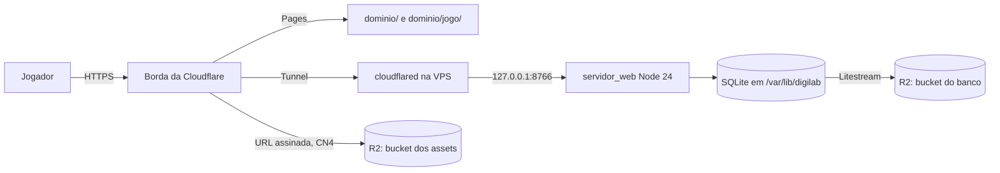

# Plano da CN5: a hospedagem de teste (2026-11-20)

**Status:** APROVADO pelo Matheus em 2026-11-21 ("Aprovo todas"; as D-CONTA-206 a 209 DECIDIDAS pela recomendação), sem código, sem conta criada e sem deploy. É a preparação da etapa **CN5** do `docs/PLANO_V3_CONTA.md` (seção 10),
dentro da pilha já decidida: a CN-7 (Node 24 + Hono numa VPS, SQLite com a cópia no R2, o login no próprio servidor, a Cloudflare na
frente) e as **CH-1 a CH-7** do `docs/PLANO_V3_CONTA_HOSPEDAGEM.md` (Lightsail em São Paulo, 2 GB; Cloudflare Pages e R2; SQLite +
Litestream; Sentry e Better Stack grátis; a Cloudflare Free; um ambiente só, o de teste com os convidados).

**Quem faz o quê:** toda contratação, criação de conta, compra e chave é do **Matheus** (seção 1). Uma sessão monta o deploy depois
(seção 3), com as contas já criadas. **Nenhuma chave, segredo, domínio interno ou lista de convidados vai para o repositório**, que ainda
é **PÚBLICO** (a PI1 é do Matheus; seção 5).

**Os preços:** lidos nas páginas oficiais em **2026-11-20**, cada um com a URL (seção 2). O que a página não mostrou fica "não conferido";
o que veio de terceiro, "secundário". Todo número que não é preço lido é **PROPOSTO, SEM FONTE**. Preço de nuvem muda sem aviso: o
Matheus confere de novo na tela de compra.

**O que este plano não faz:** não muda o `servidor_web/`, o `web/app/`, o CI nem o motor. As mudanças de código que o deploy pede estão
listadas (seção 4) e vão em PRs próprios.

**O código já está na `main` (2026-11-21):** o código da CN5 (#1057, `f6327f9a`: o `--borda cloudflare`, o roteiro em
`docs/infra/DEPLOY_CN5.md`, o workflow `publicar` desligado, o Worker dos assets) e a CN4 (#1058, `671a0efa`, e #1059, `a9275a6e`: o
`robots.txt`, as URLs assinadas, o Turnstile, a cota da fala). Este plano fica com a lista do Matheus, os preços, o que precisava vir
antes (a seção 4, agora com o estado) e as D-CONTA-206 a 209. A seção 8 diz onde ele divergia do #1057.

## 1. O que o Matheus cria ou contrata, em ordem

Cada linha diz onde (o endereço oficial), o que escolher, o que anotar e **onde guardar**. "Guardar" é sempre um destes três lugares, e
nunca um arquivo do repositório, um comentário de PR ou uma mensagem de sessão:
- **(G)** um secret do GitHub (Settings › Secrets and variables › Actions, no ambiente `teste`), para o CI;
- **(S)** o arquivo de ambiente do servidor na VPS (`/etc/digilab/servidor.env`, dono `root`, modo `600`; seção 3.2);
- **(M)** o gerenciador de senhas do Matheus (a conta, a senha, o código de recuperação, a chave SSH privada).

| # | o quê | onde | o que escolher | o que anotar e onde guardar | custo do dia |
|---|---|---|---|---|---|
| 0 | **o repositório privado e o teto do Actions** (PI1) | github.com › o repositório › Settings › General › Danger Zone; Billing › Budgets | privado; o teto de US$ 20 por mês (PI-2) | nada novo | US$ 0 (os minutos do privado contam; PI-2) |
| 1 | **o domínio** | [registro.br](https://registro.br/) (`.com.br`) ou o [Cloudflare Registrar](https://www.cloudflare.com/products/registrar/) (`.com`) | o nome é do Matheus; ver a seção 1.1 | a conta do registrador e a renovação (M); o nome não entra no repositório até a CN6 abrir (seção 5) | `.com.br` R$ 40 por ano; `.com` uns US$ 10,46 por ano (secundário); seção 2 |
| 2 | **a conta da Cloudflare** (Free) | [dash.cloudflare.com](https://dash.cloudflare.com/sign-up) | o plano Free (CH-6); a zona do domínio; se o domínio é do registro.br, trocar os servidores de DNS no registro.br para os dois que a Cloudflare mostrar | a conta e a autenticação de dois fatores (M); o **Account ID** (G: `CLOUDFLARE_ACCOUNT_ID`) | US$ 0 |
| 3 | **o R2** (na mesma conta) | dash.cloudflare.com › R2 | dois buckets na localização automática ou "South America" se a tela oferecer: um para o **banco** (privado, a cópia do Litestream e as cópias diárias) e um para os **assets** (privado; a CN4 serve por URL assinada) | dois tokens de API do R2, cada um só com o seu bucket: o do banco com leitura e escrita (S: `LITESTREAM_ACCESS_KEY_ID`, `LITESTREAM_SECRET_ACCESS_KEY`); o dos assets, para o envio feito da máquina do Matheus (M); o endpoint S3 da conta (S) | US$ 0 até 10 GB-mês (seção 2); **se a ativação pede um cartão: não conferido** |
| 4 | **o Turnstile** | dash.cloudflare.com › Turnstile | um widget, modo "Managed", só os nomes de host do jogo | a site key (vai no build: não é segredo, mas fica como variável do GitHub, G) e a **secret key** (S: `TURNSTILE_SECRET`) | US$ 0 |
| 5 | **o token do deploy na Cloudflare** | dash.cloudflare.com › My Profile › API Tokens | só "Cloudflare Pages: Edit" na conta (para o CI publicar o jogo) | G: `CLOUDFLARE_API_TOKEN` | US$ 0 |
| 6 | **a conta da AWS** | [aws.amazon.com](https://aws.amazon.com/) | a conta raiz com dois fatores, e **um usuário IAM só para o Lightsail**; o **alerta de gasto** (Billing › Budgets) em US$ 20 por mês (PROPOSTO, SEM FONTE) | a conta raiz e o código de recuperação (M); nenhuma chave de acesso da AWS no CI (o CI entra por SSH, seção 3.6) | US$ 0 |
| 7 | **a instância do Lightsail** | [lightsail.aws.amazon.com](https://lightsail.aws.amazon.com/) | região **São Paulo** (sa-east-1, CH-1), Linux, **Ubuntu LTS** (a mais nova da lista), o plano **2 GB, 2 vCPU, 60 GB, com IPv4** (CH-2); o IP estático ligado à instância; os snapshots automáticos ligados | o IP (M; não entra no repositório); a chave SSH do Matheus (M) | **US$ 12 por mês** (seção 2); o snapshot US$ 0,05 por GB-mês |
| 8 | **a chave SSH do deploy** | na máquina do Matheus, `ssh-keygen -t ed25519` (um par só para o CI) | a pública vai para o usuário `deploy` da VPS (seção 3.2); a privada | G: `DEPLOY_SSH_KEY`; o host e a impressão digital do servidor (G: `DEPLOY_HOST`, `DEPLOY_KNOWN_HOSTS`) | US$ 0 |
| 9 | **a chave da Anthropic do servidor** | [console.anthropic.com](https://console.anthropic.com/) | uma chave **só para o servidor de teste**, separada da chave local; o limite de gasto mensal da organização no console (PROPOSTO: US$ 10, SEM FONTE) | S: `ANTHROPIC_API_KEY` | por uso; o teto TOTAL do servidor é US$ 2 por padrão (`--limite-usd`, o `catalogo_fala.json`) |
| 10 | **o app OAuth do Google** | [console.cloud.google.com](https://console.cloud.google.com/apis/credentials) | um projeto; a tela de consentimento "Externa", em teste, com os convidados como usuários de teste; credencial "ID do cliente OAuth", tipo "Aplicativo da Web"; o URI de redirecionamento `https://<api>/auth/callback`; os escopos `openid` e `email` (os que o `provedores.ts` pede) | S: `GOOGLE_CLIENT_ID`, `GOOGLE_CLIENT_SECRET` | US$ 0 |
| 11 | **o app OAuth do GitHub** | [github.com/settings/developers](https://github.com/settings/developers) › OAuth Apps | a URL de callback `https://<api>/auth/callback`; sem escopo (o `provedores.ts` pede `scope: ""`) | S: `GITHUB_CLIENT_ID`, `GITHUB_CLIENT_SECRET` | US$ 0 |
| 12 | **o Sentry** (CH-5) | [sentry.io](https://sentry.io/signup/) | o plano Developer; um projeto Node e um navegador | o DSN do servidor (S: `SENTRY_DSN`) e o do jogo (G: `VITE_SENTRY_DSN`; o DSN do navegador é público por natureza). **O código do Sentry ainda não existe** (seção 4) | US$ 0 |
| 13 | **o Better Stack** (CH-5) | [betterstack.com](https://betterstack.com/) | o plano Free; um monitor HTTP na `https://<api>/saude` e um na página do jogo, a cada 3 min (PROPOSTO, SEM FONTE); o aviso por e-mail e no celular | nada no repositório (a conta, M) | US$ 0 |
| 14 | **a lista de convidados** | no servidor, nunca no repositório | as chaves no formato do `servidor_web/src/conta/convidados.ts` (`github:<login>`, `email:<e-mail>`, `google:id:<id>`) | S: `DIGILAB_CONVIDADOS`, ou a tabela `convidados` | US$ 0 |

**Os segredos que o servidor gera sozinho** (não são do Matheus): o segredo HMAC das sementes da semana e do dia nasce no banco
(`servidor_web/CLAUDE.md`, MMO4 e MMO6). A cópia do banco no R2 leva esses segredos junto: o bucket do banco nunca fica público.

### 1.1 O domínio: `.com.br` ou `.com`

| | `.com.br` no registro.br | `.com` no Cloudflare Registrar |
|---|---|---|
| preço por ano | **R$ 40,00** (conferido) | **US$ 10,46** (secundário: cfdomainpricing.com, de terceiro) |
| DNS | troca manual dos servidores de nome para a Cloudflare | já nasce na Cloudflare |
| quem pode | pessoa física com CPF | qualquer conta da Cloudflare |
| o que pesa | o público é brasileiro; o pagamento é em real | a renovação é em dólar, com o câmbio do dia |

**A recomendação (PROPOSTA):** o `.com.br` no registro.br, pelo público e pelo preço em real. Custo de errar: baixo. Trocar o domínio
depois é um DNS, um build com o endereço novo e os apps OAuth com o callback novo; o `localStorage` dos jogadores sem conta fica no
endereço velho (RC-7).

## 2. Os preços conferidos em 2026-11-20

| item | número | URL | conferido |
|---|---|---|---|
| **Lightsail, Linux 2 GB** | **US$ 12 por mês**: 2 GB, 2 vCPU, 60 GB SSD, 3 TB de tráfego, com IPv4 público (US$ 10 só com IPv6); cobrado por hora | [lightsail/pricing](https://aws.amazon.com/lightsail/pricing/) | sim |
| **Lightsail em São Paulo: o preço** | a página tem **uma lista de preços só**, sem preço por região; ela não diz que São Paulo custa diferente. A FAQ diz que "planos em certas regiões" têm outra especificação, sem dizer quais | [pricing](https://aws.amazon.com/lightsail/pricing/), [FAQ](https://aws.amazon.com/lightsail/faq/) | **não conferido** o preço em São Paulo: conferir na tela de criar a instância, que mostra o preço da região escolhida |
| **Lightsail em São Paulo: o tráfego** | a página diz que os planos em São Paulo incluem **a metade** do tráfego: no de 2 GB, 1,5 TB (a conta é deste plano; a página não escreve o 1,5) | [pricing](https://aws.amazon.com/lightsail/pricing/) | sim (a regra); a FAQ só cita Mumbai e Sydney, e as duas páginas não batem |
| **Lightsail: o excedente de tráfego** | a FAQ lista US$ 0,09/GB (EUA e Europa) a US$ 0,17/GB (Sydney); **São Paulo não está na lista**. Os US$ 0,15/GB de São Paulo da página são do armazenamento de objetos do Lightsail, não da instância | [FAQ](https://aws.amazon.com/lightsail/faq/) | **não conferido** para a instância em São Paulo. Não pesa: a API usa pouco, e os assets saem pelo R2 |
| **Lightsail: snapshot** | US$ 0,05 por GB-mês | [pricing](https://aws.amazon.com/lightsail/pricing/) | sim |
| **Lightsail: IP estático** | incluído enquanto ligado a uma instância; US$ 0,005 por hora se ficar solto mais de 1 hora | [FAQ](https://aws.amazon.com/lightsail/faq/) | sim |
| **Lightsail: disco a mais** | US$ 0,10 por GB-mês, a partir de 8 GB | [pricing](https://aws.amazon.com/lightsail/pricing/) | sim (não é preciso: os 60 GB sobram) |
| **domínio `.com.br`** | **R$ 40,00** por 1 ano; R$ 184,00 por 5 anos; R$ 364,00 por 10 anos (a tabela "desde 2017") | [registro.br, pagamento](https://registro.br/ajuda/pagamento-de-dominio/) | sim |
| **domínio `.com`** | o Registrar diz que vende "at cost", sem margem; a página não mostra o preço do `.com`. Um site de terceiro diz **US$ 10,46** de registro e de renovação, "Updated 2026-11-20" | [Registrar](https://www.cloudflare.com/products/registrar/); [cfdomainpricing.com](https://cfdomainpricing.com/) | secundário |
| **Cloudflare Pro** | US$ 20 por mês no anual, US$ 25 no mensal | [planos](https://www.cloudflare.com/plans/network-cdn.md) | sim (a CH-6 fica no Free) |
| **Cloudflare R2, Pages, Turnstile** | os números da hospedagem (seção 3 do `PLANO_V3_CONTA_HOSPEDAGEM.md`, lidos em 2026-11-12) | as URLs de lá | não relidos hoje |
| **Render** (a outra opção de PaaS) | o serviço web de 1 CPU e 2 GB: **US$ 25 por mês**; o disco persistente: **US$ 0,25 por GB-mês**; as regiões: Oregon, Ohio, Virgínia, Frankfurt, Singapura, **sem a América do Sul** | [pricing](https://render.com/pricing), [regions](https://render.com/docs/regions) | sim. Não muda a CH-2: custa o dobro do Lightsail e não tem São Paulo |
| **Magalu Cloud** | a página de preços só tem a calculadora "Simule seu investimento", que pede escolher a configuração; nenhum número aparece sem preencher | [preços](https://magalu.cloud/precos/) | **não conferido** (não preenchi a calculadora). Não muda a CH-2 |
| **Akamai na América do Sul** | a página de regiões não abriu (404) | — | **não conferido**. Não muda a CH-2 |

### 2.1 O que a Cloudflare Free dá contra os robôs de IA (conferido em 2026-11-20)

- **AI Crawl Control:** "Available on all plans", inclusive o Free ([fonte](https://developers.cloudflare.com/ai-crawl-control/)).
- **As políticas de acesso dos robôs e agentes de IA** (o antigo "Configure AI bot policies"): ações separadas para Busca, Agente e
  Treino, com Bloquear, Bloquear nas páginas com anúncio, Permitir e Não autorizar (só o Treino); num domínio novo, **as três começam em
  "Permitir"**. A página **não diz em que planos** isso existe ([fonte](https://developers.cloudflare.com/bots/additional-configurations/block-ai-bots/)).
  Não conferido no Free: o Matheus vê no painel, depois de criar a zona.
- **O Bot Fight Mode** (grátis): desafia o tráfego que parece robô no domínio inteiro, **não se ajusta e não se pula por regra de WAF**, e
  pode desafiar o tráfego de API ([fonte](https://developers.cloudflare.com/bots/get-started/bot-fight-mode/)). **Isso pesa:** o jogo chama a
  API por `fetch`, e o desafio quebra a sincronização. A recomendação está na seção 4 (D-CONTA-207).
- **O `robots.txt` gerenciado pela Cloudflare:** nenhuma página lida fala dele. Não conferido; o `robots.txt` do jogo é da CN4 de qualquer
  jeito.
- **O limite de pedidos e as regras de WAF do Free:** a tabela de planos só diz "Cloudflare Rules: 70 rules" no Free, sem separar o limite
  de pedidos ([fonte](https://www.cloudflare.com/plans/network-cdn.md)). Não conferido.

### 2.2 A conta do mês (PROPOSTO)

| | por mês |
|---|---|
| Lightsail 2 GB em São Paulo (se o preço da região for o da lista) | US$ 12 |
| snapshots (uns 20 GB, SEM FONTE) | uns US$ 1 |
| domínio `.com.br` | uns R$ 3,33 (R$ 40 por ano) |
| Cloudflare Free, R2 abaixo de 10 GB, Turnstile, Sentry, Better Stack | US$ 0 |
| **total sem a fala** | **uns US$ 13 e R$ 3,33**, igual à seção 6 da hospedagem |
| a fala | por uso, com o teto TOTAL de US$ 2 do servidor e o limite do console da Anthropic |

## 3. O roteiro do deploy (depois que as contas existirem)

**O desenho:** o jogo e a página de entrada no Cloudflare Pages; a API no Lightsail, **sem nenhuma porta aberta para a internet além do
SSH**, ligada à Cloudflare por um **Cloudflare Tunnel** (`cloudflared`), que sai da VPS para a borda (a D-CONTA-197 do PR #1057, `--borda cloudflare`). O servidor continua
escutando só em `127.0.0.1`, como hoje. Os endereços seguem a seção 8.1 do `docs/ROADMAP_V3_CONTA.md` (RC-6): o jogo em `dominio/jogo/`,
a API em `api.dominio`, os assets em `assets.dominio`.



### 3.1 A VPS: o sistema

1. Criar a instância (seção 1, linha 7) e entrar pelo SSH do navegador do Lightsail uma vez.
2. `apt update && apt full-upgrade`; ligar as atualizações de segurança automáticas (`unattended-upgrades`).
3. **O firewall do Lightsail** (a aba Networking): só a porta 22, e só do IP do Matheus quando possível; **fechar a 80 e a 443** (o
   Tunnel não precisa delas). O `ufw` dentro da VPS com a mesma regra, como segunda camada.
4. O SSH: só chave, sem senha, sem login de `root` (`PasswordAuthentication no`, `PermitRootLogin no`).
5. **O Node 24:** pelo repositório oficial do NodeSource ou pelo binário oficial de [nodejs.org](https://nodejs.org/), a versão 24 LTS.
   Conferir com `node --version`. O servidor precisa do `node:sqlite` e roda TypeScript direto (`node src/main.ts`), o que o Node 24 faz.
6. **Os usuários:** `digilab` (roda o servidor, sem shell, sem sudo) e `deploy` (recebe os arquivos do CI, sem sudo; só pode reiniciar o
   serviço por uma regra estreita do `sudoers`: `systemctl restart digilab`).
7. **As pastas:**
   - `/opt/digilab/versoes/<sha>/` o código de cada deploy, de dono `deploy`, só leitura para o `digilab`;
   - `/opt/digilab/atual` um link para a versão que roda;
   - `/var/lib/digilab/` o banco (`conta.sqlite`) e o `gasto_fala.json`, de dono `digilab`, modo `700`;
   - `/etc/digilab/servidor.env` os segredos (seção 3.2), de dono `root`, modo `600` (o systemd lê como root antes de baixar o usuário).
8. **O disco:** os 60 GB do plano. O banco tem o tamanho dos saves (a CN0 mediu de 0,6 a 23 kB crus por dia de jogo) e cabe com folga.
   Um aviso quando o disco passar de 80 % (o agente do Better Stack ou um `cron` simples; PROPOSTO).

### 3.2 O ambiente do servidor (`/etc/digilab/servidor.env`)

Só os nomes; os valores ficam na VPS. Cada um já existe no código, salvo os marcados "novo" (seção 4).

| variável | o que é | de onde |
|---|---|---|
| `DIGILAB_URL_API` | `https://api.<dominio>` | `servidor_web/src/conta/config.ts` |
| `DIGILAB_URL_JOGO` | `https://<dominio>/jogo/` (a origem do CORS) | `config.ts` |
| `DIGILAB_BANCO` | `/var/lib/digilab/conta.sqlite` | `config.ts` |
| `DIGILAB_GASTO_FALA` | `/var/lib/digilab/gasto_fala.json` (o padrão aponta para `servidor/`, que não vai à VPS) | `servidor_web/src/main.ts` |
| `DIGILAB_PROVEDOR_FALSO` | `0` | `config.ts` (fora do local, ligado levanta) |
| `DIGILAB_CONVIDADOS` | a lista (seção 1, linha 14) | `convidados.ts` |
| `DIGILAB_MARCO_RANQUEADA` | `7` no beta (BT0-1), senão vazio | `config.ts` |
| `ANTHROPIC_API_KEY` | a chave do servidor (linha 9) | `servidor_web/src/fala.ts` |
| `GOOGLE_CLIENT_ID`, `GOOGLE_CLIENT_SECRET`, `GITHUB_CLIENT_ID`, `GITHUB_CLIENT_SECRET` | os apps OAuth | `provedores.ts` |
| `TURNSTILE_SECRET` | novo (CN4) | — |
| `SENTRY_DSN` | novo (seção 4) | — |
| `LITESTREAM_ACCESS_KEY_ID`, `LITESTREAM_SECRET_ACCESS_KEY` | o token do bucket do banco (lidos pelo Litestream, não pelo servidor) | — |

### 3.3 O serviço (systemd)

Um `digilab.service` (o texto vai no PR do deploy; o rascunho):

```ini
[Unit]
Description=Digilab servidor_web
After=network-online.target

[Service]
User=digilab
WorkingDirectory=/opt/digilab/atual/servidor_web
EnvironmentFile=/etc/digilab/servidor.env
ExecStart=/usr/bin/node src/main.ts --porta 8766 --limite-usd 2
Restart=on-failure
RestartSec=5
NoNewPrivileges=true
ProtectSystem=strict
ProtectHome=true
ReadWritePaths=/var/lib/digilab
PrivateTmp=true

[Install]
WantedBy=multi-user.target
```

O `cloudflared` roda como serviço próprio (o instalador da Cloudflare cria) e aponta `api.<dominio>` para `http://127.0.0.1:8766`. O
`litestream` também (seção 3.5). O `--limite-usd 2` é o padrão de hoje; subir o teto é decisão do Matheus.

### 3.4 A Cloudflare na frente

1. **O DNS:** a zona do domínio na Cloudflare; `api` como rota do Tunnel (proxied); a raiz e o `www` no Pages; `assets` no domínio
   personalizado do bucket dos assets (CN4).
2. **O SSL/TLS:** "Full (strict)" não se aplica ao Tunnel (a ligação já é cifrada); ligar "Always Use HTTPS" e o HSTS só depois do primeiro
   teste (o HSTS é difícil de desfazer).
3. **O Pages:** um projeto, publicado pelo CI (seção 3.6) com o `wrangler pages deploy`; a página de entrada na raiz, o jogo em `/jogo/`.
4. **Os robôs:** as políticas de IA (seção 2.1) com **Treino bloqueado, Agente bloqueado na API, Busca permitida** nas páginas públicas
   (PI-6); o **Bot Fight Mode desligado** até a CN4 decidir (D-CONTA-207).
5. **O cache:** o Pages cuida do jogo; a API sem cache (`Cache-Control: no-store` já é o caso nas rotas da conta: a conferir no PR do
   deploy).

### 3.5 A cópia contínua do SQLite para o R2 (Litestream) e o backup

- **O Litestream** ([litestream.io](https://litestream.io/)) lê o WAL do banco (o `banco.ts` já abre em WAL) e copia para o bucket do banco
  pelo endpoint S3 do R2, de forma contínua. A versão e a configuração exata do R2 se conferem na documentação do dia (não conferido hoje).
  A configuração em `/etc/litestream.yml`: o caminho do banco, a réplica `s3://<bucket>/conta`, o endpoint do R2, a retenção de 30 dias
  (as cópias da seção 5.6 do plano da conta; PROPOSTO).
- **Três camadas:** (1) o Litestream, contínuo; (2) o snapshot automático diário do Lightsail (a máquina inteira, 7 dias; PROPOSTO); (3)
  uma cópia diária do arquivo inteiro (`sqlite3 .backup`, ou o `VACUUM INTO`) para o bucket do banco, guardada 30 dias.
- **A restauração testada (o portão da CN5):** antes do primeiro convidado, numa máquina que não é a VPS (a do Matheus ou uma instância de
  teste do Lightsail por uma hora), `litestream restore` do R2 para um arquivo novo; subir o `servidor_web` com `DIGILAB_BANCO` nesse
  arquivo e conferir que a conta de teste, o pet na nuvem e o envio aparecem; registrar a hora e o resultado no PR do deploy. **Sem esse
  teste, a cópia não conta como backup.** Repetir uma vez por mês (PROPOSTO).
- **O banco não mistura com os assets:** o bucket do banco é privado, com o token só dele; os segredos das sementes estão dentro.

### 3.6 O deploy pelo CI

**O que o workflow faz** (um arquivo novo, `.github/workflows/deploy-teste.yml`, no PR do deploy, não neste):

1. **Quando:** `workflow_dispatch` (manual) no começo; um push na `main` só depois de três deploys manuais que deram certo (PROPOSTO).
2. **Antes:** o mesmo que o `verificar-pr.yml` já roda para o `web` e o `servidor-web` (tipos, Vitest, build); se falhar, não publica.
3. **O jogo:** `npm ci` e `npm run build` em `web/app/` com `VITE_DIGILAB_API`, `VITE_DIGILAB_NUVEM` (só quando o Matheus ligar) e as
   variáveis públicas; `wrangler pages deploy` com o `CLOUDFLARE_API_TOKEN` e o `CLOUDFLARE_ACCOUNT_ID`.
4. **O servidor:** monta um pacote com `servidor_web/` (sem `node_modules`, `dados/`, `medicoes/`) e **o `web/app/src/` e o
   `web/app/motor/`** que o servidor importa (a conferência do envio, o `tamer.ts`, o protocolo da nuvem); manda por SSH para
   `/opt/digilab/versoes/<sha>/`; roda `npm ci --omit=dev` lá; troca o link `atual`; `sudo systemctl restart digilab`.
5. **Depois:** espera a `https://api.<dominio>/saude` responder 200 em até 60 s; se não, volta o link para a versão anterior e reinicia
   (o retorno automático). As 3 últimas versões ficam na VPS.
6. **Os secrets que pede** (no ambiente `teste` do GitHub, com a aprovação manual do Matheus no ambiente): `CLOUDFLARE_API_TOKEN`,
   `CLOUDFLARE_ACCOUNT_ID`, `DEPLOY_SSH_KEY`, `DEPLOY_HOST`, `DEPLOY_KNOWN_HOSTS`; as variáveis públicas `VITE_DIGILAB_API`,
   `VITE_SENTRY_DSN`, a site key do Turnstile. **Nenhum segredo do servidor passa pelo CI:** eles vivem só no `servidor.env` da VPS.

**Os assets não passam pelo CI.** O atlas, os sons, a arena e a evolução ficam em `D:\Trab\digilab\Assets`, fora do git (o
`web/app/vite.config.ts` os serve no dev). O envio ao bucket dos assets é um script da máquina do Matheus (com o `rclone` ou o `wrangler r2`),
que manda **só a lista que o `vite.config.ts` já permite** (o atlas de clipes e de peças, a decoração listada, os sons, a arena, a
evolução). **Os kits do dev que não se redistribuem** (o `kits3d/tiny_fantasy_forest`, pela EULA da Unity Asset Store, e o
`kits3d/cassette_beasts`) **nunca vão**: o script recusa qualquer caminho fora da lista.

### 3.7 O painel e a observabilidade

- **O servidor de pé:** o Better Stack (linha 13) na `/saude` e na página do jogo; o aviso no celular do Matheus.
- **Os erros:** o Sentry no servidor e no jogo (depois do código da seção 4).
- **O gasto da fala:** o `gasto_fala.json` (o teto TOTAL) e o painel de uso do console da Anthropic; o alerta de 80 % que o `ControleGasto`
  já escreve no log do serviço (`journalctl -u digilab`).
- **O gasto da nuvem:** o alerta de gasto da AWS (linha 6) e o painel do R2 (o armazenamento e as operações do mês).
- **Os robôs:** o painel do AI Crawl Control e os eventos de segurança da Cloudflare, uma vez por semana no beta (PROPOSTO); se os robôs
  aparecerem, a CH-6 manda pensar no Pro.

### 3.8 Como desligar tudo

Em ordem, do mais fácil de voltar ao mais difícil:
1. **Pausar sem perder nada:** o Pages com uma página "em manutenção" (um deploy); `systemctl stop digilab` na VPS. O banco fica no disco e
   no R2.
2. **Desligar a API:** remover a rota `api` do Tunnel no painel da Cloudflare.
3. **Parar de pagar a VPS:** um snapshot manual final; uma cópia do banco baixada para a máquina do Matheus (`litestream restore`);
   **apagar a instância** e **soltar o IP estático** (o IP solto cobra; seção 2). Apagar os snapshots que não quiser guardar.
4. **O R2:** apagar o bucket dos assets; o do banco só depois que a cópia local estiver conferida e que os convidados tiverem sido avisados
   (o "apagar a conta" e o "baixar os dados" da seção 9 do plano da conta valem também no fim do serviço).
5. **As chaves:** revogar a chave da Anthropic do servidor, os tokens da Cloudflare e do R2, a chave SSH do deploy, os apps OAuth; apagar
   os secrets do GitHub.
6. **O domínio:** deixar vencer ou manter; o domínio parado não custa além da anuidade.

## 4. O que a CN4 e o código precisam entregar antes do primeiro deploy

Lido no código da `main` (`04f32b41`). Sem estes, o deploy não funciona ou abre a fala a qualquer um.

**O estado em 2026-11-21:** tudo o que a tabela 4.1 pedia antes do primeiro deploy está na `main`. O modo publicado do servidor é o
`--borda cloudflare` (#1057). A fala vai ao endereço da API, só com a sessão e com a cota de 30 por conta e por dia (#1058, #1059, com a
chave `VITE_DIGILAB_PROTECAO=1` no build). O `robots.txt` do jogo e o da API (#1058). Os assets saem só por URL assinada, com o bucket
privado e o Worker na frente (#1058, #1059, #1057). O Turnstile já entrou na criação da conta e no visitante (#1058, #1059), antes do que a
D-CONTA-206 pedia; a D-CONTA-206 fica sem efeito. **O que ainda falta:** os enfeites e os modelos 3D da ilha em `web/app/public/` seguem
fora da URL assinada (D-CONTA-222); o aviso de mineração reservada (PI-6) não aparecia no código (entrou no branch `v3-pi6-tdmrep`, D-CONTA-231 a 234); e conferir na Cloudflare de verdade o
formato da assinatura e as políticas de robôs (as NÃO CONFERIDAS da CN4, D-CONTA-210, 212 e 217). A tabela abaixo fica como estava escrita,
para o registro do que se pediu.

### 4.1 Bloqueiam o deploy (antes)

| o quê | por quê | onde | etapa |
|---|---|---|---|
| **o modo publicado do servidor** | hoje o `servidor_web/src/app.ts` responde **403** a todo pedido com `Cf-Ray`, `Cf-Connecting-Ip` ou `X-Forwarded-For` (a regra do servidor local sem `--remoto`). Atrás da Cloudflare, todo pedido traz esses cabeçalhos: nada funcionaria. Precisa de uma chave (PROPOSTA: `--publicado`) que aceite só pedidos com o `Cf-Connecting-Ip` e leia o IP dele para os limites, e que continue recusando quando desligada | `servidor_web/src/app.ts`, `main.ts` | o PR do deploy (CN5) |
| **a fala no endereço da API** | o jogo chama `/api/fala` e `/api/fala/status` **no mesmo endereço da página** (`web/app/src/fala.ts`); no Pages, isso cai no Pages, não na VPS. Precisa usar o `VITE_DIGILAB_API` como base, como a conta já faz | `web/app/src/fala.ts` | o PR do deploy (CN5) |
| **a `/api/fala` só com sessão e com a cota** | hoje a fala responde a quem chamar, só com o teto TOTAL. Publicada, um robô gasta os US$ 2 do teto em pouco tempo e deixa os convidados sem fala. A sessão obrigatória e a cota por conta e por dia (CN-8, CN-16; PROPOSTO: 30) | `servidor_web/src/app.ts`, `fala.ts` | **CN4** |
| **o `robots.txt` e o aviso de mineração** | o Pages publica o jogo na hora; sem o arquivo, o primeiro robô honesto já coleta (PI-6) | `web/app/public/` e a página de entrada | **CN4** (PI3) |
| **os assets fora de um caminho fixo** | o jogo pede o atlas em `../../../Assets/...`, relativo à página. No deploy, ou o atlas vai num caminho fixo (o download em lote que a CN-9 quer evitar), ou já sai por URL assinada | `web/app/src/` (os pedidos do atlas, dos sons, da arena e da evolução) e uma rota nova no servidor | **CN4** (a URL assinada) |
| **o Turnstile na entrada da conta** | as contas em massa (CN-9); a conta já é só por convite, então o risco é menor que o da fala | as telas da conta e `servidor_web/src/conta/rotas.ts` | **CN4**; pode ir junto (seção 4.2) se o Matheus aceitar a D-CONTA-206 |

### 4.2 Podem ir junto ou depois do primeiro deploy

- **O Sentry no código** (o servidor e o jogo): ajuda, mas o Better Stack já avisa se cair. Junto ou logo depois.
- **O Turnstile na conta** (se a D-CONTA-206 for aceita): a lista de convidados já segura as contas em massa no teste.
- **As políticas de IA da Cloudflare:** é configuração do painel, não código; vão no dia do deploy.
- **O registro dos pets no R2 (CN3):** hoje os registros ficam no SQLite, que o Litestream copia. Mover para o R2 é só se o banco crescer.
- **A página de entrada e o aviso da mudança de endereço (RC-7):** a página já tem PR próprio; o aviso pode vir no primeiro deploy.

## 5. Os riscos

| risco | o que se vê | o que segura |
|---|---|---|
| **o repositório é PÚBLICO** (a PI1 é do Matheus) | tudo que entra num commit fica público para sempre (a PI-3 decidiu não reescrever o histórico) | este plano e o PR do deploy só dizem **nomes** de variáveis e de secrets, nunca valores; **nem o domínio, nem o IP, nem a lista de convidados, nem o id da conta da Cloudflare** vão no repositório (o domínio vai nos secrets e variáveis do GitHub e no ambiente). A recomendação é fazer a PI1 antes da linha 1 da seção 1 |
| **um segredo commitado por engano** | a chave fica no histórico | revogar na hora (não basta apagar o commit); o GitHub avisa algumas chaves (o secret scanning), não todas |
| **a fala aberta antes da CN4** | o teto de US$ 2 some num dia, e a fala vira template | o deploy só depois da sessão e da cota (seção 4.1); o limite mensal no console da Anthropic (linha 9) |
| **o Bot Fight Mode quebrando a API** | a sincronização falha com o desafio | desligado até a CN4; ou só nas páginas (D-CONTA-207) |
| **a cópia que não restaura** | perder os pets dos convidados | o teste de restauração antes do primeiro convidado (seção 3.5) |
| **o preço de São Paulo diferente da lista** | a conta do mês sobe | o Matheus confere na tela de criar a instância (seção 2); se passar de US$ 15, avisar antes de criar |
| **os kits que não se redistribuem no bucket** | violar a EULA de um kit | o script dos assets só manda a lista do `vite.config.ts` (seção 3.6) |
| **os sprites do Digimon UP publicados** | o jogo publicado leva os sprites (a decisão de usar está tomada; o crédito vai na regra 5.1 das `docs/UI_GUIDELINES.md`) | só convidados no teste; a revisão da CN6 antes de abrir |
| **a máquina do Matheus no caminho do deploy** | o deploy do servidor depende só do CI; o envio dos assets, da máquina | os assets mudam pouco; o envio é idempotente |

## 6. Decisões para o Matheus

**DECIDIDAS** pelo Matheus em 2026-11-21, pela recomendação ("Aprovo todas"). Cada uma com a recomendação e o custo de errar; a do Tunnel é a D-CONTA-197 do PR #1057; as outras duas estão no registro (D-CONTA-206 e 207).

- **A ligação da VPS com a Cloudflare: o Cloudflare Tunnel** (a D-CONTA-197, no PR #1057, com o código). Nenhuma porta aberta além do SSH, o servidor segue em
  `127.0.0.1`, e o IP da VPS não aparece no DNS. A outra opção é abrir a 443 com um proxy (Caddy ou nginx) e o certificado de origem da
  Cloudflare, com o firewall só para os IPs da Cloudflare. Custo de errar: baixo; trocar é configuração. O Tunnel ser grátis não foi
  conferido hoje.
- **D-CONTA-206. O Turnstile da conta: junto com a CN4 ou logo depois do primeiro deploy.** Recomendação: **depois**, porque a lista de
  convidados já impede as contas em massa no teste; a cota da fala e o `robots.txt` vêm antes. Custo de errar: baixo.
- **D-CONTA-207. O Bot Fight Mode: desligado no começo.** Ele desafia a API e não se ajusta no Free (seção 2.1); as políticas de IA cobrem
  os robôs declarados, e a cota da fala, o resto. Custo de errar: médio; ligado, a sincronização dos convidados pode falhar sem aviso
  claro.
- **O domínio** (seção 1.1): recomendação `.com.br` no registro.br. O nome é do Matheus.

## 7. O que o Matheus faz primeiro

1. **A PI1:** o repositório privado e o teto do Actions (seção 1, linha 0).
2. **O domínio** (linha 1) e **a conta da Cloudflare** (linhas 2 a 5): grátis, e destravam o Pages e os robôs.
3. **A conta da AWS** com o alerta de gasto (linha 6). **A instância** (linha 7): a CN4 já está na `main`; criar quando for configurar no mesmo dia, para não pagar a VPS
   parada.
4. **A chave da Anthropic do servidor e os apps OAuth** (linhas 9 a 11): precisam do domínio (o callback).

## 8. Onde este plano divergia do PR #1057 (resolvido em 2026-11-21)

- **Os assets antes da CN4: RESOLVIDO pela recomendação deste plano.** O #1057 propunha o bucket dos assets público, num caminho fixo, até
  a CN4 (a D-CONTA-199 dele). O Matheus aprovou este plano em 2026-11-21, e a D-CONTA-199 do #1057 foi trocada: **o bucket dos assets fica
  privado, e os assets saem só por URL assinada**, que é a CN4 (os PRs #1058 e #1059). O primeiro deploy espera isso (seção 4.1).
- **O excedente de tráfego em São Paulo (a D-CONTA-204 do #1057): fica para conferir no dia de contratar.** O #1057 dá US$ 0,15/GB; a
  leitura daqui (seção 2) é que esse número da página do Lightsail é do armazenamento de objetos, e que a FAQ não lista São Paulo para a
  instância. O Matheus confere na tela de criar a instância. Não pesa na conta.
- **O Sentry (a D-CONTA-200 do #1057):** o #1057 deixa o Sentry fora por ora. Este plano o põe como "junto ou depois" (seção 4.2), não como
  bloqueio: não há contradição, e a linha 12 da seção 1 pode esperar.
- **O workflow:** a seção 3.6 descreve o deploy pelo CI sem arquivo novo (D-CONTA-209); o #1057 já traz o workflow `publicar`. Vale o do
  #1057; a seção 3.6 fica como a lista do que ele precisa ter (o manual primeiro, o retorno automático, os secrets no ambiente `teste`).
