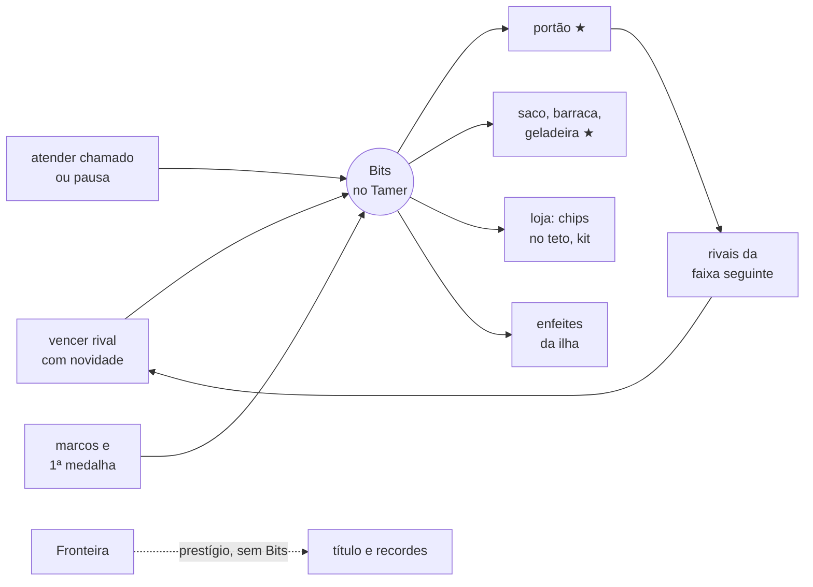

# Plano da moeda do jogo web: os Bits e as melhorias da ilha (2026-11-10)

**Status:** planejamento, sem código. As decisões M-1 a M-10 (seção 9) estão **DECIDIDAS** pelo Matheus em 2026-11-10 ("Aprovo as 10"), todas com a opção recomendada. Todo número é PROPOSTO e SEM FONTE; os
números se acertam na rodada de equilíbrio do fim (a regra "equilíbrio só no fim").

**Origem:** o Matheus, em 2026-11-10: "uma rodada de planejamento para a gente setar uma moeda para o jogo". Ele quer que:
- o jogador ganhe moedas quando derrota um inimigo ou faz certas ações nos momentos certos (fazer carinho, dar comida);
- as moedas desbloqueiem melhorias nos objetos do acampamento, e as melhorias desbloqueiem estágios e interações novos;
- a arena tenha duas travas: o pet só enfrenta um estágio depois de vencer o anterior, e o nível da arena tem que corresponder
  (exemplo dele: nível 1 até Rookie, nível 2 até Champion);
- a moeda também compre outras coisas: cosméticos, mecanismos e chips de upgrade para o Digimon.

**Só no jogo.** A pesquisa em Python não muda, como nas medalhas (`docs/DESIGN_MEDALHAS_ARENAS.md`, seção 5).

## 1. O que já existe e em que a moeda encosta

| peça | onde está | o que a moeda faz com ela |
|---|---|---|
| **o Tamer** (a conta que dura) | `web/app/src/tamer.ts`, registro com event sourcing, `VERSAO_TAMER` 8 | é onde a moeda mora (seção 6) |
| **o nível do Tamer** (marcos, só na vista) | `src/nivel.ts`, `src/trancas.ts`; `docs/PLANO_V3_PROGRESSAO_TUTORIAL.md` (P-1 a P-11) | **abre** o lugar; a moeda **melhora** o lugar já aberto. São coisas diferentes (seção 3) |
| **os lugares da ilha** | o portão (Lutar, Nv 4), a barraca (Diário, Nv 2), o saco (Crescer, Nv 3), o cais (sem menu) | ganham níveis de melhoria (seção 4) |
| **a campanha** (6 lugares, um líder por lugar) | `motor/bots.ts`, `LUGARES_V6`: Campina (Rookie), Torre de pedra e Floresta (Champion), Cidadela e Lago (Ultimate), Montanha Espiral (Mega) | **já é a trava do pet:** vencer um lugar abre o seguinte, pet a pet. É a primeira das duas travas que o Matheus pediu |
| **as medalhas** | o Tamer; travam a evolução (1, 3 e 5 para Champion, Ultimate e Mega) | ficam como estão; dão Bits uma vez (seção 2) |
| **os chips de stat** | `motor/itens.ts`, com os tetos (`bonusChipsStat`: 25 % do treino típico, o teto do estágio e o da vida) | entram na loja **dentro dos mesmos tetos** (seção 5) |
| **os chamados do bebê** | `motor/motor.ts`, `chamados.atendidos` (fome, higiene, carinho; e pelo corpo desde o #465) | são o "momento certo" do cuidado (seção 2) |
| **a pausa do treino** | `motor/motor.ts`, `pausas.atendidas` (fadiga ≥ 40, o dono deixa descansar) | outro "momento certo" |
| **a Fronteira** (Liga, Torre, Fábrica, Salão) | o Tamer; dá prestígio, não força | **não dá Bits** (seção 2) |

O que **não** existe: nenhuma moeda, loja ou preço. O `DESIGN_MEDALHAS_ARENAS.md` (seção 6) deixou "dinheiro e loja para depois",
porque eles pedem fontes e escoadouros. A pesquisa de progressão (`docs/PESQUISA_VIDA_LINHAGEM_PROGRESSAO.md`, seções 10 a 12) já
desenhou as linhas gerais: moedas separadas por origem, novidade contra o grind, uma fonte para cada escoadouro. Este plano parte dela.

## 2. Como se ganha: as fontes

**A regra geral:** a moeda paga o **feito**, não o clique. Cada fonte tem um teto ou uma queda, para que repetir o mesmo botão não
renda nada. A P-2 do plano de progressão recusou o XP por ação por este motivo, e a regra da vida do pet (2026-11-04) também: "o treino
nunca vem de clicar carinho".

| fonte | quanto (PROPOSTO, SEM FONTE) | o que segura o grind |
|---|---|---|
| **vencer um rival** na Arena ou na campanha | pela faixa do rival: Rookie 10, Champion 25, Ultimate 60, Mega 150 | **novidade:** a 1ª vitória contra um rival paga cheio; cada repetição no mesmo dia de pet paga a metade da anterior; a queda some com o tempo (PESQUISA, seção 11) |
| **vencer um líder pela 1ª vez** (a medalha) | 5× a faixa dele, uma vez por Tamer | uma vez só |
| **perder** | 0 | nada a farmar perdendo |
| **atender um chamado** (o pet pediu fome, higiene ou carinho, e o dono fez a ação certa a tempo) | 2 | só conta o chamado aberto; **teto de 20 por dia de pet** |
| **atender uma pausa** (deixar o pet descansar quando ele pede) | 3 | só a pausa que o motor abriu |
| **cuidar no momento certo do Rookie em diante** (comida com a fome baixa, banho com a higiene baixa, carinho com o pet triste) | 1 | o mesmo teto diário do chamado; dar comida com a barriga cheia não paga. O sinal sai do log, com a "necessidade baixa" que o `vinculo` já calcula |
| **marcos** (evoluir, subir o nível do Tamer) | evolução 50, 100, 200 e 400 do Rookie ao Mega; nível do Tamer 30 | uma vez por pet ou por Tamer |
| **a Fronteira** | 0 | prestígio, não dinheiro. Assim o dinheiro não compra o fim do jogo (moedas separadas por origem; os BP do Pokémon, só pista) |

- **Por que o carinho só paga no chamado:** o carinho à toa continua um gesto, como hoje. O que paga é ler o pet: ele pediu e você
  atendeu. Se o carinho pagasse sempre, o jogador aprenderia a clicar, e a P-2 cairia.
- **Do Rookie em diante não há chamado** (o `_chamados` só roda no bebê). Por isso a linha do "momento certo" lê a necessidade no log.
  Se o Matheus preferir, ela pode esperar os chamados do adulto (M-2).

## 3. As duas travas da arena

O Matheus pediu duas travas. A primeira **já existe**; a segunda é nova:

1. **A trava do pet** (a campanha): o pet só enfrenta um lugar depois de vencer o anterior. É por pet: cada ovo novo sobe de novo.
   Não muda.
2. **A trava do portão** (nova): o **nível do portão** diz até que faixa de rival a Arena oferece.

| nível do portão | rivais da Arena | lugares da campanha que abrem | preço (PROPOSTO) |
|---|---|---|---|
| **1** (vem com o nível 4 do Tamer) | até Rookie | Campina | — |
| **2** | até Champion | Torre de pedra, Floresta | 150 |
| **3** | até Ultimate | Cidadela, Lago | 600 |
| **4** | até Mega | Montanha Espiral | 2 000 |
| **5** | a Fronteira com mapa próprio | a Liga e as instalações (que ainda pedem 6 medalhas) | 4 000 |

**Na tela:** o rival acima do nível do portão aparece trancado, com o cadeado e o motivo: "Melhore o portão para enfrentar Champions".
Fica no mesmo padrão dos lugares trancados (P-11).

**O risco, e a regra que o segura:** a trava do portão pode prender a **evolução**. O Champion pede 1 medalha, e a medalha da Torre só
sai com o portão no 2. Um pet que fica pronto para evoluir e não acha rival vira frustração. Duas proteções:
- **o preço de cada nível cabe no que o jogo normal da faixa de baixo rende.** Um pet que cumpre a Campina inteira, com os chamados
  do bebê, tem de juntar os 150 do nível 2 antes de ficar pronto para o Champion. É a conta que a rodada de equilíbrio confere numa
  vida gravada, não um número chutado;
- **a evolução nunca espera a moeda:** a trava da evolução continua a das medalhas. O portão só decide contra quem se luta.

**O nível do Tamer e o nível do lugar:** são duas escadas. O nível do Tamer (marcos) abre o lugar; a moeda melhora o lugar aberto.
Para não confundir na tela, o nível do lugar aparece em estrelas: "Portão ★★" (PROPOSTO, M-4).

## 4. As melhorias de cada lugar

Cada melhoria **abre uma coisa nova**, nunca só um número maior, para a moeda não comprar força bruta (PESQUISA, seção 22, contra o
power creep). Os itens com * dependem de mecânica que ainda não existe e entram só quando ela chegar.

| lugar | ★★ | ★★★ | ★★★★ |
|---|---|---|---|
| **portão** (Lutar) | rivais Champion | rivais Ultimate | rivais Mega; ★★★★★ a Fronteira com mapa próprio |
| **saco** (Crescer) | um 2º tipo de treino à escolha (por exemplo, mira contra alvo móvel*) | o treino em dupla com um rival da Arena já vencido* | o "treino livre": o pet escolhe o treino sozinho, e o dono vê |
| **barraca** (Diário) | mais 2 vagas de pets guardados | o Catálogo mostra o caminho de evolução das formas já vistas | a árvore da linhagem inteira no Diário |
| **geladeira** (comida) | frutas novas, com os gostos do paladar (J5) | a árvore da ilha dá fruta ao ser sacudida* (ilha interativa) | receitas: duas frutas juntas* |
| **cais** (futuro) | — | — | o multiplayer (P-10), quando chegar |

- **A geladeira vira um lugar** (hoje é enfeite): ela já está na ilha (#631, #749), e a comida é o assunto do cuidado. É PROPOSTA
  (M-5); a outra opção é a comida ficar só na loja.
- **A ração continua só nutrição e de graça.** A moeda nunca pode deixar o pet com fome: cuidar do básico não custa nada.

## 5. A loja: chips, consumíveis e cosméticos

Onde fica (M-6): recomendo **o carro da ilha virar a loja** (o food truck, #748), porque é um objeto que já está lá e não pede lugar
novo. A outra opção é uma aba na barraca.

| o quê | preço (PROPOSTO) | a regra |
|---|---|---|
| **chip de stat** (+ pontos num stat) | 80 no Rookie, 200 no Champion, 500 no Ultimate e 1 200 no Mega | **o mesmo teto de hoje** (`bonusChipsStat`: até 25 % do treino típico do estágio, dentro do teto do estágio e do da vida). Com o teto cheio, a loja diz "ele já está no limite deste estágio" e não vende. O preço sobe a cada chip comprado no mesmo estágio |
| **o chip raro** (o das medalhas) | não se vende | continua vindo só da medalha: o feito não se compra |
| **consumíveis** (o kit de cura antes da luta, a bola nova) | 10 a 40 | o kit hoje é de graça; a decisão de cobrar é a M-7 |
| **cosméticos da ilha** (enfeites: postes, bancos, luzes, a cor da barraca) | 50 a 500 | **só objetos da ilha.** Nunca acréscimo no desenho do Digimon (a regra "poses sem acréscimos": nada de chapéu, asa ou braço a mais) |
| **temas dos menus** (Vidro, Militar, Holográfico) | — | continuam de graça, em Ajustes: são acessibilidade e gosto, não prêmio |

**Sem dinheiro real, nunca.** Os Bits só se ganham jogando.

## 6. Onde a moeda mora, e o custo em determinismo

**Recomendação: no registro do Tamer, a opção T do plano de progressão (seção 6).** A moeda é gasta, então precisa de um saldo que se
refaça sozinho: não pode ficar só na vista, como o nível.

- **Dois eventos novos no Tamer** (`VERSAO_TAMER` 9, que lê as oito de antes):
  - `"bits"`: {valor, origem (luta, líder, chamado, pausa, cuidado, marco), pet, tick}, escrito pelo app quando o feito acontece;
  - `"compra"`: {o quê, preço, quando}, para a melhoria, o chip ou o enfeite.
  - **O saldo é derivado:** a soma dos `"bits"` menos a dos `"compra"`. Saldo negativo no replay falha alto.
- **O pet não muda de versão.** O motor do pet nunca lê o Tamer, como nas medalhas. O chip comprado entra no pet pelo evento `"i"`
  que já existe. O nível do portão só decide quais rivais a tela oferece; a luta grava no pet o mesmo `"l"` de hoje.
- **A novidade e o teto do cuidado** saem de contas puras sobre o log do pet e o registro do Tamer, com teste no Vitest.
- **O Python não muda,** e não há paridade a manter: o Python não tem Tamer.
- **Os saves de hoje** (M-8): quem já tem medalhas entra com o portão no nível que elas pedem (1 medalha: ★★; 3: ★★★; 5: ★★★★; 6:
  ★★★★★) e com um saldo inicial pelas vitórias que já fez. Ninguém perde acesso ao que já abriu.

## 7. As etapas (um PR por etapa)

| etapa | o que entrega | depende de |
|---|---|---|
| **MO1: ganhar** | o registro do Tamer 9, os eventos, as fontes da seção 2, o contador no HUD; nada para gastar ainda | M-1, M-2, M-3 |
| **MO2: o portão** | os níveis do portão, a trava da Arena por faixa, o cadeado com o motivo, o piso dos saves antigos | MO1, M-4, M-8 |
| **MO3: a loja** | o lugar da loja, os chips dentro do teto, os consumíveis | MO1, M-6, M-7 |
| **MO4: os outros lugares** | as melhorias do saco, da barraca e da geladeira que já têm mecânica (as sem * da seção 4) | MO2, M-5 |
| **MO5: os cosméticos** | os enfeites compráveis, com os modelos no padrão cartoon (2026-11-10) | MO3 |
| **equilíbrio** | os preços e os ganhos numa vida gravada: o 1º pet junta o ★★ antes de ficar pronto para o Champion | a rodada de equilíbrio geral |

Cada etapa com capturas no desktop e no celular, juntos (a regra dos lugares da ilha), e o teste do e2e.

## 8. Fluxo

## 9. Decisões para o Matheus

Cada uma com a recomendação e o custo de errar. **DECIDIDAS em 2026-11-10 pelo Matheus ("Aprovo as 10"), todas como recomendadas.** Os números continuam PROPOSTOS (M-10).

- **M-1. O nome da moeda: Bits.** É a moeda dos Digimon World, e combina com a regra dos nomes Digimon na tela. Custo de errar: baixo;
  trocar o nome é só texto, antes do MO1.
- **M-2. As fontes da seção 2:** a vitória com novidade, a 1ª medalha, o chamado, a pausa e os marcos pagam; a derrota e a Fronteira
  não. **O cuidado do Rookie em diante paga pelo "momento certo" lido no log.** A outra opção é esperar os chamados do adulto. Custo de
  errar: o cuidado pagar à toa ensina o jogador a clicar, e é a P-2 que cai. O teto diário segura o pior caso.
- **M-3. A novidade:** a repetição no mesmo dia de pet paga a metade da anterior. A outra opção é um teto fixo de lutas pagas por dia.
  Custo de errar: sem queda, a Campina vira farm e os preços perdem sentido.
- **M-4. O portão com 5 níveis, um por faixa de rival (seção 3), mostrados em estrelas.** Custo de errar: o mais alto do plano. Se o
  preço ficar acima do que a faixa de baixo rende, o pet fica pronto para evoluir sem rival para a medalha. Por isso a evolução continua
  presa só às medalhas, e o preço sai da vida gravada.
- **M-5. A geladeira vira um lugar com melhorias** (as frutas novas). A outra opção é a comida só na loja. Custo de errar: baixo.
- **M-6. A loja no carro da ilha.** A outra opção é uma aba na barraca. Custo de errar: baixo; é onde se toca.
- **M-7. O kit de cura passa a custar Bits?** Recomendo **não**: ele faz parte do cuidado, e o cuidado básico fica de graça. Custo de
  errar: um jogador sem Bits com o pet doente.
- **M-8. Os saves de hoje entram com o portão no nível das medalhas e um saldo inicial pelas vitórias já feitas.** Custo de errar:
  sem o piso, quem já está no Ultimate perde a Arena do dia para a noite.
- **M-9. Os chips de stat na loja, dentro do teto de hoje, com preço crescente, e o chip das medalhas fora da loja.** Custo de errar:
  sem o teto, a moeda compra força e o treino perde o sentido. É a espiral que o Digilab já viu no V3b.
- **M-10. Os números das seções 2 a 5 ficam PROPOSTOS** e se acertam na rodada de equilíbrio, numa vida gravada. Custo de errar: nenhum
  agora; só a ordem de grandeza importa até lá.

## 10. Fora deste plano

- Moeda por dinheiro real, gacha, caixa de prêmio: nunca.
- Uma segunda moeda para a Fronteira (os BP): só se a Fronteira um dia vender alguma coisa.
- A troca de Bits entre jogadores: com o multiplayer, se vier.
- Qualquer mudança no motor do pet, no Python ou na pesquisa.
