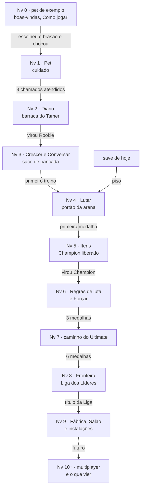

# Plano de progressão e de tutorial do jogo web (2026-11-06, PROPOSTO)

**Status:** planejamento, sem código. As decisões P-1 a P-11 (seção 8) estão DECIDIDAS pelo Matheus em 2026-11-06, todas com a opção recomendada.
Os números novos são SEM FONTE; entraram com as decisões de 2026-11-06 como estão no plano.

**De onde vem:** em 2026-11-06 o Matheus decidiu refazer os menus como **lugares da ilha**: Crescer no saco de pancada, Lutar no portão
da arena e Diário na barraca do Tamer (`docs/PROPOSTAS_V3_UX_TELA_PET.md`, seção "Lugares da ilha: menus (L2/L3)", branch
`v3-ux-lugares-menus`). Sobre travar os lugares, ele disse:
- "Pode ter trava de progresso, sim. A gente acrescenta algum tipo de nível, alguma coisa, para daí ir explicando mecânicas para o
  jogador."
- "o nível não seria o nível do Digimon, seria o nível do jogador [...] baseado no nível dele, ele vai ter acesso a certas mecânicas,
  como, por exemplo, multiplayer e coisas assim, que podem ser implementadas futuramente."

Este plano responde à pergunta 3 da prancha L2/L3 ("Um lugar se destrava com o progresso?"). A prancha usa dados de EXEMPLO para o lugar
trancado e para o aviso de destrave; com o plano decidido, ela troca o exemplo pelo nível e pelo texto da seção 4.

**Resumo em seis linhas:**
1. Quem sobe é **o Tamer (o jogador)**, e a decisão é do Matheus. O pet continua crescendo pelos estágios (In-Training → Mega), que já são
   o nível dele.
2. O nível sobe por **marcos**, não por XP de ação repetida: dez níveis, cada um com um gatilho que o motor ou o registro do Tamer já
   produzem.
3. A ordem segue a que o motor já impõe: cuidar → Diário → Crescer (no Rookie, quando o treino abre) → Lutar → Itens → Fronteira. Do
   nível 10 em diante ficam as mecânicas futuras, como o multiplayer.
4. Cada destrave mostra **um cartão** (ícone, até três palavras, uma frase curta, Ir e Depois). As dicas do Professor Agumon continuam
   como estão.
5. **Custo em determinismo na recomendação: nenhum.** O nível é uma leitura derivada do registro do Tamer e dos pets, e a trava fica só
   na vista. O motor, o save, o registro do Tamer e os gabaritos não mudam.
6. Os saves de hoje entram com tudo o que já usam aberto (piso no nível 4) e sem nenhum cartão repetido.

---

## 1. O que existe hoje

Todos os caminhos são relativos a `web/app/`. Os eventos do pet estão em `motor/tipos.ts` (`[tick, tipo, valor]`, de `motor/motor.ts`,
`aplicarEvento`); os do Tamer estão num registro à parte, em `src/tamer.ts` (`EventoTamer`). **O motor nunca lê o Tamer.** O que o pet
precisa saber do Tamer chega por um evento do próprio pet: o `"u"` (medalhas liberadas) e o `"f"` (título da Liga).

### 1.1 As mecânicas

| mecânica | motor | evento | tela | condição de hoje |
|---|---|---|---|---|
| cuidado: alimentar, limpar, brincar, carinho, tapa, tratar | `Motor.observar` (`motor/motor.ts`); `ACOES_DONO_JOGO_V11` (`motor/constantes.ts`) | `"d"`; a comida com lugar `"dc"`; a bola `"db"` | `src/telas/pet/TelaPet.tsx` (dock), `PorRacao.tsx`, `PorBola.tsx`, `ToquePet.tsx`; `src/acoes.ts` | pet nascido e vivo; tratar só com lesão |
| chamados do bebê | `Motor.chamados`, `chamadosAbertos` (`motor/motor.ts`) | atendidos pelo `"d"`; chaves de produto pelo `"p"` (`src/produto.ts`) | o balão do HUD | só no In-Training e com as chaves de produto do ovo |
| dormir | ação do pet (`AcaoPet "dormir"`, `motor/tipos.ts`); não é ação do dono | sai do `"t"` | `src/telas/pet/sono.ts` (desenho) | nenhuma |
| treino | `Motor.treinar` (`motor/motor.ts`), `motor/treino.ts` | `"tr"` | `src/telas/crescer/TelaTreinar.tsx` | **o In-Training não treina** (o motor recusa); intervalo `CTR.intervalo` |
| aprendizado (DigiBrain) | `motor/digibrain/`, `motor/digibrain.ts`; `Motor.trocarCerebro` | `"cb"`, `"pl"` (gravados no ovo, `src/produto.ts`, `src/cerebro.ts`) | `src/telas/crescer/TelaAprend.tsx`; painel DigiBrain; `src/telas/config/Laboratorio.tsx` | a troca de cérebro só nos pets v17 |
| regras de combate (gambits) | `Motor._gambit` (`motor/motor.ts`), `motor/gambits_pet.ts` | `"g"` (travar, destravar, vetar, liberar) | `src/telas/lutar/EditorRegras.tsx`, `ModalResultado.tsx` | aparecem depois das lutas |
| evolução | `Motor._evoluir`, `requisitosEvolucao`, `requisitosMega` (`motor/motor.ts`) | nenhum próprio: sai do `"t"`; a liberação por medalha chega pelo `"u"` | `src/telas/crescer/TelaEvolucao.tsx`, `src/componentes/CenaEvolucao.tsx`, `Revelacao.tsx` | tempo do estágio; **medalhas `CMD` = Champion 1, Ultimate 3, Mega 5** (`motor/constantes.ts`); sparring e vitórias; vínculo |
| itens (chips e cartas) | `motor/itens.ts`; `Motor.equipar` | `"i"`, `"k"`; no Tamer `"item"`, `"carta_usada"` | `src/telas/crescer/TelaItens.tsx` | vêm de medalha ou de revanche; vagas pelas medalhas (`CIT.vagas`); estágio mínimo. **Loja: não existe** |
| luta na Arena | `Motor.lutar` (`motor/motor.ts`), `motor/bots.ts`, `motor/arenas.ts`, `motor/combate_tr/` | `"l"` | `src/luta.ts`, `src/telas/lutar/TelaArena.tsx`, `TelaLuta.tsx`, `palcoTR/` | nenhuma de lugar |
| exploração (campanha) | `Motor.lugares`, `lugarVencido`, `desafioAberto` (`motor/motor.ts`) | `"l"` | `src/telas/lutar/TelaCampanha.tsx` (aba Exploração), `MapaExploracao.tsx` | cada lugar abre ao vencer alguém no anterior; o In-Training não luta na campanha (`TelaCampanha.tsx`) |
| medalhas | `motor/medalhas.ts` (6, uma por líder); `Motor.liberar` | pet `"u"`; Tamer `"medalha"` (`src/tamer.ts`, `conferirMedalhas`, `sincronizarPet`) | `src/telas/lutar/TelaMedalhas.tsx` | a primeira vitória contra o líder (na Cidadela, uma série de 3) |
| Fronteira (Liga dos Líderes) | `Motor.porqueNaoLiga` (`motor/motor.ts`); `MEDALHAS_LIGA = MEDALHAS.length` (`motor/liga.ts`) | `"l"` contra a Liga; no Tamer `"campeao"` | `src/telas/lutar/TelaFronteira.tsx`; o ponto trancado em `MapaExploracao.tsx` | **6 medalhas** e não ser In-Training |
| instalações, Fábrica e Salão | `motor/instalacoes.ts`, `motor/fabrica.ts`, `motor/salao.ts`; `Motor.abrirFronteira` | pet `"f"`, `"l"`; Tamer `"recorde"`, `"fabrica"`, `"fabrica_luta"`, `"fabrica_troca"`, `"salao"` | `src/telas/lutar/FabricaSalao.tsx`, `src/fronteira.ts` | **o título da Liga** |
| diário | `Motor.historico`, `_hist` (`motor/motor.ts`) | nenhum: derivado do replay | `src/telas/diario/TelaRegistro.tsx`, `TelaCatalogo.tsx`, `TelaGeracoes.tsx`, `TelaCenarios.tsx` | nenhuma |
| conversa | `src/fala.ts`, `src/falaLivre.ts`; textos em `motor/expressao.ts` | nenhum, exceto o comando validado, que vira `"d"` | `src/telas/conversar/TelaConversar.tsx` | o bebê só faz emotes (`COMO_FALA`); a LLM é opcional, precisa do servidor local e cobre Champion e Ultimate |
| ovo e nascimento | `src/jornada.ts` (`chocarDoBrasao`) → `new Motor`, `ligarProduto` | `"c"`, `"p"`, `"cb"`, `"pl"` | escolha do brasão, `src/jogo.ts` (`QUADROS_CHOCANDO`), `src/telas/pet/PalcoPet.tsx` | nenhuma |
| morte e herança | `motor/motor.ts` (lesões); `Motor.cruzar`; `src/heranca.ts` | morte sem evento (derivada); o filho começa com `"o"` | `src/componentes/Heranca.tsx` (em Meus pets) | pais adultos ou Mega, vivos |

**Nível ou XP do Tamer:** não existe. O Tamer tem medalhas, itens, título, recordes, Fábrica e Salão (`src/tamer.ts`, `VERSAO_TAMER =
7`). O que mais se parece com progressão são os marcos da jornada, `marcos()` em `src/jornada.ts` (Chocou o ovo, Virou Rookie … Venceu a
Liga dos Líderes).

**Save:** `{semente, log, versao}` (`src/save.ts`); ao abrir, `Motor.reproduzir` refaz o registro na versão gravada (`VERSAO_PET = 17`).
O Tamer tem o próprio registro (`CHAVE_TAMER`) e lê as versões anteriores.

### 1.2 As travas que já existem

| trava | onde | quem impõe |
|---|---|---|
| o In-Training não treina | `motor/motor.ts` (`treinar`); a frase em `TelaTreinar.tsx` | o motor |
| o In-Training não luta na campanha | `TelaCampanha.tsx` (`podeLutar`) | a vista |
| cada lugar da Exploração abre ao vencer o anterior | `Motor.desafioAberto`; `MapaExploracao.tsx` | o motor |
| a evolução pede medalhas (1, 3, 5) | `CMD` em `motor/constantes.ts`; `motor/motor.ts` (`_evoluir`) | o motor |
| as vagas de chip e o estágio mínimo do item | `CIT.vagas`, `CIT_V9` (`motor/constantes.ts`) | o motor |
| **a Fronteira abre com as 6 medalhas** | `MEDALHAS_LIGA` (`motor/liga.ts`), `porqueNaoLiga` | o motor (pelo `"u"`) |
| Fábrica, Salão e instalações abrem com o título | `porqueNaoInstalacao`, `porqueNaoSalao`; `FabricaSalao.tsx` | o motor (pelo `"f"`) e o Tamer |
| a herança pede pais adultos ou Mega | `src/heranca.ts` | o app |

**Crescer, Lutar e Diário não têm trava** como menu: abrem desde o ovo. O que há dentro deles já tranca por estágio (o treino) ou por
progresso (os lugares da Exploração, a Fronteira).

### 1.3 O que explica as mecânicas hoje

| peça | onde | como funciona |
|---|---|---|
| **boas-vindas** | `src/componentes/BoasVindas.tsx` | "DIGILAB · Um pet que aprende com você", três itens e Começar; só na primeira visita |
| **Como jogar** | `src/componentes/Jornada.tsx` (`ComoJogar`) | três páginas (Cuide, Ensine, Veja crescer), com Pular; termina na escolha do brasão. **A página "Ensine" ainda diz "Elogie ou repreenda"**, que os pets v11 não têm (`docs/DECISAO_PRODUTO_SEM_ELOGIO_BRONCA.md`). Ver a decisão P-9 |
| **a jornada** | `src/jornada.ts` | brasão → ovo → marcos → a conclusão na Liga dos Líderes (uma vez por pet, chave `-conclusao-liga`) |
| **as dicas do Professor Agumon** | `src/dicas.ts` (os textos), `src/App.tsx` (quando cada uma é pedida), `src/telas/lutar/ModalResultado.tsx` | uma frase por momento (ovo, chamado, Rookie, Champion, Ultimate, lesão, saúde, regra nova, derrota na campanha), uma por vez, some no Entendi e não volta; as vistas ficam em `-dicas` |
| **"Mostrar dicas"** | `src/telas/config/TelaConfig.tsx` | interruptor em Ajustes: "o Professor Agumon explica cada coisa nova, uma vez" (`-dicas-ligadas`). Não há botão para rever as dicas |
| **"Como funciona"** | dentro de cada tela (Arena, Treino, Evolução, Catálogo) | texto longo; na prancha L2/L3 vira um quadro fechado |
| **os avisos de mudança de versão** | `src/App.tsx` (`CHAVE_AVISO_V6`, `avisoTRPendente`) | uma tela que fica até o jogador ler |
| **a jornada de 2026-09** | `docs/JORNADA_JOGADOR.md` | o desenho aprovado das dicas: uma mecânica por estágio e os oito pontos em que o jogador novo trava |

As dicas do Professor Agumon já seguem a regra do contexto: cada uma aparece **na hora** em que a mecânica surge. Falta o que este plano
acrescenta: **o lugar em si** (o saco, o portão, a barraca) aparecer fechado e abrir com um motivo.

---

## 2. Referências

Fontes abertas e conferidas nesta sessão, com link. O que é de memória vem marcado **(de memória)** e não sustenta nenhuma decisão
sozinho.

| referência | o que mostra | fonte |
|---|---|---|
| **Animal Crossing: New Horizons, o NookPhone** | Os apps chegam aos poucos, cada um por um feito: o Critterpedia ao entregar um inseto ou um peixe ao Tom Nook; o DIY ao fazer a oficina; o Nook Shopping depois de 100 compras; o Island Designer depois do primeiro show do K.K. Slider. **O Best Friends List abre ao falar com o Orville sobre multiplayer:** o social também entra por destrave. Câmera, mapa e Nook Miles vêm de saída | [Nookipedia, NookPhone](https://nookipedia.com/wiki/NookPhone) |
| **Animal Crossing: New Horizons, o Island Life 101** | Os saves de antes da 2.0 compravam o app por 400 milhas; os novos o têm de saída. É um precedente de "o que muda para quem já tem save" | [Nookipedia, NookPhone](https://nookipedia.com/wiki/NookPhone) |
| **Pokémon GO, o nível do treinador** | O nível é do jogador, não do Pokémon: Ginásios e Reides no nível 5; Equipe Rocket no 8; a GO Battle League e as trocas com amigos no 10. **O multiplayer entra por nível do jogador**, como o Matheus pediu | [Leek Duck, Trainer Levels](https://leekduck.com/references/trainer-levels/); [Bulbapedia, Trainer level](https://bulbapedia.bulbagarden.net/wiki/Trainer_level) (bloqueou a leitura nesta sessão; vale pela busca) |
| **Digimon World: Next Order, o nível do Tamer** | O Tamer, não o Digimon, sobe de nível; cada nível dá 3 pontos de Tamer para uma árvore de habilidades em quatro ramos. É o nível do jogador dentro de um jogo Digimon | [player.one, guia de Tamer Skills](https://player.one/digimon-world-next-order-tamer-skills-guide-tips-how-spend-your-tamer-points-581804) |
| **Neko Atsume** | Um tutorial curto e obrigatório: põe a primeira tigela e mostra a compra; a loja só abre depois dele | [TechRadar, how to play Neko Atsume](https://www.techradar.com/uk/how-to/gaming/neko-atsume-tips-and-tricks-1318716) |
| **Stardew Valley, o Centro Comunitário** | Os pacotes (bundles) fazem o jogador passar por cultivo, pesca, mina e estações; cada pacote completo conserta uma parte da cidade. O guia de terceiros chama o percurso de tutorial | [The Review Geek, guia do ano 1](https://www.thereviewgeek.com/stardewvalley-communitycenteryear1/) (guia de fã; não é o desenvolvedor) |
| **Super Mario Bros., a fase 1-1** | O Goomba logo no começo e o formato de cogumelo ensinam sem texto | [Iwata Asks, New Super Mario Bros. Wii](https://iwataasks.nintendo.com/interviews/wii/nsmb/0/3) (primária); [MCV/Develop sobre o vídeo do Miyamoto](https://www.mcvuk.com/development-news/video-miyamoto-shares-his-level-design-secrets/) |
| **Celia Hodent, GDC 2016** | "The Gamer's Brain, Part 2: UX of Onboarding and Player Engagement": os primeiros minutos decidem; erros comuns de onboarding; aprender pelo que o cérebro faz | [GDC Vault](https://gdcvault.com/play/1022951/The-Gamer-s-Brain-Part) (a página descreve a palestra; o vídeo não foi visto) |
| **Apple, WWDC 2017, sessão 811** | Ensinar aos poucos e no contexto (revelação progressiva) | [Apple Developer, WWDC17 811](https://developer.apple.com/videos/play/wwdc2017/811/) (pela busca; o vídeo não foi visto) |
| **Tamagotchi (o brinquedo)** | Nenhum tutorial: o manual de papel e o próprio chamado (o bipe) ensinam **(de memória)** | — |
| **Digimon World (PS1)** | O Jijimon e os moradores explicam a cidade aos poucos, e cada morador recrutado abre um serviço na cidade **(de memória)** | — |
| **Pokémon (os jogos principais)** | As insígnias abrem rotas e golpes fora da luta (as HMs) **(de memória)** | — |

**O que as fontes sustentam para este plano:**
- o nível do jogador separado do nível do monstro tem precedente direto em Pokémon GO e em Digimon World: Next Order;
- abrir as partes do jogo uma a uma por um feito, e não por tempo, é o NookPhone;
- o multiplayer entrar por nível ou por um destrave tem precedente em Pokémon GO (nível 10) e no Animal Crossing (Orville);
- ensinar no contexto, com pouco texto, é o que o Professor Agumon já faz (`docs/JORNADA_JOGADOR.md`), e vai na linha da GDC e da WWDC.

**O que elas não sustentam:** nenhum número deste plano (quantos níveis, quais limites) vem de fonte. Todos são PROPOSTOS, SEM FONTE.

---

## 3. A proposta

### 3.1 O que sobe de nível: o Tamer

**DECIDIDO pelo Matheus em 2026-11-06:** o nível é do jogador (o Tamer), não do Digimon, e dá acesso a mecânicas, inclusive futuras,
como o multiplayer.

Por que isso encaixa no que já existe:
- **o Tamer já é a conta que dura** (`src/tamer.ts`): as medalhas, os itens, o título e os recordes ficam nele, e passam de um pet para o
  outro. Um destrave preso ao pet trancaria tudo de novo a cada ovo;
- **o pet já tem o nível dele:** o estágio (In-Training, Rookie, Champion, Ultimate, Mega), e a evolução é o destrave do pet. Dois níveis
  no pet confundiriam;
- **o multiplayer é coisa de jogador** (`docs/PRODUTO_VISAO.md`, seção 4, as fases posteriores): troca, luta entre amigos, ranking.

O nome na tela (PROPOSTO): **"Tamer Nv 4"**, no leque do retrato (onde ficam Meus pets, DigiBrain e Ajustes na prancha L2/L3). Ver a
decisão P-8.

### 3.2 Como o nível sobe: por marcos, não por XP

**Recomendação:** o nível é **a quantidade de marcos** que o Tamer já fez, em qualquer pet; cada marco é um feito que ensina uma coisa.
Não há XP por ação.

Por que não XP por ação (como no Next Order):
- XP por ação premia repetir o botão. Nos pets v11 o carinho e o tapa são gestos, e o treino nunca pode vir de clicar carinho
  (`docs/DECISAO_PRODUTO_SEM_ELOGIO_BRONCA.md`; a regra de 2026-11-04 da vida do pet). Um XP por carinho criaria esse incentivo;
- XP pede uma curva de números (quanto vale cada ação, quanto custa cada nível) que precisaria de calibração. Os marcos não têm número
  a calibrar: só a ordem;
- cada marco já é um momento em que a dica do Professor Agumon aparece, e o cartão de destrave cai no mesmo lugar.

### 3.3 A ordem de destravar, o lugar e o gatilho

| nível | marco (gatilho) | de onde vem o gatilho | o que destrava | lugar da ilha |
|---|---|---|---|---|
| **0** | pet de exemplo, antes do brasão | `jogo.origem === "exemplo"` (`src/App.tsx`) | nada: boas-vindas e Como jogar | — |
| **1** | **chocou o ovo** | `chocarDoBrasao` (`src/jornada.ts`); o primeiro marco de `marcos()` | **Pet**: o cuidado (dock, comida, bola, toque) | o pet, no meio da ilha |
| **2** | **atendeu 3 chamados** do In-Training | `m.chamados.atendidos` (`motor/motor.ts`), derivado dos `"d"`. Sem as chaves de produto dos chamados, vale o pet ter 1 h de vida (PROPOSTO) | **Diário**: Registro, Catálogo, Cenários | **a barraca do Tamer** |
| **3** | **virou Rookie** | `m.evolucoes` com `crianca` (derivado do `"t"`); o marco "Virou Rookie" | **Crescer**: Treinar, Aprendizado, Evolução; e **Conversar** (o Rookie já fala por ícones e sons, `COMO_FALA`) | **o saco de pancada** |
| **4** | **o primeiro treino** | o primeiro `"tr"` no registro de um pet | **Lutar**: Arena, Exploração, Medalhas | **o portão da arena** |
| **5** | **a primeira medalha** | o evento `"medalha"` no Tamer (`src/tamer.ts`) | **Itens** (em Crescer): o primeiro chip vem dessa medalha; o Champion fica liberado (`CMD`) | o saco (aba Itens) |
| **6** | **virou Champion** | `m.evolucoes` com `adolescente` | **as regras de combate** (Travar, Vetar) e o **Forçar** do treino. Hoje essas peças aparecem desde o Rookie; ver a decisão P-4 | o portão (Arena) e o saco (Treinar) |
| **7** | **3 medalhas** | os eventos `"medalha"` no Tamer | nada novo de lugar: a dica das 10 lutas de treino e o caminho do Ultimate | — |
| **8** | **6 medalhas** | os eventos `"medalha"` no Tamer; é a trava de hoje (`MEDALHAS_LIGA`) | **a Fronteira** (a Liga dos Líderes) | o portão (aba Fronteira); mais tarde um lugar próprio (pergunta 4 da L2/L3) |
| **9** | **o título da Liga** | o evento `"campeao"` no Tamer; no pet, o `"f"` | **Fábrica, Salão e instalações** (a regra de hoje) | a Fronteira |
| **10+** | **(futuro)** por exemplo, o primeiro Mega ou o segundo pet guardado | a definir com a mecânica | **o multiplayer** (trocar, lutar com amigos), a genética ampla, o que vier | um lugar novo na ilha (PROPOSTO: o cais) |

**Gerações** (no Diário) segue o dado, como hoje: aparece quando houver um segundo pet (guardado ou herdeiro). Não é nível.

**Por que essa ordem:**
- é a que o motor já impõe: o treino só abre no Rookie; a primeira medalha é pedida para o Champion (`CMD`); a Fronteira pede as 6
  medalhas. **A vista nunca abre antes do motor**: só anuncia, no momento certo, o que o motor já liberou;
- o Diário vem cedo porque explica o cuidado: o Registro mostra o que ele fez, e a revelação do Rookie diz "você atendeu X de Y"
  (`docs/JORNADA_JOGADOR.md`, ponto 1 de onde o jogador trava);
- Lutar vem depois do primeiro treino porque o primeiro rival da Campina pede treino (`docs/JORNADA_JOGADOR.md`, seção 2): quem luta sem
  treinar perde e não sabe por quê;
- um lugar por nível: o jogador aprende uma coisa por vez (a regra do Professor Agumon).

**Quanto tempo, na velocidade padrão (estimativa, não medida):** o In-Training dura 3 h de pet e o Rookie 12 h (`DUR_EVO` em
`motor/constantes.ts`); a 10 min de pet por segundo, isso dá uns 18 s e uns 72 s de tela ligada. Os níveis 1 a 4 caem, então, na
primeira sessão de quem treina logo, e o nível 5 depende de vencer o primeiro líder. Os números de tempo de tela são conta, SEM FONTE
de medida: a medida certa sai de uma vida gravada.

### 3.4 Lugar trancado e lugar que acabou de abrir

- **Trancado:** o lugar aparece na ilha desde o nível 1 (o portão e a barraca são objetos da ilha), apagado, com um cadeado e o número do
  nível: `🔒 Nv 3`. A dica (foco ou hover, e o `aria-label`) diz o marco: "Abre quando ele virar Rookie". No trilho, o ícone do menu fica
  igual, apagado. É o padrão da Fronteira de hoje (apagada, tracejada, com o motivo), e o do NookPhone (o app ausente, a construção à
  vista).
- **Acabou de abrir:** o cadeado se abre na ilha, o lugar brilha uma vez (o "amarelo = momento de destaque", `docs/UI_GUIDELINES.md`,
  seção 3) e aparece o cartão de destrave (seção 4). Com "reduzir movimento", sem brilho: só o cartão.
- **Atalho e rota:** a tecla (`C`, `L`, `D`) e o endereço (`#/crescer/...`) de um lugar trancado abrem o cartão do motivo, não o painel.

---

## 4. As janelas de tutorial

### 4.1 Três tipos, uma fila só

| tipo | quando aparece | forma | quantas vezes |
|---|---|---|---|
| **A. o cartão de destrave** | no marco que sobe o nível, fora da luta e fora de outra tela cheia | ícone do lugar (lucide), título de até três palavras, uma frase de até oito palavras, **Ir** (a câmera vai ao lugar) e **Depois** | uma vez por nível |
| **B. a primeira entrada** | na primeira vez que o jogador entra num lugar aberto | o destaque da ação principal pisca uma vez (o treino, o primeiro rival, a primeira linha do Registro); sem texto novo | uma vez por lugar |
| **C. as dicas do Professor Agumon** | como hoje (`src/dicas.ts`) | uma frase | uma vez por dica |

As três usam a fila que já existe em `src/dicas.ts`: uma por vez, e a de destrave antes da dica do mesmo momento.

### 4.2 Os textos (PROPOSTOS)

| nível | ícone (lucide) | título | frase |
|---|---|---|---|
| 1 | `heart` | Cuide dele | Ele chama quando precisa. Atenda logo. |
| 2 | `tent` | Diário | Veja o que ele fez e por quê. |
| 3 | `dumbbell` | Crescer | Treine no saco de pancada. |
| 3 | `message-circle` | Conversar | Agora ele responde. |
| 4 | `swords` | Lutar | Vença rivais. Medalhas fazem evoluir. |
| 5 | `package` | Itens | A medalha trouxe um chip. |
| 6 | `shield` | Regras de luta | Trave o que ele faz bem. |
| 7 | `medal` | 3 medalhas | O Ultimate está a caminho. |
| 8 | `flag` | Fronteira | Seis medalhas. A Liga abriu. |
| 9 | `trophy` | Campeão | A Fábrica e o Salão abriram. |
| 10+ | `users` | Amigos | Lute e troque com outros Tamers. (futuro) |

Os nomes dos ícones são do lucide (o front usa lucide, `docs/PRODUTO_VISAO.md`); qual ícone exato vai em cada lugar fica com a prancha.

### 4.3 Repetir e pular

- **"Mostrar dicas"** (Ajustes, já existe) desliga os três tipos. Desligado, o lugar abre do mesmo jeito, só sem o cartão.
- **"Rever o tutorial"** (novo, em Ajustes): limpa os cartões e as dicas vistas; cada um volta no próximo momento dele.
- **Depois** fecha o cartão sem viagem; **Esc** também. O cartão não volta, mas o lugar já está aberto e brilha uma vez ao se passar perto.
- **"Já conheço o jogo"** (novo, nas boas-vindas, PROPOSTO): pula o Como jogar e os cartões. Ver a decisão P-7.
- **"Como funciona"** (o quadro fechado de cada painel, prancha L2/L3) continua sendo o lugar do texto longo, sempre à mão.

---

## 5. O que muda para quem já tem save

| quem | nível de saída | cartões |
|---|---|---|
| sem save (primeira visita) | 0, e 1 ao chocar | todos, um por marco |
| com pet ativo ou guardado, ou com Tamer não vazio | **o nível dos marcos que já fez, com piso no nível 4** (Pet, Diário, Crescer e Lutar abertos) | nenhum dos níveis já alcançados: ficam marcados como vistos em silêncio |
| com medalhas | o nível pelas medalhas (5, 7, 8) e pelo título (9) | idem |

**A regra:** nunca trancar o que o jogador já usava. O piso 4 cobre quem tem um In-Training hoje e já usou Crescer e Lutar (os menus
abrem desde o ovo). As dicas do Professor Agumon já vistas continuam na chave delas (`-dicas`). É o caso do Island Life 101: o save velho
não perde o que tinha.

**O nível nunca desce.** Se um pet guardado for apagado, o nível não cai: vale o maior já alcançado (seção 6).

---

## 6. O custo em determinismo

Três jeitos de pôr o nível, do mais barato ao mais caro.

| opção | onde fica o nível | onde fica a trava | o que muda | paridade |
|---|---|---|---|---|
| **V. só na vista (recomendada)** | uma função pura que lê o registro do Tamer e os pets (ativo e guardados) e devolve o nível; o maior já visto fica numa chave de tela (`-nivel`), como as dicas | nas telas, no trilho, nas teclas, nas rotas (`src/rotas.ts`) e no minimapa | nada no motor, no save do pet, no registro do Tamer nem nos gabaritos | **nenhuma**: o Python não tem Tamer, e o motor não muda. Testes: Vitest da função (saves de exemplo de cada nível, o piso dos saves antigos) e e2e do lugar trancado |
| **T. no registro do Tamer** | um evento novo `["nivel", {n, quando}]` no Tamer, `VERSAO_TAMER` 8, com a leitura dos registros 7 | nas telas e nas ações do Tamer (Fábrica, Salão) | o registro do Tamer ganha um evento; o pet não muda | o Python não tem Tamer, então não há paridade com ele; precisa de teste do Tamer e da leitura da versão 7 |
| **M. no motor do pet** | o pet sabe o nível por um evento próprio (como o `"u"` das medalhas) | o motor recusa a ação (por exemplo, a Arena antes do primeiro treino) | regra de jogo nova: `VERSAO_PET` nova, **chave desligada**, gabarito das vidas de hoje gravado antes, paridade com o Python (que teria de ganhar a regra) | completa |

**Recomendação: V agora; T quando o multiplayer chegar.**
- Na V, a trava só anuncia o que o motor já faz ou deixa de fazer. O jogador que forçar uma rota pela barra de endereço consegue abrir o
  painel, e o motor continua dono das regras de verdade (o In-Training não treina, a Fronteira pede 6 medalhas). Num jogo local de um
  jogador, isso não quebra nada.
- Com o multiplayer, o nível passa a valer **entre jogadores** (quem pode trocar, quem pode lutar online). Aí ele precisa estar num
  registro que o outro lado consiga conferir: a opção T, junto com a tarefa do multiplayer.
- A M não é recomendada: põe no pet uma regra que é do jogador, e obriga a paridade com o Python por uma regra que a pesquisa não usa.

---

## 7. Fluxograma

Cada seta é um marco. Ao chegar num nível: o cartão de destrave, depois a dica do Professor Agumon do mesmo momento, se houver.

---

## 8. Decisões para o Matheus

Cada uma com a recomendação e o custo de errar. Em 2026-11-06 o Matheus aceitou todas as recomendações (P-2 a P-11); os números continuam como estão no plano.

- **P-1. O nível é do Tamer.** DECIDIDO pelo Matheus em 2026-11-06. Fica registrado aqui para a prancha e para as tarefas de código.
- **P-2. O nível sobe por marcos (dez, na tabela da seção 3.3), não por XP de ação.** **DECIDIDO em 2026-11-06 pelo Matheus ("Aceitar todas"), com a opção recomendada.**
  Recomendo os marcos. Custo de errar: com XP, o jogador aprende a repetir um botão para subir, e a curva pede calibração; com marcos, o
  nível sobe pouco depois do título da Liga, e as mecânicas futuras precisam de marcos novos (o que é barato: um marco por mecânica).
- **P-3. A ordem: Pet → Diário → Crescer e Conversar → Lutar → Itens → Regras de luta → Fronteira → Fábrica e Salão.** **DECIDIDO em 2026-11-06 pelo Matheus ("Aceitar todas"), com a opção recomendada.**
  Recomendo essa ordem, que segue o que o motor já impõe. Custo de errar: se Lutar abrir antes do treino, o primeiro rival vence o pet sem
  treino e o jogador não sabe por quê; se o Diário vier tarde, o "atendeu X de Y" da revelação do Rookie não tem onde ser lido.
- **P-4. As regras de combate (Travar, Vetar) e o Forçar passam a se apresentar no Champion (nível 6)?** **DECIDIDO em 2026-11-06 pelo Matheus ("Aceitar todas"), com a opção recomendada. Fica: só esconder o editor e o cartão até o nível 6, sem tocar no motor.** Hoje elas já aparecem no
  Rookie: o pet tira regras das lutas desde o começo. Recomendo **só esconder o editor e o cartão até o nível 6, sem tocar no motor**: o
  pet continua aprendendo as regras desde o Rookie, e o jogador vê o editor quando chega lá. Custo de errar: esconder demais faz o
  jogador não entender uma derrota do Rookie; mostrar cedo põe o conceito mais abstrato do jogo (`docs/JORNADA_JOGADOR.md`, ponto 7)
  junto com o primeiro treino.
- **P-5. Onde o nível fica: só na vista (opção V), e no registro do Tamer (opção T) quando o multiplayer chegar.** **DECIDIDO em 2026-11-06 pelo Matheus ("Aceitar todas"), com a opção recomendada.**
  Recomendo a V. Custo de errar: na V, o nível é refeito a cada abertura e um jogador consegue abrir um painel pelo endereço (sem efeito
  de regra); se o multiplayer chegar sem a T, o nível não é conferível entre jogadores. Pôr a M agora custa uma versão de pet e uma
  paridade com o Python por uma regra que a pesquisa não usa.
- **P-6. Quem tem save entra com o nível dos marcos que já fez e piso no nível 4, sem cartões repetidos.** **DECIDIDO em 2026-11-06 pelo Matheus ("Aceitar todas"), com a opção recomendada.**
  Recomendo o piso 4. Custo de errar: sem piso, quem tem um In-Training hoje perde Crescer e Lutar, que já usava; com piso mais alto, quem
  tem um pet novo perde os cartões de Itens e da Fronteira (só o texto; o lugar abre do mesmo jeito).
- **P-7. "Já conheço o jogo" nas boas-vindas: pula o Como jogar e os cartões, mas o nível sobe pelos marcos como para todo mundo?** **DECIDIDO em 2026-11-06 pelo Matheus ("Aceitar todas"), com a opção recomendada. Fica: abrir os níveis 1 a 4 e pular os cartões.** Ou
  abre de saída os níveis 1 a 4? Recomendo **abrir os níveis 1 a 4 e pular os cartões**; o resto (Itens, Fronteira) segue os marcos,
  porque depende do motor. Custo de errar: sem a opção, quem recomeça um save assiste ao tutorial de novo; com ela, alguém novo que
  clique por engano perde os cartões (volta por "Rever o tutorial").
- **P-8. O nível aparece na tela como "Tamer Nv 4", no leque do retrato.** **DECIDIDO em 2026-11-06 pelo Matheus ("Aceitar todas"), com a opção recomendada. Fica: os dois (o número no leque e o cadeado com o nível).** Ou só nos lugares trancados (`🔒 Nv 3`)? Recomendo **os dois**:
  o número pequeno no leque e o cadeado com o nível no lugar. Custo de errar: sem o número à vista, o "Nv 3" do cadeado fica sem
  referência; com o número grande demais, vira meta de subir de nível em vez de cuidar do pet.
- **P-9. O Como jogar encolhe para uma página (Cuide), e o resto vem com os níveis.** **DECIDIDO em 2026-11-06 pelo Matheus ("Aceitar todas"), com a opção recomendada.** A página "Ensine" ainda diz "Elogie ou repreenda",
  que os pets v11 não têm. Recomendo **uma página e corrigir o texto**: o Ensine e o Veja crescer viram os cartões dos níveis 3 e 6.
  Custo de errar: manter as três páginas repete o que os cartões dizem e ensina um botão que não existe.
- **P-10. O multiplayer e as mecânicas futuras entram do nível 10 em diante, cada uma com o seu marco.** **DECIDIDO em 2026-11-06 pelo Matheus ("Aceitar todas"), com a opção recomendada.** O marco exato (o primeiro Mega,
  o segundo pet, o título da Liga) fica para a tarefa da mecânica. Recomendo **não fixar agora** e manter o nível 10 como "depois do
  título da Liga". Custo de errar: fixar cedo um marco para algo que ainda não existe; deixar muito tarde (o título da Liga é o fim da
  jornada) pode afastar o jogador do social, que em Pokémon GO entra no nível 10 de 50.
- **P-11. O portão e a barraca ficam visíveis na ilha desde o nível 1, trancados.** **DECIDIDO em 2026-11-06 pelo Matheus ("Aceitar todas"), com a opção recomendada. Fica: visíveis e trancados.** Ou só aparecem quando abrem? Recomendo **visíveis e
  trancados**: o jogador vê para onde vai. Custo de errar: escondidos, a ilha muda de repente e o minimapa precisa saber o nível;
  visíveis, quem é novo pode clicar e ver o cadeado (o que é o motivo do cadeado existir).

## 9. O que vem depois

1. ~~O Matheus decide as P-2 a P-11.~~ Feito em 2026-11-06: todas aceitas como recomendadas.
2. A prancha L2/L3 (`v3-ux-lugares-menus`) troca o exemplo do lugar trancado e do destrave pelos níveis e textos decididos.
3. Uma tarefa de código (só na vista, se a P-5 for a V): a função do nível, a chave `-nivel`, o cartão de destrave na fila das dicas, o
   lugar trancado no trilho, nas teclas, nas rotas e no minimapa, o "Rever o tutorial", o piso dos saves antigos e o Como jogar de uma
   página. Testes: Vitest da função e e2e do lugar trancado e do destrave.
4. A tarefa do multiplayer, quando houver, leva o nível para o registro do Tamer (a opção T).
