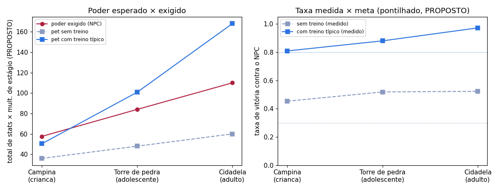

# Progressão do Digilab (resumo)

Gerado por `tools/gerar_planilha_progressao.py` (commit das fontes `79f176c`). A planilha completa, com a fonte de cada número, é `artifacts_progressao/planilha_progressao.xlsx`. Metas marcadas PROPOSTO dependem de aprovação.

## A curva

| lugar | estágio | poder do pet sem / com treino | poder exigido | taxa sem treino | taxa com treino típico | meta (PROPOSTO) |
|---|---|---|---|---|---|---|
| Campina | crianca | 36 / 50 | 58 | 0,45 | 0,81 (+8 pontos) | ≤ 0,3 / ≥ 0,8 |
| Torre de pedra | adolescente | 48 / 101 | 84 | 0,52 | 0,88 (+22 pontos) | ≤ 0,3 / ≥ 0,8 |
| Cidadela | adulto | 60 / 168 | 110 | 0,52 | 0,97 (+36 pontos) | ≤ 0,3 / ≥ 0,8 |

Poder = total de stats × multiplicador de estágio (modelo PROPOSTO da planilha). Fontes: `digilab/config.py` (ConfigCampanha, ConfigCatalogo, ConfigTreino), `experiments/calibrar_progressao.py > ALCANCE` e `experiments/configs/progressao/validacao_resultado.json` (taxas, sementes de validação).

Leitura: pelo modelo de poder o pet com treino típico fica abaixo do NPC em Campina e mesmo assim vence 0,81; fica acima em Torre de pedra, Cidadela. O pet sem treino fica abaixo do NPC nos três lugares e vence 0,45–0,52: o estilo e a imprevisibilidade (ε 0,4–0,5) dos NPCs decidem mais que o tamanho. O momento em que o jogador **precisa** treinar não existe hoje.

## Os 5 alertas mais graves

1. **Campanha não exige treino: o pet sem treino do estágio sugerido vence os NPCs.** 0,39–0,66 (média por NPC); com treino típico 0,81–0,97. Fonte: `experiments/configs/progressao/validacao_resultado.json > todos_vencem.*.basico_media / treinado_media`.
2. **A campanha não separa mais os donos.** exigente − atencioso: brutamontes -0,004, carcereiro -0,007, porteiro -0,010, sentinela -0,013, soberano -0,014. Fonte: `artifacts_treino/resumo.json > exigente_x_atencioso.campanha_exigente_menos_atencioso`.
3. **E4: o adulto esmaga o adolescente da mesma linha.** vigia 1,00, sentinela 1,00, muralha 1,00, tita 0,99, furioso 0,94, duelista 0,78, emboscador 0,74, espelho 0,62 (meta [0,60, 0,85]). Fonte: `artifacts_combate_v21c/validacao/gates.json > E4_estagio_importa_sem_esmagar.valores.taxa_por_forma`.
4. **O pet não parece crescer: o número de catálogo quase não muda do bebê ao adulto.** vigor da Brasa 9 no bebê → no máximo 12 no adulto (1,33×; soma sempre 60); a vida de combate vai de 39 a 105 (2,69×). Fonte: `digilab/combate_v2/v21/catalogo.py > stats; ConfigCatalogo.mult_estagio; ConfigCombateV21C`.
5. **Durações dos estágios cortadas pela metade (em relação aos v-pets) limitam o treino por estágio.** Rookie 12 h (v-pet 24 h), Champion 18 h (v-pet 36 h); sessões medidas no Rookie inteiro (atencioso): 3,7, com alvo de 10 por dia e teto de 10 pontos no estágio. Fonte: `docs/cronograma_interacoes.json > estagios.*.nota; artifacts_treino/vidas (contagem de treinar_*)`.

## Propostas de ajuste, em ordem de prioridade (só propostas)

1. NPCs na escala proposta (aba escala) com distância alvo, e ε menor (0,2): o 'todo pet treinado vence' depende de ε 0,4–0,5, que também deixa o pet sem treino vencer. Recalibrar só depois da escala (Parte C).
2. Consequência do alerta 1 (todo pet treinado vence 0,96–1,00). A pergunta 'forçar custa?' precisa de um portão que o pet sem treino perca; medir de novo depois da recalibração.
3. Com uma escala de franquia a luta entre estágios fica desigual de propósito; redefinir o E4 (proposta na Parte B).
4. Separar perfil (pontos, soma zero) de escala (magnitude por estágio e treino); Parte B, aba escala.
5. Com o Rookie de 12 h (parte dele dormindo) cabem poucas sessões; os pontos no fim do Rookie são SEM FONTE (ver abaixo). Se ficarem longe do teto: o estágio cresce, o teto desce, ou o ganho por sessão sobe no Rookie (princípio 7).

Divergências entre `config.py`, `docs/*.json` e a web e as células SEM FONTE estão na aba `alertas`.
