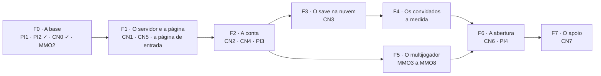

# Roadmap da conta, da nuvem e do multijogador (2026-11-12)

**Status:** as **RC-1 a RC-4 estão DECIDIDAS** pelo Matheus em 2026-11-12, pela recomendação e sem mudança ("Sim, segue e mergeia"). Junta numa ordem só as etapas dos planos já decididos; não decide nada novo de produto. A ordem, os prazos e os custos
são **PROPOSTOS, SEM FONTE**; os prazos são em semanas de trabalho do projeto, não em datas. As decisões RC-1 a RC-4 (seção 7) são só
sobre a ordem. **As RC-5 a RC-8** (a integração, seção 8, e o plano de desenvolvimento, seção 9, de 2026-11-12) são PROPOSTAS.

**Origem:** o Matheus, em 2026-11-12: "Como começar essa estrutura toda, monte um roadmap para projeção dessa arquitetura".

**Os planos que este roadmap ordena:**
- `docs/PLANO_V3_CONTA.md`: a conta, o save na nuvem, a proteção do site, a infraestrutura e a monetização (CN-1 a CN-18, DECIDIDAS;
  etapas CN0 a CN7);
- `docs/PLANO_V3_CONTA_HOSPEDAGEM.md`: os provedores (CH-1 a CH-7, DECIDIDAS: Lightsail em São Paulo, Cloudflare Pages e R2, SQLite com
  o Litestream);
- `docs/PLANO_V3_CONTA_PROTECAO.md`: a propriedade intelectual (PI-1 a PI-9, DECIDIDAS; a PI0 na `main`, #897);
- `docs/PLANO_V3_MMO.md`: o ranking, a luta ranqueada e o desafio do dia (MMO-1 a MMO-19, APROVADAS; a MMO0 e a MMO1 na `main`);
- `docs/PLANO_UX_CONTA.md`: as pranchas da conta (UX-CN-1 a 6, APROVADAS, #882) e a prancha da página de entrada.

## 1. Onde estamos (2026-11-12)

| peça | situação |
|---|---|
| o jogo | pronto para um jogador, no navegador; o save no `localStorage` |
| as decisões | todas tomadas: CN-1 a 18, CH-1 a 7, PI-1 a 9, MMO-1 a 19, UX-CN-1 a 6 |
| o que já tem código | a MMO0 (a paridade Chrome × Node), a MMO1 (a conta dos pontos), a PI0 (o CI enxuto, #897), a CN0 (a medida do save, #903), a PI2 (a licença e os canários, #904) |
| as pranchas | **aprovadas:** as sete telas da conta (`docs/PLANO_UX_CONTA.md`, UX-CN-1 a 6: a linha Conta nos Ajustes, Entrar, os estados de Entrar, o primeiro acesso, trocar o apelido, o perfil, apagar) e **a página de entrada A**, a clara, de laboratório (`docs/pranchas/ux-pagina-inicial/`, escolhida em 2026-11-12). **Faltam:** as do save na nuvem (a tela 3, levar o pet, e a tela 5, os estados) |
| o servidor | só o `servidor/servidor_local.py`, na máquina do Matheus |
| o repositório | **público**; a troca para privado (PI1) espera o Matheus |

## 2. As fases

Cada fase termina num **portão**: o critério que precisa valer antes da próxima. Um PR por etapa, como sempre; o merge é do Matheus.



### F0 · A base (sem servidor, sem custo novo) · 1 a 2 semanas

| etapa | o que entrega | quem | depende de |
|---|---|---|---|
| **PI1** | o repositório privado e o teto de gasto do Actions (PI-2: US$ 20 por mês) | **o Matheus**, nas configurações do GitHub | a PI0 (na `main`) |
| **PI2** ✓ | o `LICENSE` "todos os direitos reservados", o aviso de autoria no bundle, os canários, o teste que falha com um `.map` no `dist/` | **na `main` (#904)** | — |
| **CN0** ✓ | a medida dos saves: um dia de jogo manda de 0,6 a 23 kB cru (de 0,2 a 1,6 kB em brotli); as 37 chaves e mais três com destino; o pet não envelhece com o jogo fechado (`docs/RESULTADO_V3_CONTA_CN0.md`) | **na `main` (#903)** | — |
| **MMO2** | o marco do nível 10 e o nível no registro do Tamer (a versão nova do Tamer) | a frente MMO | os Bits na `main` (#765) |
| as pranchas que faltam | a tela 3 (levar o pet para a conta) e a tela 5 (os estados: sincronizado, offline, "aberto no outro aparelho", a escolha da história) | a frente UX | nada |

**Portão F0:** o repositório privado com o CI andando; a CN0 diz o tamanho do log e fecha a lista do que sincroniza; as pranchas das telas 3
e 5 aprovadas. **As quatro etapas correm em paralelo**, cada uma na sua sessão.

### F1 · O servidor e a página de entrada · 2 a 3 semanas

| etapa | o que entrega | quem | depende de |
|---|---|---|---|
| **a página de entrada (a tela 6, adiantada da CN6)** | a página A em código, estática, no Cloudflare Pages, na raiz do domínio; "Começar agora" leva ao jogo, sem conta; o "Já tenho conta: entrar" fica escondido até a F2 (RC-5) | uma sessão (a frente UX, que fez a prancha) | a prancha A aprovada; o domínio (a CN5) para publicar |
| **CN1** | o servidor Node 24 + Hono (em `servidor_web/`, PROPOSTO), com as rotas do jogo e a `/api/fala` portada para o SDK TS, com as regras do `servidor/CLAUDE.md` (o catálogo fechado, o teto de gasto); roda local e na VPS | uma sessão | F0 |
| **CN5, a parte da conta da AWS** | a conta da AWS, o Lightsail de 2 GB em São Paulo, o domínio, a Cloudflare na frente (o DNS, o Pages para o build, o R2 para os assets), o Sentry e o Better Stack; os preços da seção 8 do plano da hospedagem conferidos no dia | **o Matheus** contrata; uma sessão monta o deploy pelo CI | a CN1 rodando local |

**Portão F1:** o jogo abre pelo domínio, servido pela Cloudflare; a fala responde pela VPS; o deploy sai da `main` pelo CI; o Better Stack
avisa se a VPS cair. **Custo a partir daqui: uns US$ 14 a 15 por mês, mais a fala** (seção 6 do plano da hospedagem).

### F2 · A conta · 2 a 3 semanas

| etapa | o que entrega | quem | depende de |
|---|---|---|---|
| **CN2** | o OAuth com Google e GitHub, a sessão no cookie, o SQLite com o Litestream para o R2, o apelido, o aceite, a idade, a lista de convidados, apagar e baixar os dados; as telas pelas pranchas aprovadas (#882) | uma sessão | F1; **o Matheus** cria os apps OAuth no Google e no GitHub |
| **CN4** | a cota da fala por conta (CN-8, CN-16), o Turnstile, os assets por URL assinada | uma sessão | a CN2 (a cota precisa da conta) |
| **PI3** | o `robots.txt`, o aviso de mineração reservada, as políticas de robôs de IA da Cloudflare | uma sessão | a CN5 (a Cloudflare na frente) |

**Portão F2:** um convidado entra com Google ou GitHub, escolhe o apelido, aceita e apaga a conta; a fala só responde com sessão e para na
cota; um robô sem sessão não baixa o atlas.

### F3 · O save na nuvem · 3 a 4 semanas

| etapa | o que entrega | quem | depende de |
|---|---|---|---|
| **CN3** | a sincronização por eventos com o hash encadeado, a vez por pet, a divergência com a outra história em Gerações, as cópias diárias de 30 dias, o replay na sincronização; atrás de uma chave desligada no app (desligada, o save de hoje não muda) | uma sessão (a etapa mais longa) | F2, a CN0, as pranchas das telas 3 e 5 |

**Portão F3:** o mesmo pet abre no PC e no celular; jogar offline num aparelho e voltar não perde nada; a divergência mostra a escolha;
restaurar uma cópia funciona. O e2e cobre os quatro casos.

### F4 · Os convidados · 2 a 4 semanas de uso

Não é uma etapa de código: é o tempo de os convidados jogarem com a conta e o save na nuvem, no ambiente único (CH-7). **O que se mede:**
os minutos do CI depois da PI0, o uso da VPS (a CPU contra a linha de 20 % do Lightsail), o tamanho dos logs no R2, o gasto da fala por
conta, os erros no Sentry.

**Portão F4:** duas semanas sem perder save; a CPU da VPS abaixo da linha na maior parte do tempo; o gasto da fala por jogador conhecido,
para a cota da CN-16 e o modelo da voz.

### F5 · O multijogador · 6 a 10 semanas, em paralelo com F3 e F4

As etapas do `docs/PLANO_V3_MMO.md`, sobre a conta da F2. Cada uma com a sua prancha.

| etapa | o que entrega | depende de |
|---|---|---|
| **MMO3** | o envio dos logs e a conferência pelo replay no Node (a conta e o servidor já existem) | a CN2, a MMO1 |
| **MMO4** | a luta ranqueada: a semente do servidor, a semente pedida contando como luta, o limite por dia | a MMO3; a luta equilibrada (a LP5 na `main`) |
| **MMO5** | o ranking da semana, por estágio, com o segredo publicado no fim | a MMO4 |
| **MMO6** | o desafio do dia (a Fábrica com as sementes de fora, atrás de chave) | a MMO3 |
| **MMO7** | os títulos, os selos, o enfeite da temporada, o mural | a MMO5, a MMO6 |
| **MMO8** | as duas pontuações e o reset com bônus | a MMO2, a MMO5 |

**Portão F5:** uma semana inteira de ranking com os convidados, sem divergência entre o que o cliente mostra e o que o servidor conta.

### F6 · A abertura · 2 a 4 semanas (boa parte fora do código)

| etapa | o que entrega | quem |
|---|---|---|
| **CN6** | as outras páginas públicas: os termos de uso, a política de privacidade e os créditos, ligados do rodapé da página de entrada (que já entrou na F1) | uma sessão escreve; **o Matheus** aprova |
| **a revisão da LGPD** | o consentimento, os menores (CN-10), a transferência internacional | **quem entende da lei**; o Matheus contrata |
| **PI4** | o registro no INPI (R$ 210, o certificado ICP-Brasil); os termos contra a raspagem | **o Matheus** |
| **os ambientes** | o de produção separado do de teste (CH-7 previa um só até aqui); uma segunda VPS ou o mesmo Lightsail maior | **o Matheus** contrata; uma sessão monta |

**Portão F6:** a revisão da LGPD feita; o INPI pedido; os termos publicados. **Só então o jogo sai da lista de convidados.**

### F7 · O apoio · depois da abertura

| etapa | o que entrega | quando |
|---|---|---|
| **a doação** | um link (Apoia.se, Ko-fi ou Catarse), sem código | na abertura (CN-13) |
| **CN7** | a assinatura "Apoiador" (o processador com Pix e cartão, o webhook, a tabela `apoios`) e o anúncio que destrava a voz (o recompensado, a rede da CN-17), com a medida do eCPM real | com o número de jogadores medido (CN-13: uns 300 por dia) e o contador antes do primeiro real (CN-14) |

## 3. O que só o Matheus faz

Em ordem de quando aparece:
1. **F0:** trocar o repositório para privado e pôr o teto de gasto do Actions (PI1).
2. **F1:** abrir a conta da AWS (o Lightsail), comprar o domínio, abrir a conta da Cloudflare, criar a chave da API da Anthropic do servidor.
3. **F2:** criar os apps OAuth no Google Cloud e no GitHub (as chaves vão só para o ambiente do servidor).
4. **F2:** a lista de convidados.
5. **F6:** contratar a revisão da LGPD; pedir o certificado digital e o registro no INPI; aprovar os termos.
6. **F7:** falar com o contador; abrir o processador de pagamento e pedir a rede de anúncios.

## 4. O custo por fase (estimado, PROPOSTO)

| fase | o que entra no custo | por mês |
|---|---|---|
| F0 | o teto do CI | até US$ 20 (o uso real depois da PI0 ainda não foi medido) |
| F1 a F4 | o Lightsail, o snapshot, o domínio, a Cloudflare e o R2 grátis, o monitoramento grátis, mais a fala | uns US$ 14 a 15 + a fala + o CI |
| F5 | o mesmo (o replay cabe na mesma VPS) | o mesmo |
| F6 | a segunda VPS ou o Lightsail de 4 GB; a revisão jurídica e o INPI são custos únicos | uns US$ 26 a 40 + a fala + o CI; R$ 210 do INPI e o certificado, uma vez |
| F7 | as taxas do processador (uns 10 %); a receita da seção 13 do plano da conta | — |

## 5. O que corre em paralelo

- **Agora:** a PI1 (o Matheus), a PI2, a CN0, a MMO2 e as pranchas das telas 3 e 5: cinco coisas independentes.
- **Depois da F2:** a F3 (o save) e a F5 (o MMO) correm juntas, em sessões separadas: tocam arquivos diferentes (o save no app e no
  servidor; o ranking no `web/app/src/ranking/` e nas rotas do ranking).
- **A F6 começa cedo no que não é código:** a revisão da LGPD e o certificado do INPI levam semanas para sair; pedir durante a F3 encurta
  o caminho até a abertura.

## 6. Os riscos do caminho

| risco | o que se vê | o que segura |
|---|---|---|
| **o CI no privado** | o teto acaba antes do fim do mês e os merges travam | a PI0 já cortou as repetições; medir na F0; subir o teto se precisar |
| **a CN3 é a mais difícil** | a divergência entre aparelhos perde eventos | a chave desligada, o e2e dos quatro casos, as cópias de 30 dias, a F4 inteira de uso antes de abrir |
| **a paridade Chrome × Node** | o ranking conta diferente do que o jogador viu | a MMO0 mediu; o servidor manda e explica (MMO-5) |
| **o custo da fala** | o gasto cresce mais que o previsto | a cota da CN-16, o teto total, o painel na F4 |
| **o tempo do projeto** | a infraestrutura come o tempo da pesquisa e do jogo | uma fase por vez; o jogo sem conta continua igual em todas as fases |

## 7. Decisões para o Matheus

Só sobre a ordem; o resto já está decidido nos planos. **Todas DECIDIDAS** pelo Matheus em 2026-11-12, pela recomendação: "Sim, segue e mergeia".

- **RC-1 (DECIDIDA). Começar pela F0 agora, com as cinco frentes em paralelo.** A outra opção é ir direto à CN1 (o servidor). Custo de errar: baixo.
  Sem a CN0, a CN3 desenha a sincronização sem saber o tamanho do log; sem a PI1, o código do servidor nasce num repositório público.
- **RC-2 (DECIDIDA). A F5 (o MMO) em paralelo com a F3 (o save),** depois da F2. A outra opção é uma depois da outra. Custo de errar: médio. Em série,
  o caminho até o ranking fica umas 6 a 10 semanas mais longo; em paralelo, duas frentes grandes ao mesmo tempo pedem mais revisão.
- **RC-3 (DECIDIDA). A F6 começa no papel durante a F3** (pedir a revisão da LGPD e o certificado do INPI). Custo de errar: baixo.
- **RC-4 (DECIDIDA). Abrir para fora só depois do portão F6,** mesmo que o código esteja pronto antes. Custo de errar: alto, se abrir sem a revisão
  da LGPD e sem os termos (a CN-10 e a MMO-4 já pediam isso).

**As RC-5 a RC-8** vêm da seção 8 (a integração), pedida pelo Matheus em 2026-11-12. **PROPOSTAS.**

- **RC-5. A página de entrada sobe na F1,** antes da conta, com o "entrar" escondido até a F2. A outra opção é esperar a CN6, como estava.
  Custo de errar: baixo. Ela é estática e já aprovada; publicar cedo dá o endereço para os convidados e testa o Pages e o domínio.
- **RC-6. Os endereços:** a página na raiz do domínio, o jogo em `/jogo/` (os dois no Pages), a API em `api.` (o Lightsail, atrás da
  Cloudflare) e os assets em `assets.` (o R2). A outra opção é a API na mesma origem, em `/api/`, por um Worker que repassa para o
  Lightsail. Custo de errar: médio. O subdomínio é o caminho comum e não precisa de Worker; a mesma origem evita o CORS, mas põe um Worker
  no meio de toda chamada.
- **RC-7. O save do servidor local para o domínio:** pelo **exportar e importar que o jogo já tem** (`web/app/src/importar.ts`; Ajustes >
  Registro > Exportar pet), com um aviso na primeira abertura do jogo no domínio novo. A outra opção é uma ferramenta própria de mudança.
  Custo de errar: médio. Sem aviso, o convidado abre o jogo no domínio e acha que perdeu o pet, porque o `localStorage` é por endereço.
- **RC-8. O "entrar" da página de entrada abre o jogo já na tela Entrar** (os Ajustes > Conta > Entrar, a tela 2 da prancha da conta),
  por um parâmetro no endereço do jogo. A outra opção é a página ter a sua própria tela de login. Custo de errar: médio. Uma tela de login
  fora do jogo duplica a tela aprovada e contraria a CN-1 (a conta mora nos Ajustes).

## 8. A integração: como as peças se ligam

### 8.1 Os endereços (RC-6, PROPOSTO)

| endereço | o que serve | onde | da decisão |
|---|---|---|---|
| `dominio/` | a página de entrada A | Cloudflare Pages | CH-3, RC-5 |
| `dominio/jogo/` | o build do jogo (`npm run build`) | Cloudflare Pages | CH-3 |
| `dominio/termos`, `/privacidade`, `/creditos` | as páginas públicas | Cloudflare Pages | CN6 |
| `api.dominio` | o servidor Node + Hono: `/auth/*`, `/conta/*`, `/sync/*`, `/fala`, depois `/ranking/*` | o Lightsail em São Paulo, com o DNS na Cloudflare (o proxy ligado) | CH-1, CH-2, CN1 |
| `assets.dominio` | o atlas, os sons, os pacotes, por URL assinada | o R2 | CH-3, CN-9 |

O nome do domínio é do Matheus (a CN5). **O cookie da sessão** fica em `api.dominio`, com `SameSite=Lax`: a página e o jogo são do mesmo
site, então o cookie vai junto nas chamadas do jogo para a API (com o CORS aberto só para `dominio`).

### 8.2 O caminho do jogador

```mermaid
sequenceDiagram
  participant J as Jogador
  participant P as Página de entrada (dominio/)
  participant G as Jogo (dominio/jogo/)
  participant A as API (api.dominio)
  participant O as Google ou GitHub
  J->>P: abre o endereço
  alt Começar agora (sem conta, CN-1)
    P->>G: /jogo/ (o save no localStorage, como hoje)
  else Já tenho conta: entrar (RC-8)
    P->>G: /jogo/?entrar (abre os Ajustes > Conta > Entrar)
    G->>A: /auth/google ou /auth/github
    A->>O: o OAuth
    O->>A: a volta (/auth/callback)
    A->>G: o cookie da sessão; volta ao jogo
    G->>A: /conta (primeiro acesso: o apelido, a idade, o aceite)
    G->>A: /sync (a vez do pet e os eventos, CN3)
  end
```

### 8.3 O que muda para quem já joga

Hoje o jogo abre pelo servidor local (`http://localhost:8765/v1/web/dist/`) ou pelo túnel. **O `localStorage` é por endereço:** no
domínio novo, o jogo abre vazio. O caminho (RC-7) é exportar o pet no endereço antigo e importar no novo, com o que o jogo já tem. Na
primeira abertura no domínio, um aviso diz isso. Depois da CN3, a conta resolve de vez: o pet fica na nuvem.

## 9. O plano de desenvolvimento: o que começa já

### 9.1 Pode começar hoje (nada depende de contratar)

| o quê | quem | o que entrega | depende de |
|---|---|---|---|
| **a página de entrada em código** | a frente UX | a página A estática, com o "Começar agora" e o rodapé, pronta para o Pages; roda local com `npm run dev` | a prancha A (aprovada) |
| **o esqueleto do servidor (CN1, parte local)** | uma sessão nova | `servidor_web/` (PROPOSTO) com o Hono, a `/fala` portada para o SDK TS com o catálogo fechado e o teto, um teste por rota, e o `npm run dev` local; sem conta e sem nuvem | nada |
| **as pranchas das telas 3 e 5** | a frente UX | levar o pet para a conta; os estados do save no HUD; a escolha da história | nada |
| **a MMO2** | a frente MMO | o nível 10 no registro do Tamer | nada |
| **a preparação do Matheus** | **o Matheus** | o repositório privado e o teto (PI1); escolher o domínio; abrir as contas da AWS e da Cloudflare; a chave da API da Anthropic só para o servidor | nada |

### 9.2 A ordem dos PRs, depois

Cada linha é um PR; o tamanho é PROPOSTO (P: um dia, M: uns três dias, G: uma semana ou mais).

| ordem | o PR | tamanho | depende de |
|---|---|---|---|
| 1 | a página de entrada em código | M | — |
| 2 | o esqueleto do servidor e a `/fala` portada | M | — |
| 3 | o deploy: o Pages (a página e o jogo), o Lightsail, o DNS, o CI que publica da `main`, o Sentry e o Better Stack | M | o domínio e as contas (o Matheus) |
| 4 | o aviso da mudança de endereço no jogo (RC-7) | P | 3 |
| 5 | o login: o OAuth, a sessão, o SQLite com o Litestream | G | 3; os apps OAuth (o Matheus) |
| 6 | as telas da conta no jogo (as sete da prancha), com o servidor falso no e2e | G | 5 |
| 7 | o "entrar" da página de entrada (RC-8) | P | 6 |
| 8 | a cota da fala, o Turnstile, as URLs assinadas, o `robots.txt` e a borda (CN4, PI3) | M | 5 |
| 9 | o save na nuvem (CN3), atrás de chave | G (o maior) | 6; as pranchas 3 e 5 |
| 10 | o MMO3 em diante (a F5) | G, vários | 5 |

**Em paralelo:** 1 e 2 já; 3 quando o Matheus tiver o domínio; 8 junto com 6; 9 e 10 juntos (RC-2).
